# CPG + Fault Fieldbook

A runnable, **experimental** companion to [cpg2python](https://github.com/arturcastiel/cpg2python)
(`cpg2unstructured`) and [fault-projections](https://github.com/arturcastiel/fault-projections)
(`fault_projections`). The libraries do the work; this repository teaches their
calls and independently checks what each example actually establishes. Grid
adaptation is not fracture propagation, transmissibility modeling, or a
simulator-ready deck.

## Quick start

Python 3.10+, with this repository checked out beside both libraries:

```bash
python -m venv .venv
.venv/bin/python -m pip install -e "../cpg2python[fast]" -e "../fault-projections" -e ".[test]"
.venv/bin/python -m fieldbook.cli doctor                     # versions and pinned revisions
.venv/bin/python -m fieldbook.cli run 19_z_slide_sequential  # run one example
.venv/bin/python -m pytest -q                                # run every example (about 5 min)
```

On Windows use `.venv\Scripts\python.exe` instead of `.venv/bin/python`
([Windows instructions](docs/start/install-windows.md)). The library
checkouts should be at the revisions in [`upstream-lock.toml`](upstream-lock.toml).

## Workflows

Not sure which call you need? The [workflows](docs/workflows/index.md)
section has a flowchart per task. Each one names the exact calls, shows
the grid before and after, and links to the lessons and sections to read.

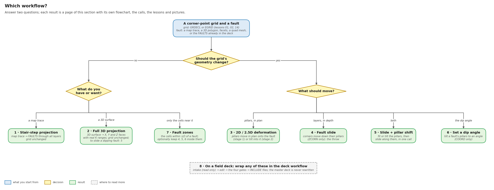

| # | Workflow | Changes | Use it when |
| --- | --- | --- | --- |
| 1 | [Stair-step projection](docs/workflows/stair-step.md) | `FAULTS` only | the grid must not move; the fault follows cell edges |
| 2 | [Full 3D projection](docs/workflows/full-3d.md) | `FAULTS` (X, Y, Z faces) | a dipping surface onto 3D cell faces, with real K ranges; marks faces only; to slide it use 9 ([why](docs/workflows/full-3d.md#can-i-slide-it-afterwards-not-the-staircase)) |
| 3 | [2D / 2.5D deformation](docs/workflows/deformation.md) | `COORD` | the grid should follow a trace, or tilt into a dipping plane |
| 4 | [Fault slide](docs/workflows/slide.md) | `ZCORN` | offset the layers across existing `FAULTS` |
| 5 | [Slide + pillar shift](docs/workflows/slide-pillars.md) | `COORD` + `ZCORN` | a dip-slip: move the pillars, then slide along them |
| 6 | [Set a dip angle](docs/workflows/dip-angle.md) | `COORD` | tilt a fault to an exact angle |
| 7 | [Fault zones](docs/workflows/fault-zones.md) | a region (optional: confine 4–6) | find the cells within ±D; keep an edit inside them |
| 8 | [A field deck, end to end](docs/workflows/field-deck.md) | separate `INCLUDE` files | intake, edit, check and write a real deck |
| 9 | [Slide a 3D fault surface](docs/workflows/slide-3d.md) | `ZCORN` (+ `COORD` if it dips) | slide a fault given as a 3D surface: vertical as projected, dipping after moving the pillars; horizontal is not possible |

<table>
<tr>
<td width="50%" valign="top"><a href="docs/workflows/stair-step.md">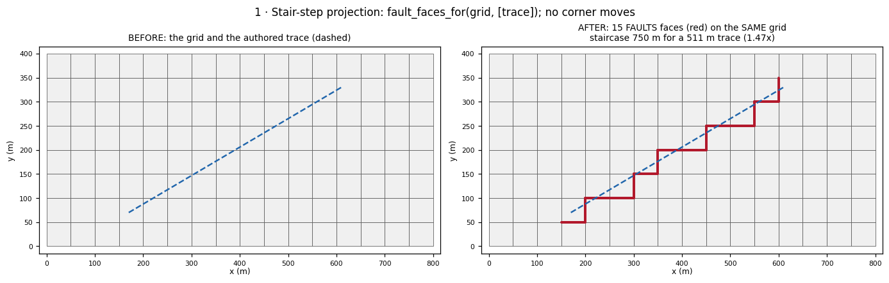</a><br><b>1.</b> 15 <code>FAULTS</code> faces; no corner moves.</td>
<td width="50%" valign="top"><a href="docs/workflows/deformation.md">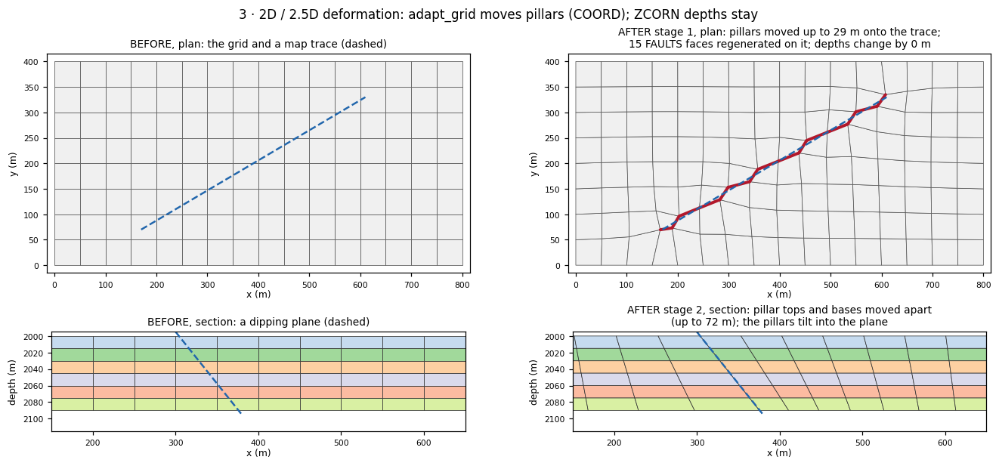</a><br><b>3.</b> Pillars move onto the trace (stage 1) or tilt into a plane (stage 2).</td>
</tr>
<tr>
<td valign="top"><a href="docs/workflows/slide-pillars.md">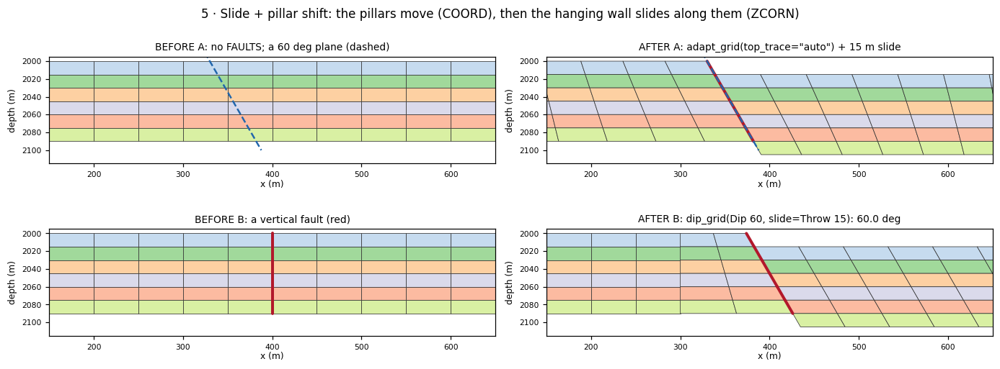</a><br><b>5.</b> Fit or tilt the pillars, then slide the hanging wall 15 m along them.</td>
<td valign="top"><a href="docs/workflows/fault-zones.md">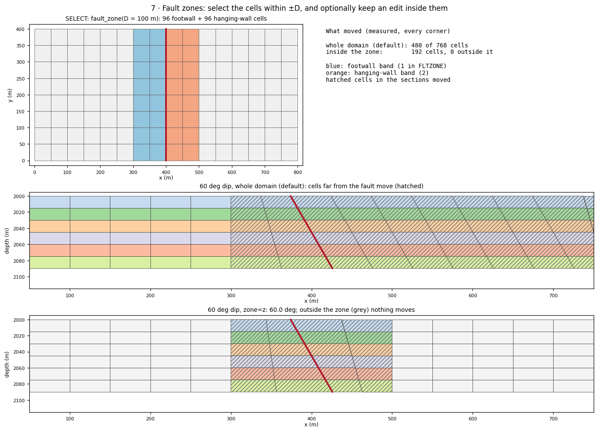</a><br><b>7.</b> 96 + 96 cells within 100 m; a confined dip moves 0 cells outside them.</td>
</tr>
<tr>
<td valign="top"><a href="docs/workflows/slide-3d.md">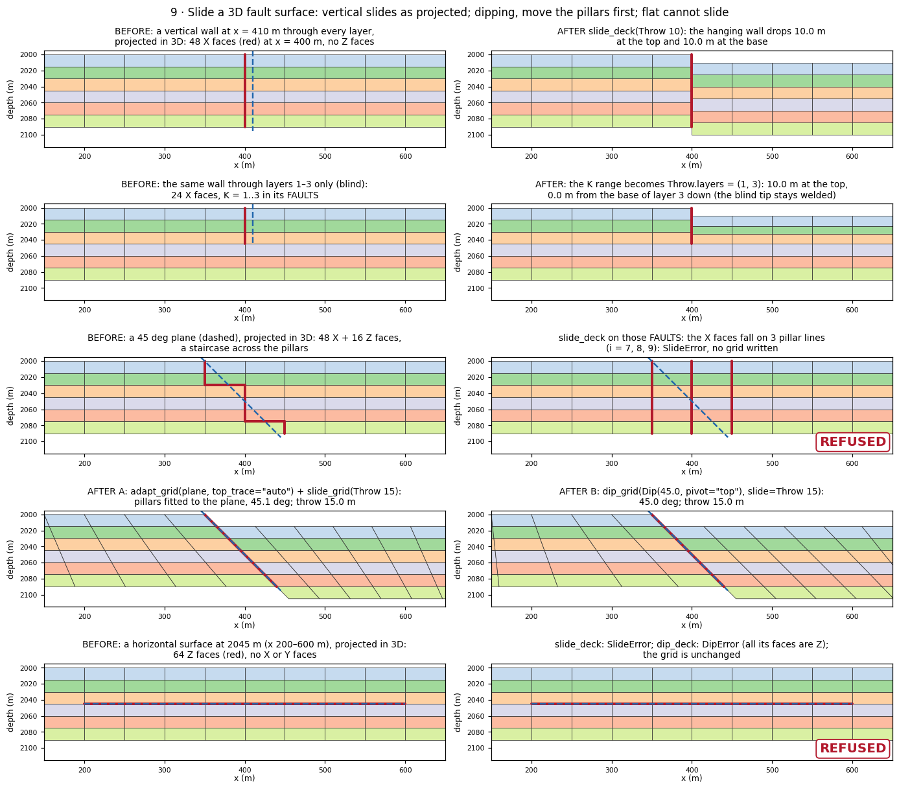</a><br><b>9.</b> A vertical 3D fault slides as projected; a dipping staircase is refused until the pillars move (45.0–45.1°, 15.0 m); a horizontal one is refused.</td>
<td valign="top"><a href="docs/workflows/index.md#what-the-workflows-cannot-do">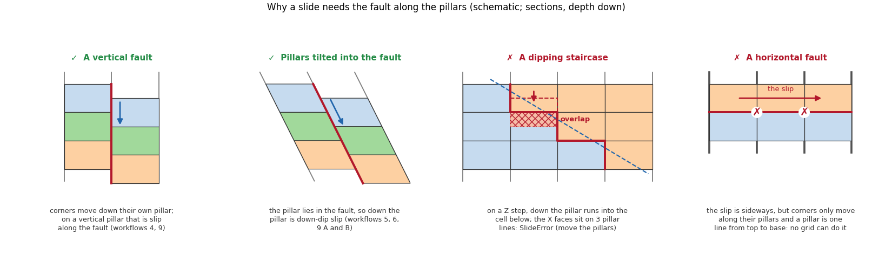</a><br><b>Limits.</b> A slide moves corners along their pillars, so the fault must lie along them. <a href="docs/workflows/index.md#what-the-workflows-cannot-do">What the workflows cannot do</a>.</td>
</tr>
</table>

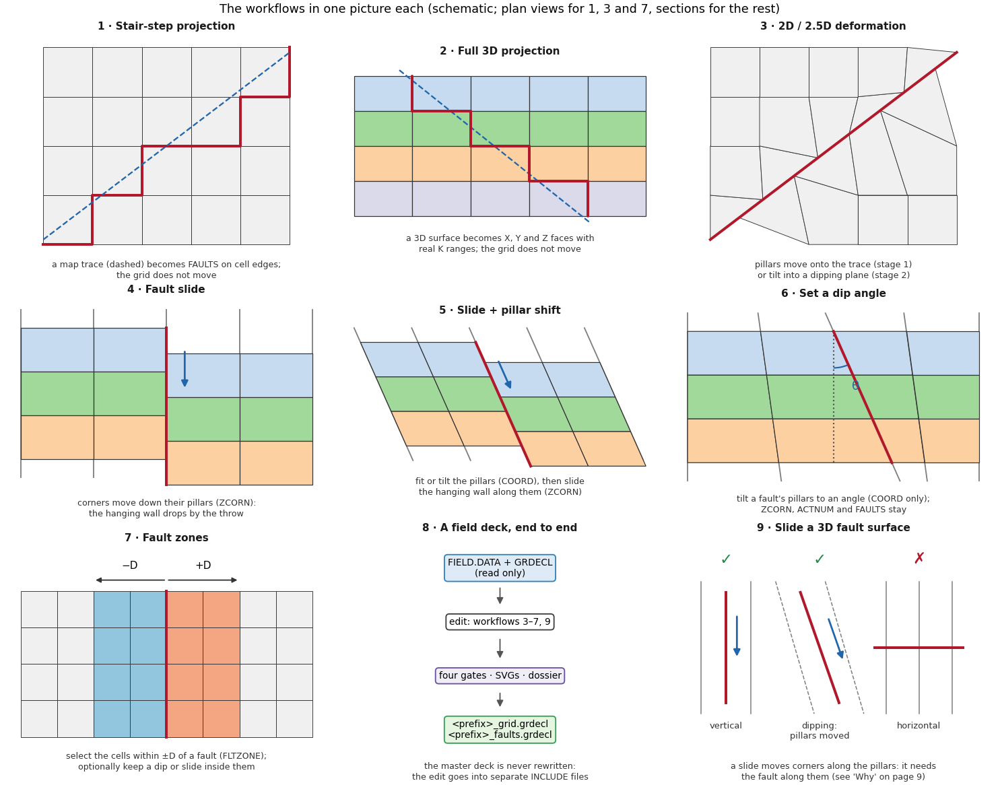

## Examples

Every script in [`examples/`](examples/) runs offline and checks its own
results. Add `--out DIR` to keep the decks it writes.

| # | Example | What it shows |
|---|---|---|
| 01 | `read_grid` | Read a text deck; logical and active dimensions |
| 02 | `egrid` | Read binary EGRID; MAPAXES vs local coordinates |
| 03 | `mesh_graph` | Corner-point grid to faces, properties and a cell graph |
| 04 | `project_trace` | Project a 2D fault trace to FAULTS |
| 05 | `project_surface` | Project a planar 3D fault onto cell faces |
| 06 | `one_trace` | Adapt a grid to one fault trace and check it |
| 07 | `crossing_traces` | Two crossing faults in one solve |
| 08 | `dipping_fault` | Stage 2: a dipping fault moves top and bottom separately |
| 09 | `settings` | Four solver settings on the same fault |
| 10 | `sheared_rim` | A sliding rim can shear the model outline |
| 11 | `four_gates` | Validity, corridor, chain and rim checks |
| 12 | `export_includes` | Write a grid INCLUDE (`--out` required) |
| 13 | `quad_surface` | Project a quad-mesh fault surface (`--out` required) |
| 14 | `field_deck_intake` | Read-only intake of your own deck (`--deck PATH`) |
| 15 | `visualize` | Before/after SVG figures (`--out` required) |
| 16 | `faceted_fault` | A curved fault from two planar facets |
| 17 | `mapaxes_guard` | Why MAPAXES coordinates cannot round-trip silently |
| 18 | `case_dossier` | A traceable JSON case report (`--out` required) |
| 19 | `z_slide_sequential` | **Z slide:** two faults slid one after the other (ZCORN only) |
| 20 | `z_slide_partial_fault` | **Z slide:** a fault ending inside the grid, tapered throw |
| 21 | `z_slide_oblique_fault` | **Z slide:** an oblique, dipping fault, regular vs adapted grid |
| 22 | `z_slide_throw_control` | **Z slide:** throw profile, far field and footwall share |
| 23 | `gallery_structural_styles` | **Gallery:** graben, horst, domino, ring collapse, reverse fault |
| 24 | `gallery_fault_interactions` | **Gallery:** X, T and Y junctions, relay ramp, compartments |
| 25 | `gallery_geometry_inputs` | **Gallery:** traces, sticks, point clouds and meshes to a slid grid |
| 26 | `gallery_throw_definitions` | **Gallery:** throw tables, growth, large throws, restoration, inversion |
| 27 | `gallery_reservoir_applications` | **Gallery:** Allan diagram, fault seal, connectivity, wells |
| 28 | `gallery_regridding` | **Gallery:** fault transfer, resolution, solver settings, ACTNUM, damage zone |
| 29 | `gallery_export_workflows` | **Gallery:** simulator bundle, `adapt_deck`, VTK series, round trip |
| 30 | `deck_slide_workflows` | **Decks:** `adapt_deck(slide=...)` in one call; slide Norne's FAULTS (`--deck`, `--throw`); a dipping fault in one call (`top_trace="auto"`) |
| 31 | `fault_dip` | **Fault dip:** set a fault's angle by tilting pillars (COORD only): free vs fixed outline vs decay, pivots, a tip, an angle table, a stair-stepped fault, a graben, the validity gate, `dip_deck(slide=...)`, and Norne (one pass, one honest failure) |
| 32 | `fault_dip_stress` | **Fault dip, stress:** 22 hard cases (curved and S traces, graben/horst, domino, T-junction, caldera, growth and blind faults, pinch-outs, skewed columns, shallow and random angles, seeded fuzz, Norne), each judged by an independent cell checker |
| 33 | `fault_zone` | **Fault zones:** the cells within −D/+D of each fault (vertical, dipping, asymmetric, curved, crossing, `FLTZONE` export, Norne), and an optional `zone=` that keeps a dip or slide inside them |

Lessons 23-30 share [`fieldbook/zslide.py`](fieldbook/zslide.py), which
slides faults with `fault_projections.slide_grid` and adds the lessons'
independent checks. The
[Z-slide page](docs/learn/z-slide.md) and the
[gallery page](docs/learn/gallery.md) explain every case with figures.
Lesson 31 calls `fault_projections.dip_grid` and re-checks every result
from COORD, a re-processed topology or the bytes on disk; the
[fault-dip page](docs/learn/fault-dip.md) lists what each case must print.
Lesson 32 judges every dip and slide with a cell checker that shares no
code with the library ([stress page](docs/learn/fault-dip-stress.md)), and
lesson 33 re-measures every fault zone by the plane's equation or brute
force ([fault-zone page](docs/learn/fault-zone.md)).

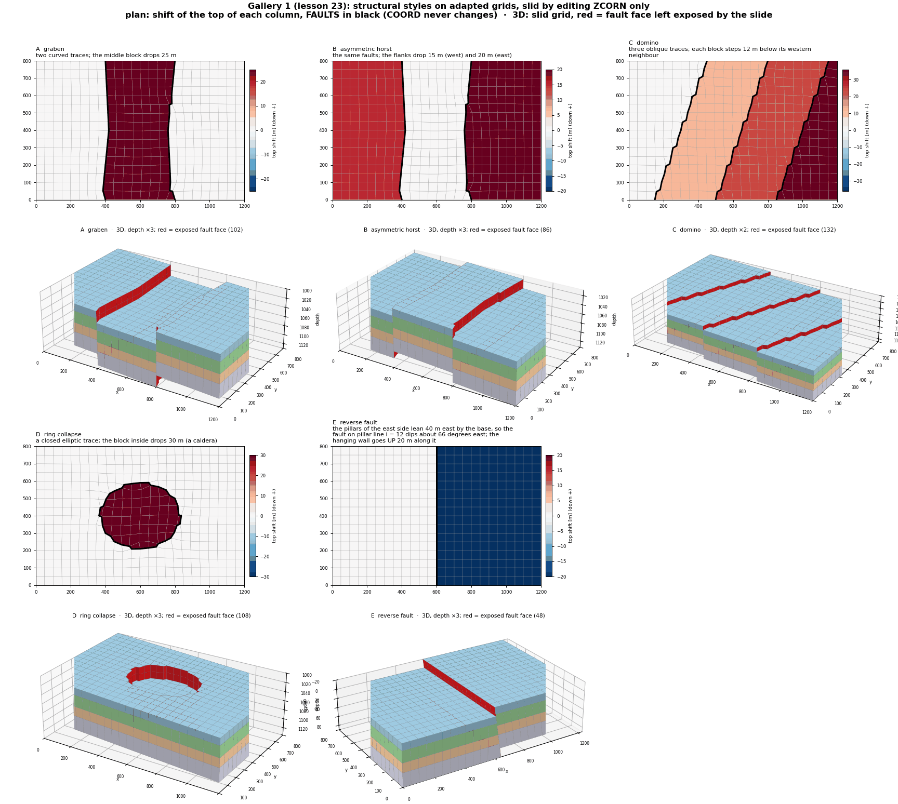

## Fault dip, stress tests and fault zones

Lessons 31–33 cover three `fault_projections` tools:

- **Set a fault's dip** (`dip_grid`, lesson 31). It tilts the fault's
  pillars to an exact angle, editing COORD only. Neighbouring pillars follow
  over a fade, and a cell gate refuses any grid with folded or squashed
  cells. By default the grid's outline is held fixed.
- **Stress tests** (lesson 32). There are 22 hard cases: curved and
  S-shaped traces, junctions, a caldera, growth and blind faults, seeded
  fuzz, and Norne. An independent cell checker re-judges every verdict. It
  found no accepted grid with broken cells.
- **Fault zones** (`fault_zone`, lesson 33). The tool selects the cells
  within −D/+D of each fault, measured to the fault surface, and can export
  them as a GRDECL keyword. Optionally, `zone=` keeps a dip or a slide
  inside those cells, and every cell outside stays bit-identical. Without
  `zone=`, the whole domain deforms and the outline holds.

```python
from fault_projections import Dip, dip_grid, fault_zone, write_zone

z = fault_zone(grid, faults, 80.0, hanging_side="right")  # cells within -80 m / +80 m
print(z.summary())                     # footwall + hanging-wall cells, per fault
write_zone(z, "zone.grdecl")           # FLTZONE: 0 outside, 1 footwall, 2 hanging wall
res = dip_grid(grid, Dip("F1", 70.0, hanging_side="right"), faults=faults, zone=z)
```

The [fault-zone method page](docs/functions/fault-zone.md) runs this on a
small grid and checks every printed number.

Each picture shows the grid **BEFORE** and **AFTER**; click one to open its
lesson. Zone colours: the footwall band (−D) is blue, the hanging-wall band
(+D) orange, and cells outside the zone are grey. Cells that moved are
outlined in black.

<table>
<tr>
<td width="50%" valign="top"><a href="docs/learn/fault-dip.md">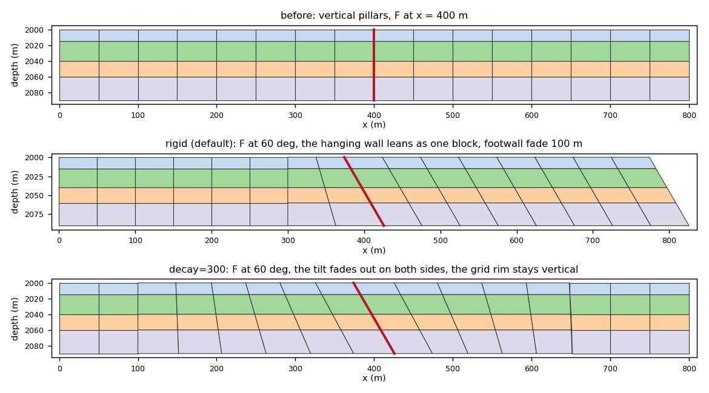</a><br><b>Dip.</b> F set to 60°, exact at all 9 pillars: before, then <code>boundary="free"</code>, the default fixed outline, and <code>decay=300</code>.</td>
<td width="50%" valign="top"><a href="docs/learn/fault-dip-stress.md">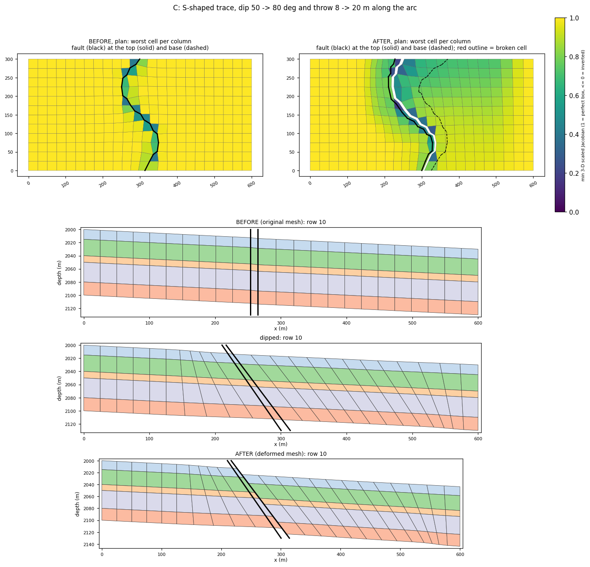</a><br><b>Stress.</b> An S-shaped fault with angle and throw tables. This case found a 9 m tear in the rigid slide, now fixed.</td>
</tr>
<tr>
<td valign="top"><a href="docs/learn/fault-dip-stress.md">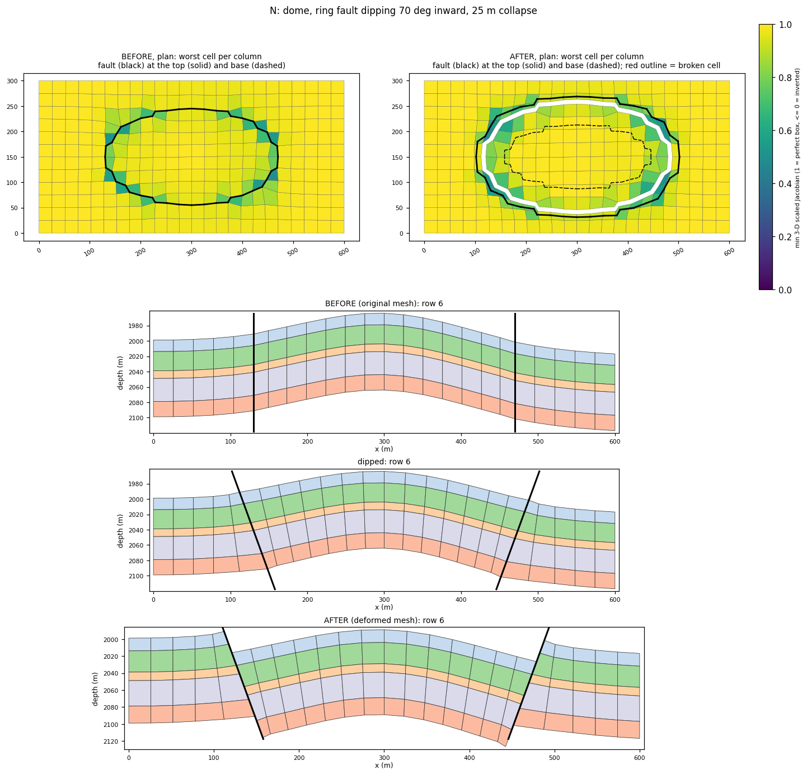</a><br><b>Stress.</b> A caldera: a ring fault dipped 70° inward and collapsed 25 m all round, with 0 broken cells.</td>
<td valign="top"><a href="docs/learn/fault-dip-stress.md">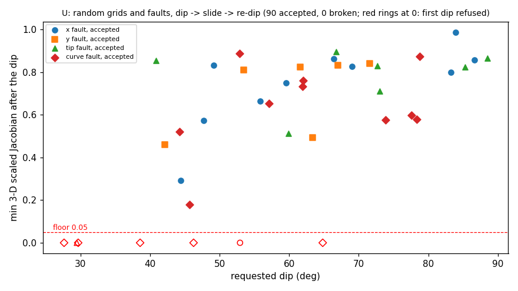</a><br><b>Stress.</b> 40 random grids, dip → slide → re-dip. All 90 accepted steps pass the checker, and none disagrees with it.</td>
</tr>
<tr>
<td valign="top"><a href="docs/learn/fault-zone.md">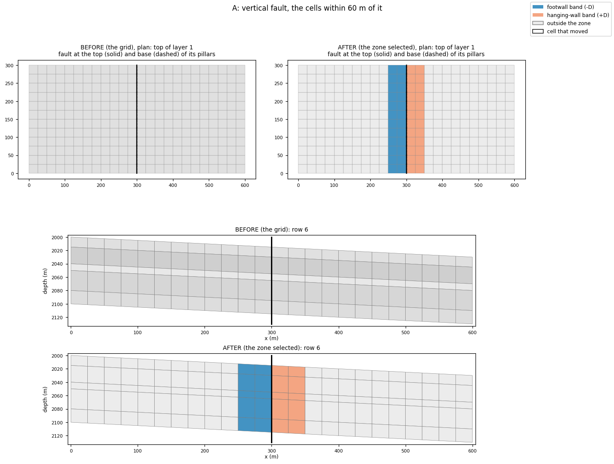</a><br><b>Zone, select.</b> The cells within 60 m of a vertical fault: 120 footwall + 120 hanging wall, exactly those with |x − 300| ≤ 60.</td>
<td valign="top"><a href="docs/learn/fault-zone.md">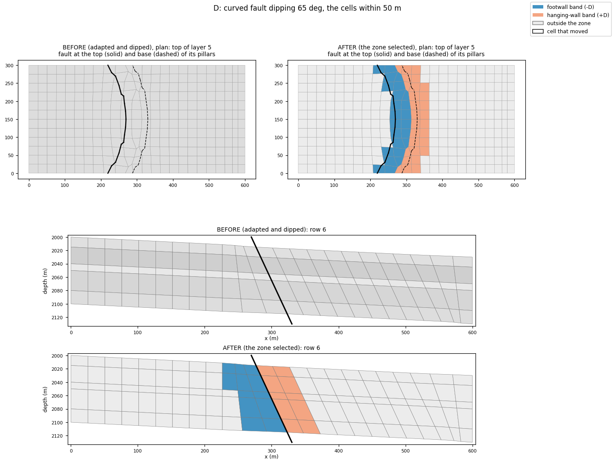</a><br><b>Zone, select.</b> A curved fault dipping 65°, D = 50 m: 158 + 140 cells, matching a brute force to 0.04 m.</td>
</tr>
<tr>
<td valign="top"><a href="docs/learn/fault-zone.md">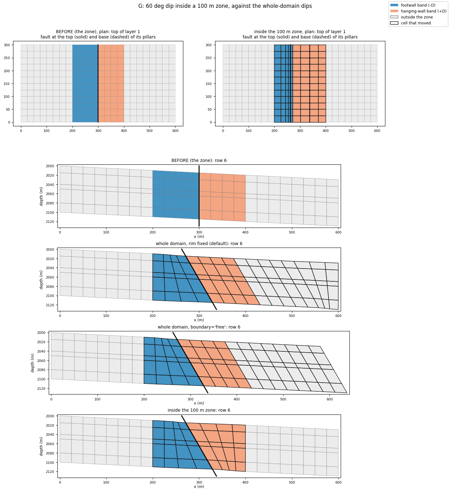</a><br><b>Zone, confine a dip.</b> 60° over the whole domain moves 960 cells. With <code>zone=100</code>, 480 move and 0 outside the zone.</td>
<td valign="top"><a href="docs/learn/fault-zone.md">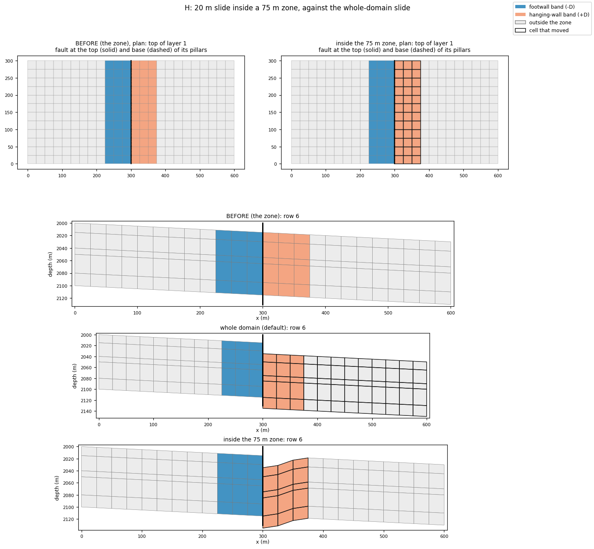</a><br><b>Zone, confine a slide.</b> A 20 m slide over the whole domain moves 720 cells, 540 of them outside the zone. With <code>zone=75</code>, 180 move and 0 outside.</td>
</tr>
<tr>
<td valign="top"><a href="docs/learn/fault-zone.md">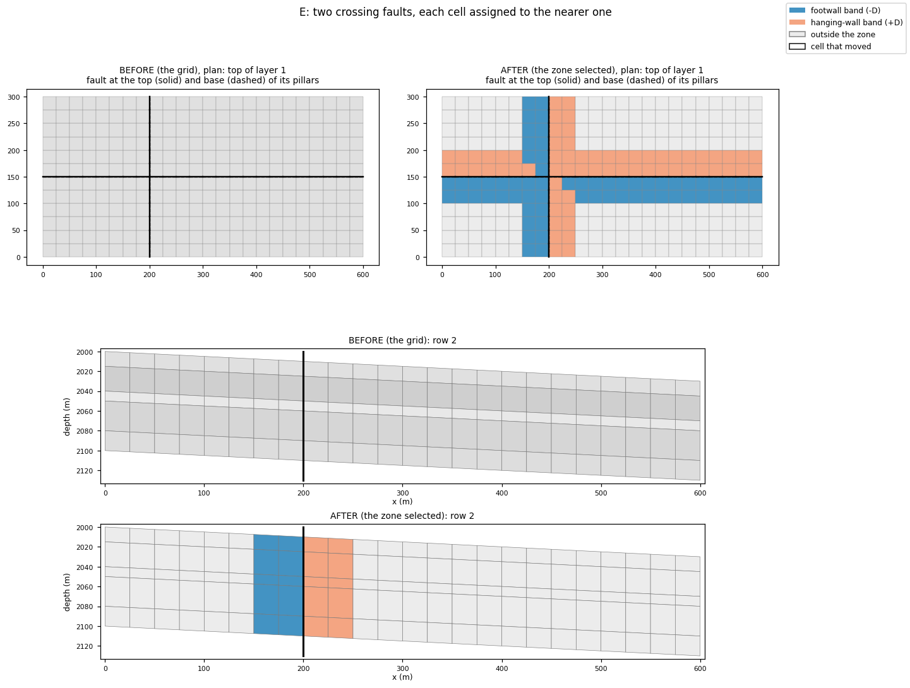</a><br><b>Zone, two faults.</b> 80 cells lie near both faults; the nearer fault decides their side, and ties go to the first fault listed.</td>
<td valign="top"><a href="docs/learn/fault-zone.md">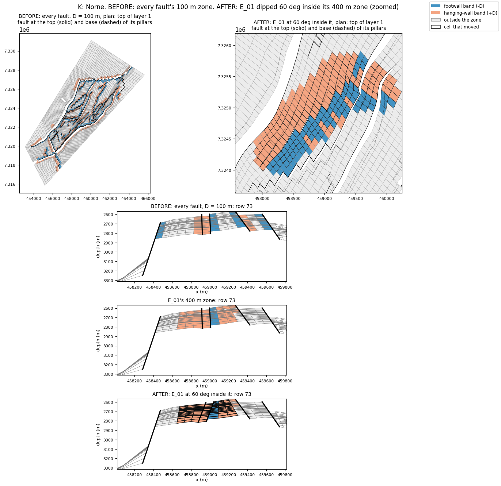</a><br><b>Zone, Norne.</b> 61 faults at D = 100 m: 22,759 + 22,075 cells. Setting E_01 to 60° inside 400 m moves 0 of the 108,203 cells outside the zone.</td>
</tr>
</table>

All 37 pictures, with the numbers each case must print, are on the
[fault-dip](docs/learn/fault-dip.md),
[stress-test](docs/learn/fault-dip-stress.md) and
[fault-zone](docs/learn/fault-zone.md) pages.

## Figures

Regenerate the Z-slide and gallery figures (PNG plus interactive 3D HTML)
into `output/figures/`:

```bash
.venv/bin/python -m pip install -e ".[figures]"
.venv/bin/python tools/figures/make_figures.py              # all, about 15 min
.venv/bin/python tools/figures/make_figures.py --only 07 10 # some
```

The figures in `docs/assets/fault-dip/`, `fault-dip-stress/` and
`fault-zone/` come from lessons 31, 32 and 33 (about 5 min, needs
matplotlib):

```bash
.venv/bin/python tools/figures/fault_dip.py
```

The flowcharts and before/after illustrations in `docs/assets/workflows/`
are drawn by one script. Every number in them is computed with the library
calls the workflow pages show (about 90 s, needs matplotlib):

```bash
.venv/bin/python tools/figures/workflows.py
```

## Documentation

Start with [the wiki](docs/index.md). `python -m fieldbook.docs` builds it
into `site/` (needs `.[docs]`); `python -m fieldbook.docs --check` checks
that example inclusions and links resolve. The
[function reference](docs/functions/index.md),
[API coverage](docs/reference/coverage.md) and
[known limits](docs/reference/limits.md) say what is and is not covered.
An example passing on the bundled fixture does **not** qualify an arbitrary
field deck; see the [opt-in data guide](docs/reference/data.md).

**CI.** `fault-projections` is private, so the workflow needs read-only
access to it. It uses a read-only deploy key on `arturcastiel/fault-projections`
whose private half is the secret `FAULT_PROJECTIONS_DEPLOY_KEY`:

```bash
ssh-keygen -t ed25519 -N "" -f fp_ci
gh repo deploy-key add fp_ci.pub -R arturcastiel/fault-projections --title "cpg-fault-fieldbook CI (read-only)"
gh secret set FAULT_PROJECTIONS_DEPLOY_KEY -R arturcastiel/cpg-fault-fieldbook < fp_ci
rm fp_ci fp_ci.pub
```

A fine-grained token (*Contents: read-only* on that repository) in the secret
`FAULT_PROJECTIONS_TOKEN` works too. Pull requests from forks get neither
secret, so their checks cannot install `fault-projections`.

## Licensing and data

This companion and its upstream-derived quickstart fixture are distributed
under GPL-3.0-or-later. See [LICENSE](LICENSE) and
[fixture provenance](fixtures/README.md). Neither upstream implementation
is copied into this package. Do not commit private decks or generated reports.
