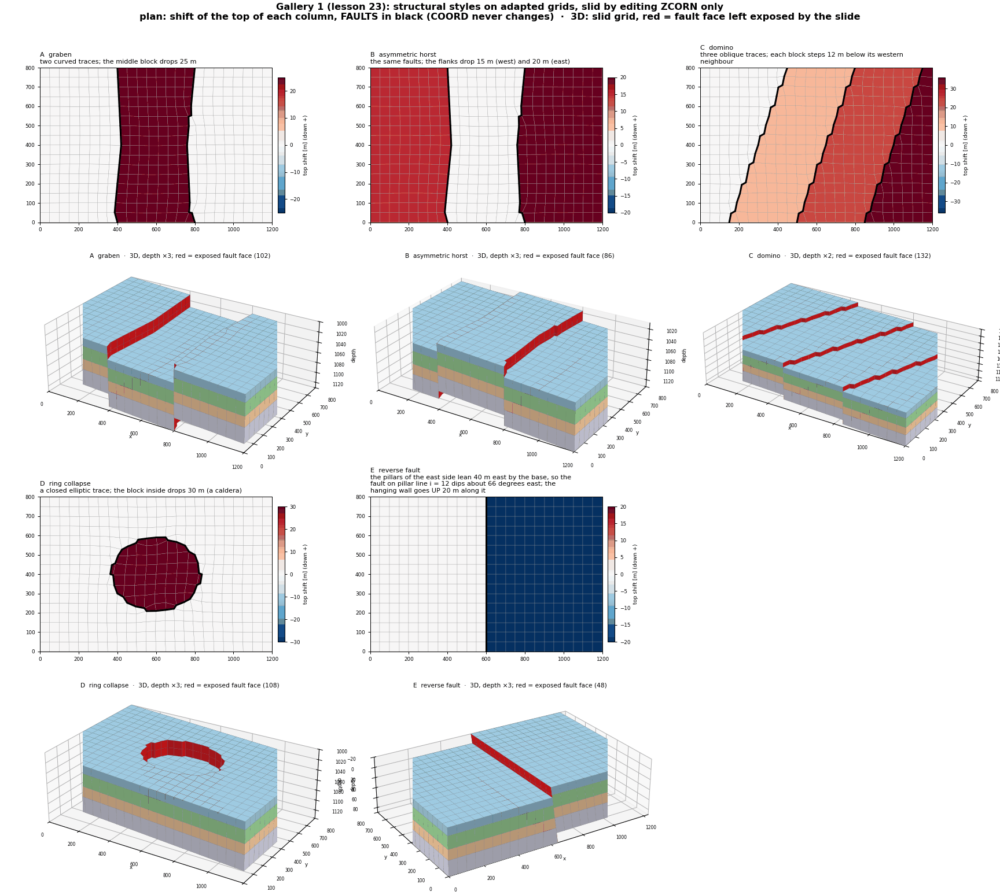

# CPG + Fault Fieldbook

A runnable, **experimental** companion to [cpg2python](https://github.com/arturcastiel/cpg2python)
(`cpg2unstructured`) and [fault-projections](https://github.com/arturcastiel/fault-projections)
(`fault_projections`). The libraries do the work; this repository teaches their
calls and independently checks what each example actually establishes. Grid
adaptation is not fracture propagation, transmissibility modeling, or a
simulator-ready deck.

## Quick start

Python 3.10+, with this repository checked out beside both libraries:

```bash
python -m venv .venv
.venv/bin/python -m pip install -e "../cpg2python[fast]" -e "../fault-projections" -e ".[test]"
.venv/bin/python -m fieldbook.cli doctor                     # versions and pinned revisions
.venv/bin/python -m fieldbook.cli run 19_z_slide_sequential  # run one example
.venv/bin/python -m pytest -q                                # run every example (about 5 min)
```

On Windows use `.venv\Scripts\python.exe` instead of `.venv/bin/python`
([Windows instructions](docs/start/install-windows.md)). The library
checkouts should be at the revisions in [`upstream-lock.toml`](upstream-lock.toml).

## Examples

Every script in [`examples/`](examples/) runs offline and checks its own
results. Add `--out DIR` to keep the decks it writes.

| # | Example | What it shows |
|---|---|---|
| 01 | `read_grid` | Read a text deck; logical and active dimensions |
| 02 | `egrid` | Read binary EGRID; MAPAXES vs local coordinates |
| 03 | `mesh_graph` | Corner-point grid to faces, properties and a cell graph |
| 04 | `project_trace` | Project a 2D fault trace to FAULTS |
| 05 | `project_surface` | Project a planar 3D fault onto cell faces |
| 06 | `one_trace` | Adapt a grid to one fault trace and check it |
| 07 | `crossing_traces` | Two crossing faults in one solve |
| 08 | `dipping_fault` | Stage 2: a dipping fault moves top and bottom separately |
| 09 | `settings` | Four solver settings on the same fault |
| 10 | `sheared_rim` | A sliding rim can shear the model outline |
| 11 | `four_gates` | Validity, corridor, chain and rim checks |
| 12 | `export_includes` | Write a grid INCLUDE (`--out` required) |
| 13 | `quad_surface` | Project a quad-mesh fault surface (`--out` required) |
| 14 | `field_deck_intake` | Read-only intake of your own deck (`--deck PATH`) |
| 15 | `visualize` | Before/after SVG figures (`--out` required) |
| 16 | `faceted_fault` | A curved fault from two planar facets |
| 17 | `mapaxes_guard` | Why MAPAXES coordinates cannot round-trip silently |
| 18 | `case_dossier` | A traceable JSON case report (`--out` required) |
| 19 | `z_slide_sequential` | **Z slide:** two faults slid one after the other (ZCORN only) |
| 20 | `z_slide_partial_fault` | **Z slide:** a fault ending inside the grid, tapered throw |
| 21 | `z_slide_oblique_fault` | **Z slide:** an oblique, dipping fault, regular vs adapted grid |
| 22 | `z_slide_throw_control` | **Z slide:** throw profile, far field and footwall share |
| 23 | `gallery_structural_styles` | **Gallery:** graben, horst, domino, ring collapse, reverse fault |
| 24 | `gallery_fault_interactions` | **Gallery:** X, T and Y junctions, relay ramp, compartments |
| 25 | `gallery_geometry_inputs` | **Gallery:** traces, sticks, point clouds and meshes to a slid grid |
| 26 | `gallery_throw_definitions` | **Gallery:** throw tables, growth, large throws, restoration, inversion |
| 27 | `gallery_reservoir_applications` | **Gallery:** Allan diagram, fault seal, connectivity, wells |
| 28 | `gallery_regridding` | **Gallery:** fault transfer, resolution, solver settings, ACTNUM, damage zone |
| 29 | `gallery_export_workflows` | **Gallery:** simulator bundle, `adapt_deck`, VTK series, round trip |
| 30 | `deck_slide_workflows` | **Decks:** `adapt_deck(slide=...)` in one call; slide Norne's FAULTS (`--deck`, `--throw`) |

Lessons 23-30 share [`fieldbook/zslide.py`](fieldbook/zslide.py), which
slides faults with `fault_projections.slide_grid` and adds the lessons'
independent checks. The
[Z-slide page](docs/learn/z-slide.md) and the
[gallery page](docs/learn/gallery.md) explain every case with figures.



## Figures

Regenerate the Z-slide and gallery figures (PNG plus interactive 3D HTML)
into `output/figures/`:

```bash
.venv/bin/python -m pip install -e ".[figures]"
.venv/bin/python tools/figures/make_figures.py              # all, about 15 min
.venv/bin/python tools/figures/make_figures.py --only 07 10 # some
```

## Documentation

Start with [the wiki](docs/index.md). `python -m fieldbook.docs` builds it
into `site/` (needs `.[docs]`); `python -m fieldbook.docs --check` checks
that example inclusions and links resolve. The
[function reference](docs/functions/index.md),
[API coverage](docs/reference/coverage.md) and
[known limits](docs/reference/limits.md) say what is and is not covered.
An example passing on the bundled fixture does **not** qualify an arbitrary
field deck; see the [opt-in data guide](docs/reference/data.md).

**CI.** `fault-projections` is private, so the workflow needs the secret
`FAULT_PROJECTIONS_TOKEN` (a fine-grained token, *Contents: read-only* on
`arturcastiel/fault-projections`):
`gh secret set FAULT_PROJECTIONS_TOKEN -R arturcastiel/cpg-fault-fieldbook`.

## Licensing and data

This companion and its upstream-derived quickstart fixture are distributed
under GPL-3.0-or-later. See [LICENSE](LICENSE) and
[fixture provenance](fixtures/README.md). Neither upstream implementation
is copied into this package. Do not commit private decks or generated reports.
