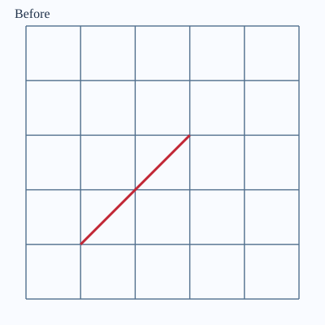
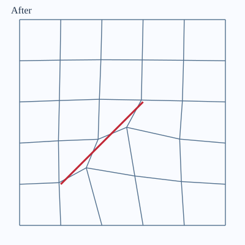

# Case: an interior trace that passes the chosen gates

**Fixture:** bundled 5 × 5 × 3 GRDECL; XY units unspecified. Authored
trace `[[1, 1], [3, 3]]`; targets made with
`targets_from_polyline`, solved with elastic smoothing, `w0=0.05`,
`boundary="pinned"`, `polish="barrier"`, `on_invalid="raise"`.

The two SVGs use **the same physical scale**. Run
`python -m fieldbook.cli run 15_visualize --out output/figures` to
regenerate them; the script uses the exact target object for its
four-gate report. The generated view is top-plane only, and visual
agreement alone is not evidence of bottom-plane quality.

| Gate | Observed on this fixture | Verdict |
|---|---:|---|
| Cell validity | No folds/welds/separation violations | Pass |
| Top and bottom minimum scaled Jacobian | 0.6275, 0.6275 (project floor 0.3) | Pass |
| Face-connected containing corridor | Yes | Pass |
| Claimed pillar chain contiguous | Yes | Pass |
| Maximum active-rim XY displacement | 0 | Pass |

**Scope of verdict:** passed these synthetic geometry checks, **not**
approved for simulator use. The output is not a deck. A real model
needs its own coordinate-frame, fault geometry, original-defect,
property and simulator checks.

To record the input hash, upstream revisions, dependency versions,
settings and every gate in machine-readable JSON, run:
`python -m fieldbook.cli run 18_case_dossier --out output/dossier`.
The artifact is explicitly labeled `simulator_validated: false`.

{{ example:18_case_dossier.py }}
