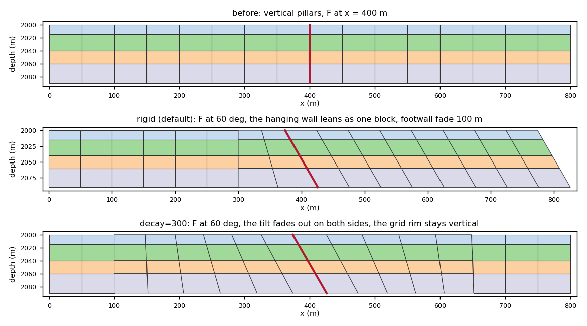
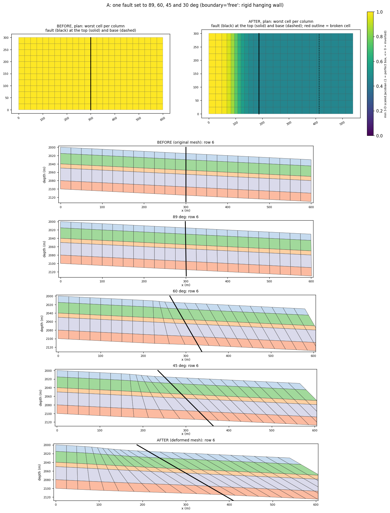

# Fault dip: `dip_grid`, `dip_deck` and `Dip`

A fault dip sets the angle of existing `FAULTS` by tilting pillars, so only
COORD changes. Every corner keeps its depth and slides sideways with its
pillar; ZCORN, ACTNUM and the `FAULTS` face set never change. Apply a dip
before a slide: `dip_deck(..., slide=...)` does both.

The lesson with every case worked through is
[7. Set a fault's dip angle](../learn/fault-dip.md).

## `dip_grid`

### Syntax

```python
dip_grid(
    grid: CornerPointGrid,
    dips: Dip | Sequence[Dip],
    *,
    faults=None,               # every fault face: {name: faces}; default the dips' faces
    on_invalid: str = "raise", # "raise", "bisect" or "ignore"
    widen: int = 4,            # how many times the fades may be doubled (0: never)
    max_bisect: int = 20,
    min_jacobian: float = 0.05,  # gate floor (applied only where a cell got worse)
    min_fraction: float = 0.10,  # gate floor on edge length, fraction of the original
    passes: int = 6,           # rounds for several dips to hold their angles together
    report: bool = True,       # re-process the grid (part of the gate), fill volumes
    slide=None,                # Throw(s) to slide the dipped grid by (fades widen until it fits)
    slide_options=None,        # keywords for slide_grid
    boundary: str = "fixed",   # "fixed": the grid's outline holds; "free": it leans
    zone=None,                 # None: the whole grid may move; D, (D_fw, D_hw) or a FaultZone
) -> DipResult
```

`faults` decides which faults separate the grid, which in turn decides each
dip's mode. Give all of a deck's faults when the dipped fault abuts others.

- **`boundary="fixed"`** (default): the four outer sides of the grid hold
  still. A pillar on a side keeps only the part of its shift along that side
  (a roller), and the four corner pillars do not move. The release fades in
  from the side over the fade distance. Fault pillars within it lean along
  strike, so the angle stays exact. A hanging wall that reaches the rim is
  therefore not rigid next to it, and those cells change volume.
  `boundary="free"` lets the outline lean with the change (the rigid shear of
  earlier versions).
- **`zone`** keeps the dip inside the cells within a distance of the dipped
  faults ([Fault zones](fault-zone.md)). A pillar moves only if every cell on
  it (all layers, all four columns) is in the zone. The change fades with a
  cosine from full on the fault to zero at the nearest frozen pillar. Every
  cell outside the zone keeps its corners bit for bit, and a `slide=` is
  confined to the same zone. A zone that freezes a fault pillar raises
  `ZoneError`. `DipResult.zone` holds the zone used, and `DipResult.moved`
  marks the cells that moved.
- **`slide`**: each widening step must also let `slide_grid` take the full
  throw through its cell gate. A dip that passes at the present depths could
  otherwise fail once the slide moves the cells down converging pillars.

`Dip(fault, angle=60.0, hanging_side=None, pivot="middle", decay="auto",
footwall="auto", smoothing=None, name="")` describes one fault:

| Field | Meaning |
|---|---|
| `fault` | A name in `faults`, or the fault's faces (one branch-free chain; a ring is allowed) |
| `angle` | Degrees below horizontal, in (0, 90]: one value, an `(n, 2)` table of `(arc length, angle)` along the oriented chain, or one value per chain pillar |
| `hanging_side` | A plan point on the hanging wall, `"left"`/`"right"` of the chain, or `None` to read it from the current lean (a vertical fault needs it) |
| `pivot` | The depth that keeps its plan position: `"top"`, `"middle"` (default) or `"bottom"` of the cells on each fault pillar, or a depth |
| `decay` | `"auto"`: rigid for a fault that separates the grid, else a fade over `max(L/2, π·reach, 2h)`. `None`: rigid (an error for a fault with a tip). A distance: decay mode with that fade, even for a separating fault |
| `footwall` | Fade of the footwall. `"auto"`: `max(π·reach, 2h)` in rigid mode, the `decay` distance in decay mode. `None`/`0`: no fade (rigid only) |
| `smoothing` | Gaussian width over which the strike is averaged along the chain. Default: twice the median face length |
| `name` | Name for a fault given as faces |

Here `L` is the fault length, `h` the median face length, and `reach` the
largest corner shift on the fault at the full dip.

### What moves

At each pillar, the change is a horizontal shift that grows linearly with
depth away from the pivot depth `z0`. A corner at depth `z` moves by

```text
Δxy = w · (z − z0) · k
```

- **On the fault**, `w = 1` and `k` sets the angle exactly. With `s` the
  pillar's present lean per unit depth, `t` the smoothed strike and `n` the
  dip direction (toward the hanging wall), the new lean is
  `(s·t) t + cot(angle) n`. The along-strike component of the lean is kept;
  the component along the dip direction is set to `cot(angle)`. So
  `k = (s·t) t + cot(angle) n − s`.
- **Off the fault**, `k` and `z0` are spread from the chain pillars by a
  local linear fit along strike, weighted by `ℓ_m / (r² + σ²)`. Here `ℓ_m` is
  the arc length each chain pillar stands for and `σ` is the smoothing.
  Curved and stair-stepped faults therefore give a smooth field. Off a
  straight fault the field is constant along the fault's normal, so a rigid
  hanging wall stays rigid, also near the fault's ends. Past a tip, the fit is
  read at the tip.
- **The weight `w`** fades with a cosine ramp:
  - in **rigid** mode, `w = 1` on every pillar of the hanging wall (the flood
    fill of the side the fault separates, including any blocks beyond other
    faults), fading to 0 over `footwall` into the footwall. With the default
    `boundary="fixed"`, the shift across the rim is then released near the
    rim;
  - in **decay** mode, `w` fades with distance from the fault on both sides:
    over `decay` on the hanging side and over `footwall` on the footwall.
- **With several dips**, each dip removes only the component of its change
  *across* another dipped fault, locally (within that fault's footwall fade).
  The other fault's own angle is untouched, and a pillar shared at a
  T-junction holds both angles. The dips are applied in turn, and repeated up
  to `passes` times until every fault holds its angle to 1e-9.

The `"auto"` distances keep the strain in the fade zone at or below one half:
`π` times the largest corner shift, and at least two cells.

**Volumes.** In rigid mode on a straight fault with `boundary="free"`, the
hanging wall is sheared parallel to the fault, so its cells keep their
volumes (lesson 31 measures 0). With the default fixed outline, that holds
except within the release next to the rim (lesson 31 A: up to 21.7 %
there). With the middle pivot, the top of a column moves opposite to its base
by the same amount, so every column keeps its **total** volume. Volume still
moves between the layers of a column (case A: −21.65 % to +17.32 % in one
footwall column). The other pivots change column volumes.



*Lesson 31 A.* F is set to 60°, exact at all 9 fault pillars: the grid
before, then `boundary="free"` (the hanging wall leans as one block, east
rim included), the default `boundary="fixed"` (the outline holds; the lean
is released over the last cell), and `decay=300` (the tilt fades out on both
sides).



*Lesson 32 A.* One rim-to-rim fault set to 89, 75, 60, 45, 35 and 30°
(`boundary="free"`). COORD reads back each angle exactly, and the
independent cell checker finds 0 broken cells; the worst 3-D Jacobian
falls from 0.998 to 0.457 as the angle falls.

### The gate

The dipped grid is checked where cells are. At the top, middle and base of
every active cell, the plan-view corner angles (scaled Jacobian, signed
against the original orientation) and edge lengths are compared with the
original. Each cell's 3-D scaled Jacobian is also sampled at 27 points of its
trilinear map (`quality.hex_jacobians`). A pillar tilted below the bedding it
crosses can turn a cell inside out in 3-D while every plan section looks
fine. A cell fails if:

- a corner folds, in plan or in 3-D;
- its worst scaled Jacobian falls below `min_jacobian` **and** more than 1 %
  below what it was before (a cell that was already poor is not blamed for
  staying poor);
- an edge falls below `min_fraction` of its original length;
- or, with `report=True`, the grid no longer re-processes (`build_topology`).

On failure the fades are doubled, up to `widen` times (×2, ×4, …; the angle
on the fault stays exact). From the first doubling on, each fade is at least
its auto distance: `max(d·f, auto·f/2)` at factor `f`. A successful widening
warns. Widening never changes a rigid hanging wall; it only lengthens the
fades. If the grid still fails, `on_invalid` decides:

- `"raise"`: a `DipError` with the failing counts;
- `"bisect"`: the largest valid fraction of the change is applied, with a
  warning. **The requested angle is then not reached**; `scale` reports the
  fraction;
- `"ignore"`: the result is returned with `ok` False.

### Output: `DipResult`

| Field | Meaning |
|---|---|
| `grid`, `before` | The dipped grid and the input |
| `ok` | The gate passed and the grid re-processes |
| `realized_dip(name, grid=None)` | `(M, 2)`: arc length and dip in degrees at each chain pillar, measured from COORD along the dip direction; above 90 means overturned. Pass `grid` to measure another grid, e.g. one read back from disk |
| `angle_before`, `requested` | Per fault: the dip before, and the requested dip, per chain pillar |
| `modes` | `"rigid"` or `"decay"` per fault |
| `fade` | `(decay, footwall)` distances in use, after widening |
| `widen`, `scale`, `bisection_steps`, `passes` | Widening factor, fraction of the change applied, bisection steps, dip rounds |
| `d_top`, `d_bot` | `(NX+1, NY+1, 2)` applied shifts of the pillar tops and bases |
| `check` | `DipCheck`: `n_folded`, `n_degenerate`, `n_squeezed`, `min_jacobian_before`, `min_jacobian`, `bad` (an `(NX, NY, NZ)` mask), `ok`, `summary()` |
| `pillar_validity` | `check_validity` of the COORD planes. Informative only: COORD ends may lie off the cells |
| `volume_change` | `(NX, NY, NZ)` relative change; NaN where inactive |
| `normals`, `chains`, `hanging_sign`, `faults` | The geometry used |
| `slide` | The `SlideResult` when `slide=` is given: `slide.grid` is the dipped **and** slid grid, while `grid` stays the dip alone |
| `grid_path`, `report_path` | Filled by `dip_deck` |

`summary()` gives one line and `report()` a full text report: the before,
requested and realized angle at every chain pillar.

### Example

```python
import numpy as np
from cpg2unstructured import CornerPointGrid
from fault_projections import Dip, dip_grid
from fault_projections.faults import FaultFace

nx, ny, nz, dx, dz = 6, 4, 3, 100.0, 10.0
coord = [(i * dx, j * dx, 0.0, i * dx, j * dx, nz * dz)       # vertical pillars, 0 to 30 m
         for j in range(ny + 1) for i in range(nx + 1)]
depth = np.repeat(np.arange(nz) * dz, 2) + np.tile([0.0, dz], nz)
zcorn = np.broadcast_to(depth[:, None, None], (2 * nz, 2 * ny, 2 * nx)).ravel()
grid = CornerPointGrid((nx, ny, nz), np.array(coord), zcorn.astype(float),
                       np.ones(nx * ny * nz, np.int8))

f1 = [FaultFace(3, j, "X") for j in range(1, ny + 1)]   # rim to rim, x = 300 m
res = dip_grid(grid, Dip(f1, 70.0, hanging_side=(500.0, 200.0), name="F1"))
print(res.summary())
# OK: 1 fault(s) dipped (F1 rigid) · F1 70..70 deg · cells valid (min corner Jacobian 1 -> 1, 3-D 1 -> 0.94) · max |volume change| 1.82 %
print(res.realized_dip("F1"))           # (arc length, degrees) per fault pillar
# [[  0.  70.]
#  [100.  70.]
#  [200.  70.]
#  [300.  70.]
#  [400.  70.]]
print(np.array(res.grid.coord).reshape(ny + 1, nx + 1, 6)[0, 3])
# [294.54044649   0.           0.         305.45955351   0.
#   30.        ]
```

Check it by hand: the pillar runs `305.460 − 294.540 = 10.919` m over 30 m,
and `atan(30 / 10.919) = 70.000°`. The middle pivot (15 m) moved the top
5.46 m west and the base 5.46 m east. The east rim pillars stay vertical at
x = 600 m (the default fixed outline). This snippet was run against the pinned
revisions.

## `dip_deck`

```python
dip_deck(deck, dips, out_dir, *, prefix="dipped", faults=None, slide=None,
         slide_options=None, **dip_kw) -> DipResult
```

Reads a deck, dips it and writes `<prefix>_grid.grdecl` (COORD, ZCORN, ACTNUM)
and `<prefix>_report.txt`.

- `faults` defaults to the deck's own `FAULTS` (INCLUDE is followed), so a dip
  can name a fault: `Dip("F1", 70.0)`.
- `slide=Throw(...)` slides the dipped grid with
  [`slide_grid`](fault-slide.md#slide_grid) (`slide_options` go to it). The
  written grid is then the slid one, and `DipResult.slide` holds the
  `SlideResult`. A throw that names a deck fault gets the fault's `FAULTS` K
  range as `Throw.layers`, as in `slide_deck`.
- A fault whose `FAULTS` faces are all `Z` raises `DipError`.
- Other keywords go to `dip_grid`.
- The `FAULTS` set does not change, so replace the grid in the deck with
  `INCLUDE '<prefix>_grid.grdecl' /`. The input deck is never written.

Lesson 31 runs every case below and re-checks each result from COORD, a
re-processed topology or the bytes on disk:

| Case | What it shows |
|---|---|
| A | A 60° dip on a rim-to-rim fault: `boundary="free"` (rigid, the rim leans), the default fixed outline, and `decay=300` |
| B | 40° needs more than a cell of lean: the naive tilt folds 16 columns, `dip_grid` stays valid |
| C | The four pivots and what they do to column volumes |
| D | A fault with a tip: decay mode, fading around the tip |
| E | An angle table, 55° to 80° along strike |
| F | A stair-stepped diagonal fault dips along its smoothed strike |
| G | A graben: two faults at 60° and 70° dipping toward each other |
| H | The gate: widening, `DipError`, and bisection that misses the angle |
| I | `dip_deck` with `slide=`: angle and throw read back from disk |
| J | Norne (when present): E_01 → 60° passes; BC → 70° fails with the middle pivot and passes with `pivot="top"` |

The full source and the numbers each case prints are on the
[lesson page](../learn/fault-dip.md). Lesson 32
([stress cases](../learn/fault-dip-stress.md)) runs 22 harder grids through an
independent cell checker. Lesson 33 ([fault zones](../learn/fault-zone.md))
confines dips with `zone=`.

## Failure modes and limitations

- **Faults must lie on pillar lines** (a deck's `FAULTS`). A dip cannot move a
  fault in plan or change which faces it uses.
- **Angles are limited to (0°, 90°].** Overturned faults can be measured
  (`realized_dip` above 90) but not requested.
- **With the default fixed outline, the hanging wall is not rigid next to the
  rim.** The cells there change volume (lesson 31 A: up to 21.7 %), and a
  shallow dip on a fault near a parallel side can be refused because the
  release has no room. `boundary="free"` keeps the hanging wall rigid out to
  the rim, but the rim then leans, along with any fault blocks beyond it.
  `decay=` fades the tilt out instead.
- **Cell volumes are not conserved one by one.** A rigid hanging wall away
  from the rim keeps them; footwall and fade-zone cells do not. With the
  middle pivot only column totals are kept.
- **A zone must be wide enough for the change.** All of the tilt is taken up
  between the fault and the zone's edge. A 30° dip inside 40 m folds cells and
  is refused (lesson 33 J).
- **Faults whose present dip varies sharply along strike can fail the gate**
  whatever the fade. Norne's BC jumps from 59° to 84° within four pillars, and
  at 70° with the middle pivot one top-layer cell folds even when widened ×16;
  `pivot="top"` passes. The neighbouring pillars receive a smoothed blend of
  very different tilts, and widening only lengthens the fades.
- **Large changes on short fades** raise `DipError` unless `widen` or
  `on_invalid` allow otherwise. Bisection keeps the grid valid, but then the
  angle is not reached.
- **The result is geometric only:** no restoration, no geomechanics.

## Source and tests

- [`dip_grid`, `dip_deck`, `Dip`, `DipResult`, `DipCheck`](https://github.com/arturcastiel/fault-projections/blob/48dd1ece3614b875c524e9a6a6bbefac99ddf5d7/fault_projections/dip.py)
  · [Dip tests](https://github.com/arturcastiel/fault-projections/blob/48dd1ece3614b875c524e9a6a6bbefac99ddf5d7/tests/test_dip.py)
- Lessons 31 ([fault dip](../learn/fault-dip.md)), 32
  ([stress cases](../learn/fault-dip-stress.md)) and 33
  ([fault zones](../learn/fault-zone.md))
