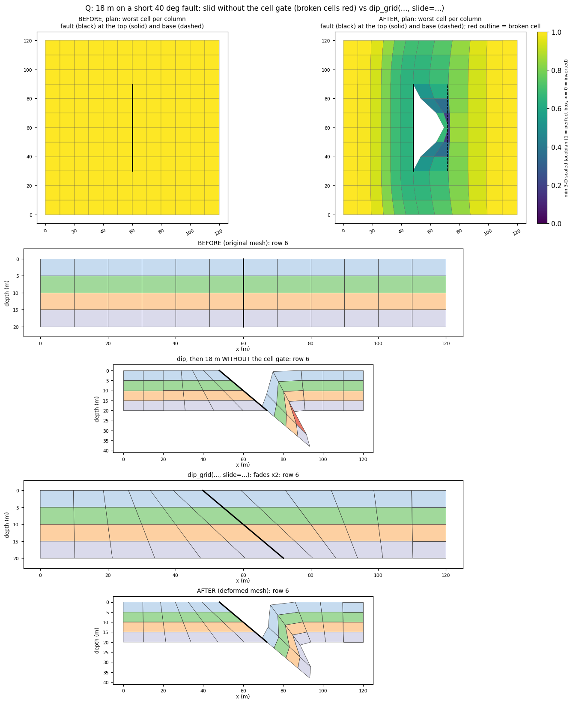
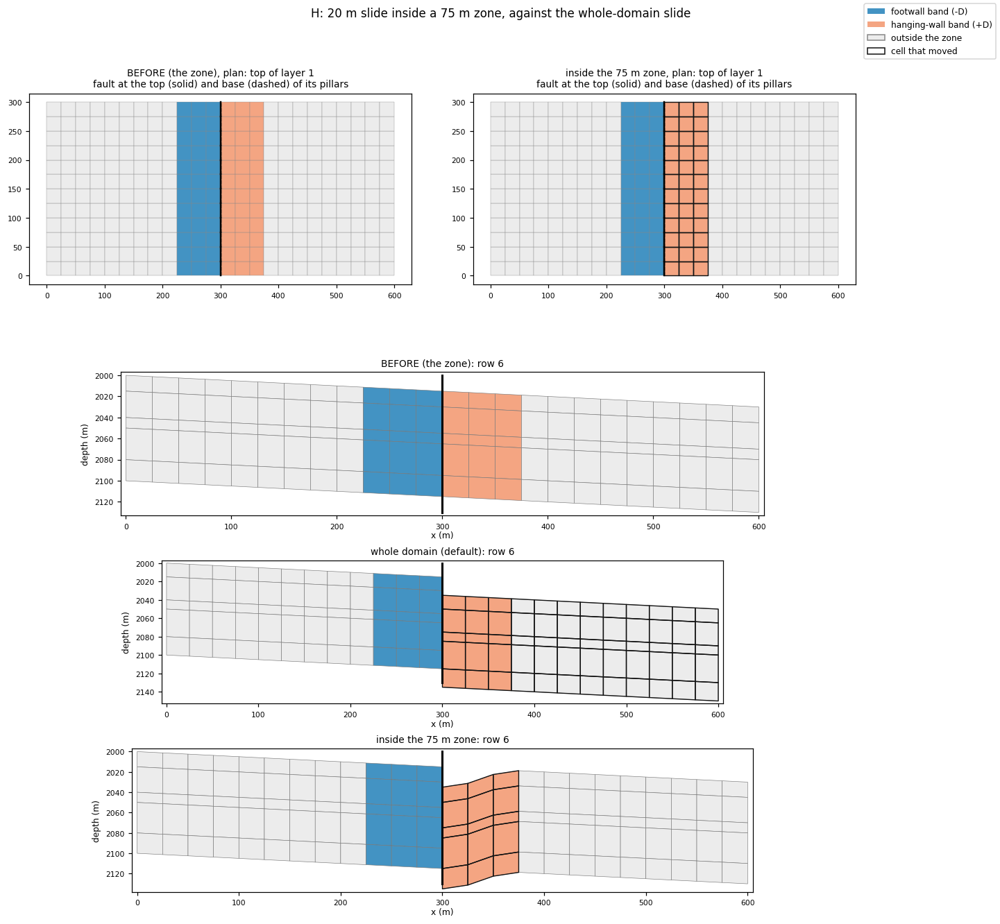

# Fault slides in Z: `slide_grid`, `slide_deck` and `zcorn_ops`

A fault slide gives existing `FAULTS` a throw by editing ZCORN only. Every
corner moves along its own pillar, so COORD never changes and only faces listed
in `FAULTS` open. `fault_projections.slide` decides the shifts;
`cpg2unstructured.zcorn_ops` applies and checks them. To change a fault's
angle first (COORD only), see [Fault dip](fault-dip.md).

## `slide_grid`

### Syntax

```python
slide_grid(
    grid: CornerPointGrid,
    throws: Throw | Sequence[Throw],
    *,
    faults=None,             # every face that may open: {name: faces}; default the throws' faces
    method: str = "kernel",  # far field of faults with tips: "kernel" or "laplacian"
    on_invalid: str = "raise",   # "raise", "bisect" or "ignore"
    max_bisect: int = 20,
    report: bool = True,     # re-process the grid and fill the report
    tol: float = 0.0,
    min_jacobian: float | None = 0.05,  # 3-D cell-shape floor of the gate; None skips it
    zone=None,               # None: the whole grid may move; D, (D_fw, D_hw) or a FaultZone
) -> SlideResult
```

- **`min_jacobian`.** Corners slide along their pillars, so on leaning
  pillars a throw also moves them sideways. The gate checks every cell's 3-D
  scaled Jacobian (`quality.hex_check`). A cell fails if it turns inside out,
  or if its worst value drops below the floor and below what it was.
- **`zone`.** It keeps the slide inside the cells within a distance of the
  slid faults ([Fault zones](fault-zone.md)). A ZCORN corner moves only when
  every cell sharing it is in the zone. Its shift fades with a cosine from
  full on the fault to zero at the nearest frozen corner. Every cell outside
  the zone keeps its corners bit for bit. A zone that freezes a corner on the
  fault raises `ZoneError`. `SlideResult.zone` holds the zone used.



*The slide's cell gate (lesson 32 Q).* On leaning pillars, a large throw
near a fault tip can turn cells inside out while ZCORN stays in order;
`min_jacobian` refuses it. The full 18 m fits only after
`dip_grid(slide=...)` widens the fades.



*A confined slide (lesson 33 H).* A 20 m throw over the whole domain moves
720 cells, 540 of them outside the zone. With `zone=75`, 180 move and 0
outside; cells that moved are outlined in black.

`Throw(fault, throw, hanging_side=None, hanging=1.0, profile="cosine",
taper=None, decay="auto", growth=None, snap=False, name="", layers=None)`
describes one fault:

| Field | Meaning |
|---|---|
| `fault` | A name in `faults`, or the fault's faces (one branch-free chain; a ring is allowed) |
| `throw` | Positive = hanging wall down. A peak value that tapers to zero at each tip, an `(n, 2)` table of `(arc length, throw)`, or one value per chain pillar |
| `hanging_side` | A plan point on the hanging wall, `"left"`/`"right"`, or `None` to read it from the pillar dip |
| `hanging` | Share of the throw taken by the hanging wall; the footwall moves up by the rest |
| `decay` | `"auto"`: a fault that separates the grid slides a block rigidly; one that ends inside the grid fades with distance |
| `growth` | `NZ + 1` factors, one per horizon: a growth fault (layers change thickness) |
| `snap` | Lower the throw at pillars so layer boundaries never cross inside a face |
| `layers` | `(k1, k2)`, 1-based and inclusive: the layers a **blind** fault cuts. Layers outside stay welded across the faces; the throw falls to zero at the tip horizons with a cosine profile in depth, and the hanging-wall layers there change thickness to absorb it. `None`: every layer |

Several throws add up: sliding two faults at once gives the same grid as
sliding them one after the other.

### Output: `SlideResult`

`grid` is the slid grid and `before` the input. `ok` is True when no cell
inverted, no layers overlap, no face outside `FAULTS` opened (`unexpected`) and
the grid re-processes. `modes` gives `"rigid"`, `"decay"` or `"block"` per fault;
`realized_throw(name, horizon=0)` the throw along the chain at a horizon
(0 is the top of layer 1, `k` the base of layer `k`, `NZ` the base of the grid);
`peak_horizon(name)` the horizon where a blind fault's throw peaks (0 for a
fault that cuts every layer; the report and the slide PNG read the throw
there); `layers` the K range per blind fault; `scale` the fraction of the
throws applied after bisection. With `report=True`, `juxtaposition`,
`connections` (cell pairs across faults, with areas) and `volume_change` are
filled. `summary()` gives one line, `report()` a full text report.

### Example

```python
import numpy as np
from cpg2unstructured import CornerPointGrid
from fault_projections import Throw, slide_grid
from fault_projections.faults import FaultFace

nx, ny, nz, dx, dz = 6, 4, 3, 100.0, 10.0
coord = [(i * dx, j * dx, 0.0, i * dx, j * dx, 100.0)
         for j in range(ny + 1) for i in range(nx + 1)]
depth = np.repeat(np.arange(nz) * dz, 2) + np.tile([0.0, dz], nz)
zcorn = np.broadcast_to(depth[:, None, None], (2 * nz, 2 * ny, 2 * nx)).ravel()
grid = CornerPointGrid((nx, ny, nz), np.array(coord), zcorn.astype(float),
                       np.ones(nx * ny * nz, np.int8))

f1 = [FaultFace(3, j, "X") for j in range(1, ny + 1)]   # rim to rim
res = slide_grid(grid, Throw(f1, 15.0, hanging_side=(500.0, 200.0), name="F1"))
print(res.summary())
# OK: 1 fault(s) slid (F1 rigid) · 4 face(s) opened · max |volume change| 0 %
```

This snippet was run against the pinned revisions.

A blind fault cuts only some layers. On the same layout with four 10 m
layers, only layers 2–3 are cut:

```python
res = slide_grid(grid, Throw(f1, 6.0, hanging_side=(500.0, 200.0), layers=(2, 3), name="F1"))
print(res.summary())
# OK: 1 fault(s) slid (F1 rigid) · 4 face(s) opened · max |volume change| 60 %
print([round(float(res.realized_throw("F1", horizon=k)[0, 1]), 3) for k in range(nz + 1)])
# [0.0, 0.0, 6.0, 0.0, 0.0]
print(res.peak_horizon("F1"))
# 2
```

Here `nz = 4` and the pillars run from 0 to 40 m. The throw is 6 m at
horizon 2, between the two cut layers, and zero at horizons 1 and 3, where
the fault dies out. In the hanging wall, layer 2 thickens from 10 m to 16 m
and layer 3 thins from 10 m to 4 m. That is the 60 % volume change: a blind
fault's throw is absorbed by the layers it cuts.

## `slide_deck`

```python
slide_deck(deck, throws, out_dir, *, prefix="slid", faults=None, vtk=False,
           png=False, **slide_kw) -> SlideResult
```

Reads a deck, slides it and writes `<prefix>_grid.grdecl` (COORD, ZCORN,
ACTNUM) and `<prefix>_report.txt`. `faults` defaults to the deck's own `FAULTS`
(INCLUDE is followed), so a throw can name a fault: `Throw("F1", 20.0)`. The
`FAULTS` set does not change, so replace the grid in the deck with
`INCLUDE '<prefix>_grid.grdecl' /`. A fault whose `FAULTS` records cut only
some layers (a K range other than `1..NZ`) slides as a blind fault: the K
range becomes `Throw.layers`, unless the throw sets it. Earlier versions slid
every layer. A K range that varies along the fault warns and uses its hull.
Sliding a fault whose faces are all `Z` raises `SlideError`. `png=True` also writes `<prefix>_slide.png`:
a plan map of the top shift with the fault chains, and the realized throw
along each fault (`viz.plot_slide(res)`, `write_slide_png(res, path)`; needs
matplotlib).

Lesson 30 slides Norne's E_01 (5 m, fading to its tips) and BC (3 m, rigid)
through a deck: 8 faces open, none outside `FAULTS`, a round trip returns to
5e-13 m and cell volumes change by up to 2.4 % on the tilted pillars. To adapt
and slide in one call, use [`adapt_deck(slide=...)`](adapt-grid.md#adapt_deck);
case C does it for a dipping polygon with `top_trace="auto"`. With matplotlib
installed, cases B and C also write a PNG.

{{ example:30_deck_slide_workflows.py }}

## `zcorn_ops` (cpg2unstructured)

| Function | What it does |
|---|---|
| `zcorn_cube(grid)` / `with_zcorn(grid, cube)` | ZCORN as a `(2NX, 2NY, 2NZ)` cube of corner slots, and back |
| `apply_zcorn_displacement(grid, dz)` | Shift corners along their pillars: a scalar, per column corner `(2NX, 2NY)`, per horizon `(2NX, 2NY, NZ+1)` or per slot |
| `unwelded_faces(grid, tol=0.0)` | `(open_i, open_j)` masks of lateral faces whose corners no longer match |
| `zcorn_validity(grid, tol=0.0)` | `ZcornValidity`: inverted cells and overlapping layers |

## Failure modes and limitations

- Faults must lie on pillar lines (a deck's `FAULTS`, or the faces
  `adapt_grid` regenerates). k-direction faults are not supported.
- A throw that fails the gate raises `SlideError`, unless
  `on_invalid="bisect"` or `"ignore"`.
- On tilted pillars, cells next to a moved pillar change volume by the fault
  wedge; `volume_change` reports it.
- With `zone=`, the throw must fade to zero inside the zone. A narrow zone
  around a large throw squeezes the cells between the fault and the zone's
  edge, and the gate may refuse it (lesson 33 J).
- A fault that ends inside the grid fades by a distance kernel or a harmonic
  solve, not by a geomechanical model.

## Source and tests

- [`slide_grid`, `slide_deck`, `Throw`, `SlideResult`](https://github.com/arturcastiel/fault-projections/blob/48dd1ece3614b875c524e9a6a6bbefac99ddf5d7/fault_projections/slide.py)
  · [Slide tests](https://github.com/arturcastiel/fault-projections/blob/48dd1ece3614b875c524e9a6a6bbefac99ddf5d7/tests/test_slide.py)
- [`zcorn_ops`](https://github.com/arturcastiel/cpg2python/blob/7d98aebbd64b03ee4623cf0c97e01dd19cda9f5b/cpg2unstructured/zcorn_ops.py)
- Lessons 19–30 ([Z slide](../learn/z-slide.md), [gallery](../learn/gallery.md));
  lesson 31 I slides a dipped fault ([fault dip](../learn/fault-dip.md));
  lesson 33 H and I confine a slide to a fault zone
  ([fault zones](../learn/fault-zone.md))
