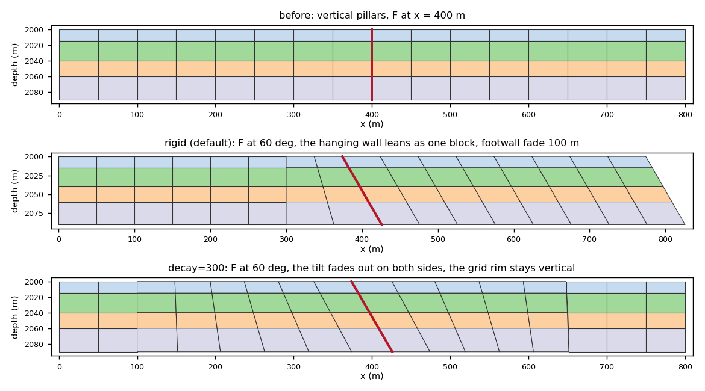
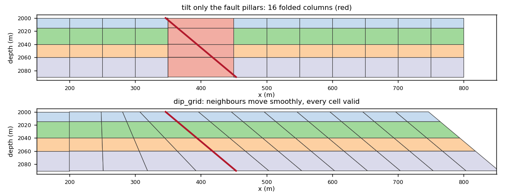
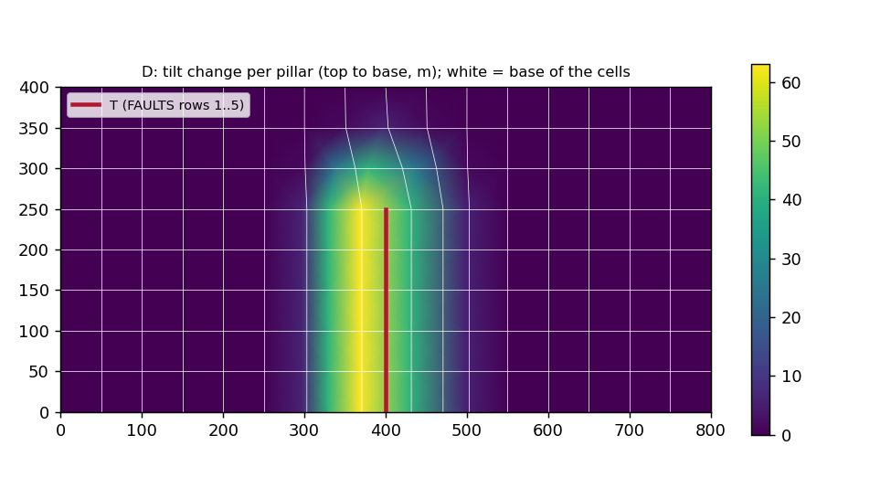
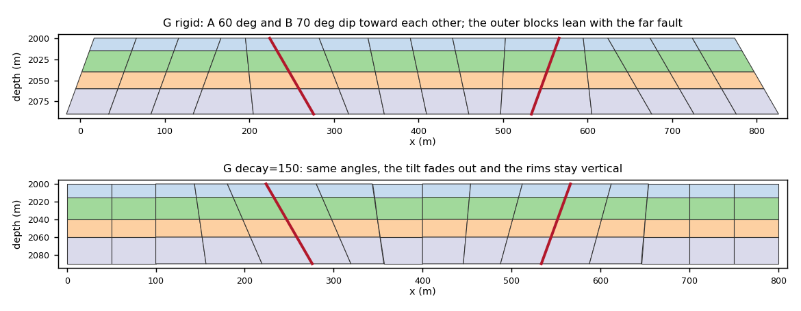

# 7. Set a fault's dip angle by tilting pillars

A fault in a corner-point grid is a ruled surface between its pillars. Its
**dip is the lean of those pillars**, and nothing else. `dip_grid` sets that
lean:

- it rotates every pillar of the fault, in the vertical plane normal to the
  fault's strike, until the fault dips at the requested angle toward its
  hanging wall;
- it moves the neighbouring pillars smoothly so that no cell folds or
  collapses.

Only COORD changes. Every corner keeps its depth and slides sideways with its
pillar. ZCORN, ACTNUM and the `FAULTS` face set stay exactly as they were, so
layering, thicknesses and the deck's `FAULTS` stay valid.

Run `python -m fieldbook.cli run 31_fault_dip`. Add `--out DIR` to keep the
decks and, with matplotlib, the figures.

> **Library calls.** `fault_projections.Dip`, `dip_grid` and `dip_deck`
> (fault-projections after 0.4.0, pinned in `upstream-lock.toml`). The method
> reference is [Fault dip](../functions/fault-dip.md).

## Check every number yourself

The lesson does not trust the result object. Each claim is re-derived from
the grid, and you can repeat the derivation with a calculator or a few lines
of numpy.

| Claim | How it is checked |
|---|---|
| The angle | From the six COORD numbers of each fault pillar: `atan(Δz / run)`, with `run` the horizontal offset measured along the dip direction |
| ZCORN and ACTNUM untouched | `np.array_equal` with the input |
| Cell volumes | The grid is re-processed (`build_topology`), and volumes are computed from the new faces, independently of `DipResult.volume_change` |
| No folded cells | `cpg2unstructured.check_validity` on the pillar lattice, a check separate from the dip's own gate |
| A deck round trip | The written INCLUDE file is read back from disk and measured again |

For example, case A prints the COORD record of pillar (8, 4) after a 60°
dip:

```text
pillar (8,4) COORD 374.019 200 2000  425.981 200 2090: atan(90 / 51.962) = 60.000000 deg
```

`90 / tan(60°) = 51.962`. The pillar moved 25.98 m west at the top and
25.98 m east at the base, so it pivots at the middle (2045 m).

## The grid

Every synthetic case uses the same layer cake:

- 16 × 8 × 4 cells, 50 m wide;
- layers 15, 25, 20 and 30 m thick (90 m in total, from 2000 m to 2090 m);
- vertical pillars.

Faults are X faces on one pillar line: F sits at x = 400 m (pillar line 8).
All cross-sections below are drawn from the real cell faces of row 0, with
true vertical scale, so the angles you see are the angles in the grid.

## A. A rigid 60° dip

F runs from rim to rim, so it cuts the grid in two. With `decay="auto"` this
gives **rigid** mode:

- the whole hanging wall takes the full tilt, so it shears parallel to the
  fault as one block;
- the footwall takes the change back over a cosine fade (here 100 m: two
  cells).



**What to expect:**

- **The angle:** F dips 60.000000000° at all 9 fault pillars.
- **The pillar lean** on lines 5–16: `0 0 26 52 52 … 52` m. Line 7, one
  cell into the footwall, takes half the tilt.
- **Hanging-wall volumes** change by 1e-14: no change, within rounding.
- **Footwall volumes:** cells change by up to 21.65 %. Column 7, from top to
  base, changes by −21.65, −10.10, +2.89 and +17.32 %. The tilt **moves
  volume between layers**: the top of the footwall column narrows and its base
  widens. Every column keeps its total volume, to 8e-15.
- **The rim:** rigid mode leans the whole hanging wall, *including the
  east rim of the grid*. If the model outline must stay vertical, pass a
  distance, `decay=300`. The tilt then fades out on both sides: the rim lean
  is 0.0 m, and the lean on lines 3–13 is
  `3.5 13 26 39 48.5 52 48.5 39 26 13 3.5` m. Cells then change by up to
  10.83 % on both sides.

## B. Why the neighbours must move

40° needs a lean of 107.3 m over the 90 m column, more than one 50 m cell.

- **Tilting only the fault's own pillars** (the naive edit) gives
  `INVALID: 16 folded column(s), 27 weld(s), 27 separation violation(s)`.
- **`dip_grid`** gives `cells valid`. The footwall fade grows to 168 m (π times
  the largest corner shift). The base shift on pillar lines 4–9 is
  `0.0 1.6 19.0 42.8 53.6 53.6` m: the fade grows smoothly from zero.



The "auto" distances keep the strain of the fade zone at or below one half
(π times the largest corner shift, and at least two cells). That keeps every
cell between the fault and the undisturbed grid stretched or squeezed, never
folded.

## C. The pivot: which depth stays put

At 70° the lean is 32.76 m. Pillar (8, 4) moves east by:

| `pivot` | Top | Base | Fixed depth | Footwall column 7 volume |
|---|---|---|---|---|
| `"top"` | +0.00 m | +32.76 m | 2000 m | +15.65 % |
| `"middle"` (default) | −16.38 m | +16.38 m | 2045 m | 0.00 % |
| `"bottom"` | −32.76 m | +0.00 m | 2090 m | −15.65 % |
| `2030.0` | −10.92 m | +21.84 m | 2030 m | +5.46 % |

Only the middle pivot keeps every column's total volume. Use `"top"` to keep
the top-surface map unchanged (case J shows that it can also be the only
pivot that passes).

## D. A fault with a tip

FAULTS `T` covers rows 1–5 of 8, so its tip pillar (8, 5) lies inside the
grid. A rigid block is impossible there, and `decay="auto"` gives **decay**
mode: the tilt fades with distance on both sides. Here the fade is 125 m:
the larger of half the fault length and π times the largest corner shift.



**What to expect:**

- **The angle:** T dips 55.000000° on all 6 of its pillars.
- **North of the tip**, on pillars j = 5–8, the lean is 63.0, 41.2, 6.0 and
  0.0 m. **East into the hanging wall** it is 63.0, 41.2, 6.0, then 0.0 m.
- **Cells:** all valid. Volumes change by up to 29.4 %; a fading tilt
  stretches cells, and only rigid mode keeps them.
- `Dip(..., decay=None)` on a fault with a tip raises `DipError`.

## E. An angle that varies along strike

`angle=` takes a table of `(arc length, degrees)` along the oriented chain;
here 55° at the south rim to 80° at the north rim. Requested → measured from
COORD, at every fault pillar:

```text
0: 55.000->55.000  50: 58.125->58.125  100: 61.250->61.250  150: 64.375->64.375
200: 67.500->67.500  250: 70.625->70.625  300: 73.750->73.750  350: 76.875->76.875
400: 80.000->80.000
```

One angle per chain pillar is also accepted.

## F. A stair-stepped diagonal fault

A straight trace at 45° in plan becomes 15 stair faces (8 X, 7 Y) on 16 chain
pillars. Each pillar is tilted along the **smoothed** strike, a Gaussian over
`smoothing` (default: twice the median face length), so the stairs dip along
the fault's mean direction, not along the grid lines.

- Along the smoothed strike: exactly 65.000000°. The mid-chain dip direction
  is (+0.707, −0.707).
- Along the ideal normal of the straight trace: 65.00° to 65.45°. The ends
  differ because the strike there is averaged over fewer steps.

## G. A graben: two faults dipping toward each other

A (x = 250 m) dips 60° east and B (x = 550 m) dips 70° west, and the block
between them is the hanging wall of both. Several dips are applied in turn
and repeated until each holds its angle under the others' fades. A dip's fade
is pinned locally to zero at the other dipped faults.



| Mode | A | B | Cells, max change | Rim lean (W / E) |
|---|---|---|---|---|
| rigid | 60.000000° | 70.000000° | 35.73 % | −32.8 / +52.0 m |
| `decay=150` | 60.000000° | 70.000000° | 21.65 % | 0.0 / 0.0 m |

In both modes every column keeps its total volume to 8e-15. In rigid mode
each outer block is on the hanging side of the *far* fault, so it leans with
it, rim and all. `decay=` keeps the rims vertical.

## H. The gate: widening, refusing, bisecting

The dipped grid is checked where the cells are: at the top, middle and base
of every active cell, the plan-view corners and edges are compared with the
original. A cell fails if:

- a corner folds;
- its scaled Jacobian falls below `min_jacobian` (0.05) **and** below what it
  was;
- an edge shrinks below `min_fraction` (10 %) of its length;
- or the grid no longer re-processes.

A request of 35° with `footwall=10` cannot be met:

- **Default:** the fades are widened ×2 to 202 m with a `UserWarning`, and
  the angle is exact. The first widening jumps to at least the auto distance.
- **`widen=0`:** `DipError: the dip fails the validity gate even with the
  fades widened x1: INVALID cells: 8 folded, …`
- **`widen=0, on_invalid="bisect"`:** 70.0 % of the change is applied, and F
  reaches **only 45.00°, not 35°**. Bisection trades the angle for validity,
  and the result says so (`scale`, `summary()`).

## I. On a deck: dip and slide in one call

`dip_deck(deck, Dip("F", 65), out, slide=Throw("F", 12))` reads the deck,
dips F, slides it 12 m and writes `dipped_grid.grdecl` and
`dipped_report.txt`. The lesson reads the written file back:

- F dips 65.000000° and the throw is 12.000000 m at every pillar;
- the input deck is byte-identical, and the output has no `FAULTS` because
  the deck's own `FAULTS` stay valid. Include the grid with
  `INCLUDE 'dipped_grid.grdecl' /`;
- hanging-wall volumes change by 1e-14. A rigid dip followed by a rigid throw
  slides the block along pillars parallel to the fault, so no volume drifts.
  The footwall changes by up to 17.49 %.

## J. A field deck: Norne

Case J runs when Norne is on the machine (`CPG_NORNE_GRDECL`, as in lesson
30): 46 × 112 × 22 cells, 44,927 active. It is reported as it came out,
**including a failure**.

- **E_01 → 60°: passes.** E_01 was 63.0° to 98.4° on 28 pillars; above 90°
  means one end leans past vertical. After the dip it is 60.000000° when the
  written file is read back. Decay mode with a 1,278 m fade; all cells valid;
  cell volumes change by up to 43.2 %.
- **BC → 70° with the default middle pivot: fails.** `DipError: the dip
  fails the validity gate even with the fades widened x16: INVALID cells:
  1 folded`. BC's present dip jumps from 59° to 84° within four neighbouring
  pillars, so a uniform 70° needs very different tilts on adjacent pillars,
  and one top-layer cell folds however wide the fade.
- **BC → 70° with `pivot="top"`: passes.** BC was 36.8° to 84.0°; it is now
  70.000000° (fades widened ×4), and all cells are valid. 65° with the
  default pivot also passes (widened ×4). With `decay=1000` and
  `on_invalid="bisect"`, 94.2 % of the change is applied and BC lies between
  67.2° and 70.8°: valid, but not the angle requested.
- **Also failing at 70° with the middle pivot:** `decay` 500, 1000 or 2000;
  `pivot="bottom"`; `smoothing=400`. 75° and 80° fail too. These runs were
  made while writing this page, not in the lesson, to keep its run time
  short.

When a field fault refuses, try a different `pivot`, a smaller change, or a
longer `decay`/`footwall`, in that order, and read `summary()` each time.

{{ example:31_fault_dip.py }}

## What a dip does not do

- **It does not move ZCORN.** To give the fault a throw, slide it afterwards
  ([Slide a fault in Z](z-slide.md), or `dip_deck(slide=...)`).
- **It does not change `FAULTS`.** The faces stay on the same pillar lines; a
  dip cannot move a fault in plan.
- **It is not volume-neutral cell by cell.** Rigid hanging walls and
  middle-pivot columns keep their volumes; individual footwall and fade-zone
  cells do not. The result reports `volume_change`.
- **Angles are limited to (0°, 90°].** An overturned fault cannot be
  requested; `realized_dip` reports above 90° when one already exists.
- **It is geometric only.** It is no restoration or geomechanical model, and
  no simulator acceptance is implied.
