# 9. Fault zones: find the cells within ±D of a fault, and optionally keep an edit inside them

A **fault zone** is the set of cells within a distance `D` of a fault, on
either side. `fault_zone` finds them and does nothing else: the grid is not
changed. These are two separate features:

1. **Selection** (`fault_zone`): which cells lie in `−D … +D` of each fault.
   You can use the selection on its own: as a region keyword (`FLTZONE`), a
   mask, or a property.
2. **Confinement** (`zone=` on `dip_grid` and `slide_grid`, optional): only
   cells of the zone may deform. **The default is no zone:** a dip or slide
   deforms the whole domain, and only the grid's outer boundary is held fixed
   (`dip_grid(boundary="fixed")`).

**How the distance is measured.** For every cell, `fault_zone` measures the
distance from the cell centre to the fault *surface*. That surface is the
ruled surface between the fault's pillars, extended past the top and base of
the grid. The distance is taken along the surface's normal, so a dipping
fault gives a slanted band. It is signed: `+` on the hanging wall, `−` on the
footwall. `D` can be one number, or `(D_footwall, D_hanging_wall)` for a
different width on each side. Past a fault's tip the distance is to the
surface's edge, so the zone wraps round the tip.

Run `python -m fieldbook.cli run 33_fault_zone`. Add `--out DIR` for one
figure per case, or `--case B,G` to run only those cases.

> **Library calls.** `fault_projections.fault_zone`, `FaultZone`,
> `write_zone`, and `zone=` on `dip_grid` and `slide_grid`
> (fault-projections after 0.4.0, pinned in `upstream-lock.toml`). The method
> reference is [Fault zones](../functions/fault-zone.md).

## How to read the figures

Every figure shows a plan (top of layer 1) and a cross-section (row 6),
**BEFORE** and **AFTER**. The footwall band is blue, the hanging-wall band
orange, and cells outside the zone grey. The fault is drawn in black: in
plan, solid at the top of its pillars and dashed at the base.

- **Selection cases (A–F):** BEFORE is the grid alone, and AFTER is the
  same grid with the selected zone coloured. Nothing is moved.
- **Edit cases (G–K):** BEFORE is the original grid with the zone, and AFTER
  is the edited grid (G and H show the whole-domain runs too). **Every cell
  that moved is outlined in black**, so you can see at a glance that nothing
  outside the zone moved when it is confined.

## Check every number yourself

The lesson does not trust the library. Each selection is re-measured
independently, and each edit is judged by lesson 32's cell checker, which
shares no code with the library.

| Claim | How it is checked |
|---|---|
| Distances on a planar fault | The plane fitted through the fault's own COORD; each cell's distance from its equation |
| Distances on a curved or twisted fault | Brute force: the pillar surface sampled densely (128,000 points; 2.6 million on Norne) and the nearest sample found |
| The zone file | `FLTZONE` is read back by hand from the text, and compared cell by cell in deck order |
| Nothing outside the zone moved | Raw COORD and ZCORN compared with `np.array_equal` for every corner of every cell outside the zone |
| No broken cells | Lesson 32's checker: trilinear Jacobians at 45 points per cell, volumes, and plan folds, rebuilt from raw COORD and ZCORN |

## The grid

The synthetic cases use a 24 × 12 × 5 grid (1,440 cells) with 25 m-wide
columns. Its layers dip gently east (the top falls 5 m per 100 m). Faults are
rim-to-rim X faces unless stated.

## A. A vertical fault, D = 60 m

F is vertical on x = 300 m, and `+` is east.

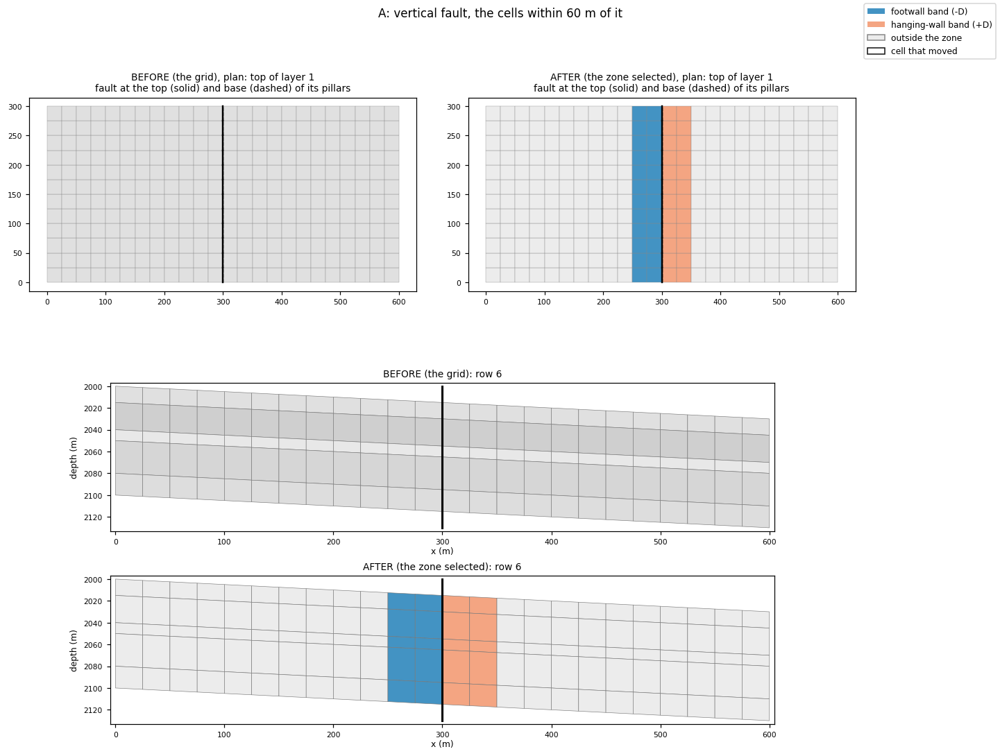

**What to expect:** 120 footwall + 120 hanging-wall cells: exactly the cells
with `|x_centre − 300| ≤ 60` (columns 10–13). The distances equal `x − 300`
to 1e-9.

## B. A dipping fault (60°), D = 50 m

F is first dipped 60° east. The zone is measured on the dipped grid.

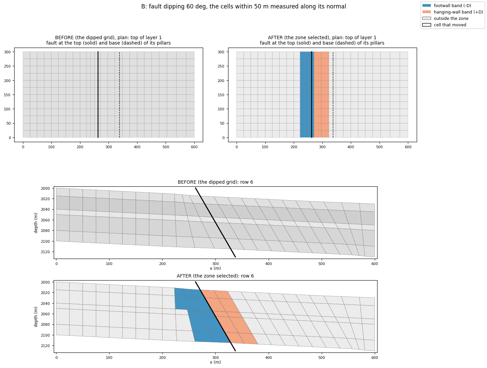

**What to expect:**

- The fault's pillars lie on one plane (residual 7e-15 m) dipping
  60.000000°. The zone's distances match the plane's equation to 4e-14 m.
- The `+` side is read from the dip: east.
- **The band slants with the fault.** On row 6 the zone covers columns 9–13
  in the top layer and 10–13 in the bottom one.

## C. An asymmetric zone: 30 m footwall, 90 m hanging wall

`fault_zone(grid, faults, (30.0, 90.0))` on the same 60° fault.

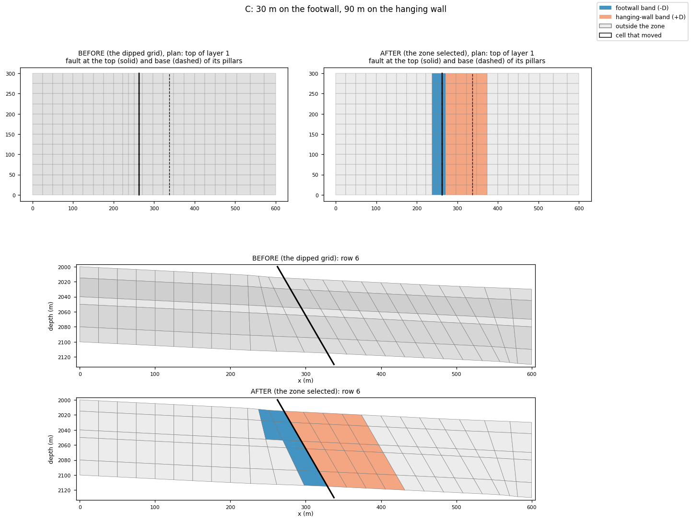

**What to expect:** 84 footwall + 240 hanging-wall cells. These are every
cell with `−30 ≤ d ≤ 90` by the plane's equation, and no other cell.

## D. A curved fault

An arc is adapted into the pillars (`adapt_grid`) and dipped 65°. The zone
uses D = 50 m.

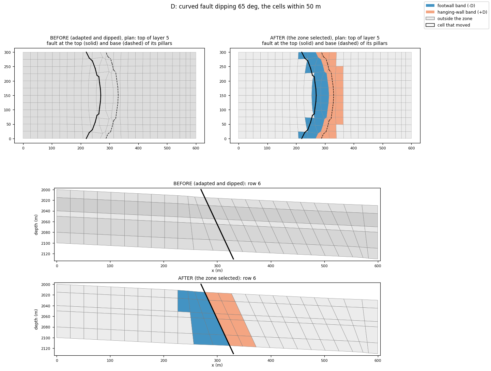

**What to expect:** 158 footwall + 140 hanging-wall cells. Against brute
force over 128,000 surface points (1 m sampling step), the distances agree to
0.04 m. Every cell farther than 1 m from the zone's edge gets the same
verdict.

## E. Two crossing faults, D = 60 m

F1 lies on x = 200 m (`+` east) and F2 on y = 150 m (`+` north).

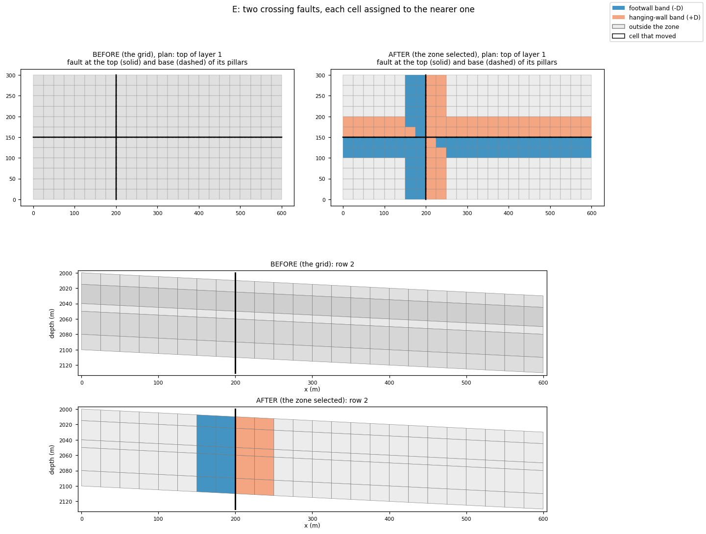

**What to expect:**

- **Each fault on its own:** F1 has 120 + 120 cells and F2 has 240 + 240
  (footwall + hanging wall).
- **Overlap:** 80 cells are within 60 m of both faults. The nearer fault
  decides their side. 40 of them are equally close to both, and those go to
  F1, the first listed (`FaultZone.nearest`, ties within 1e-6).
- **Union:** 320 footwall + 320 hanging-wall cells.

## F. Export as a GRDECL region keyword

`write_zone(zone, "zone.grdecl")` writes the B zone as `FLTZONE`: 0 outside,
1 in the footwall band, 2 in the hanging-wall band, with I fastest. Rename
the keyword (for example to `MULTNUM` or `FIPNUM`) to use it in a deck.

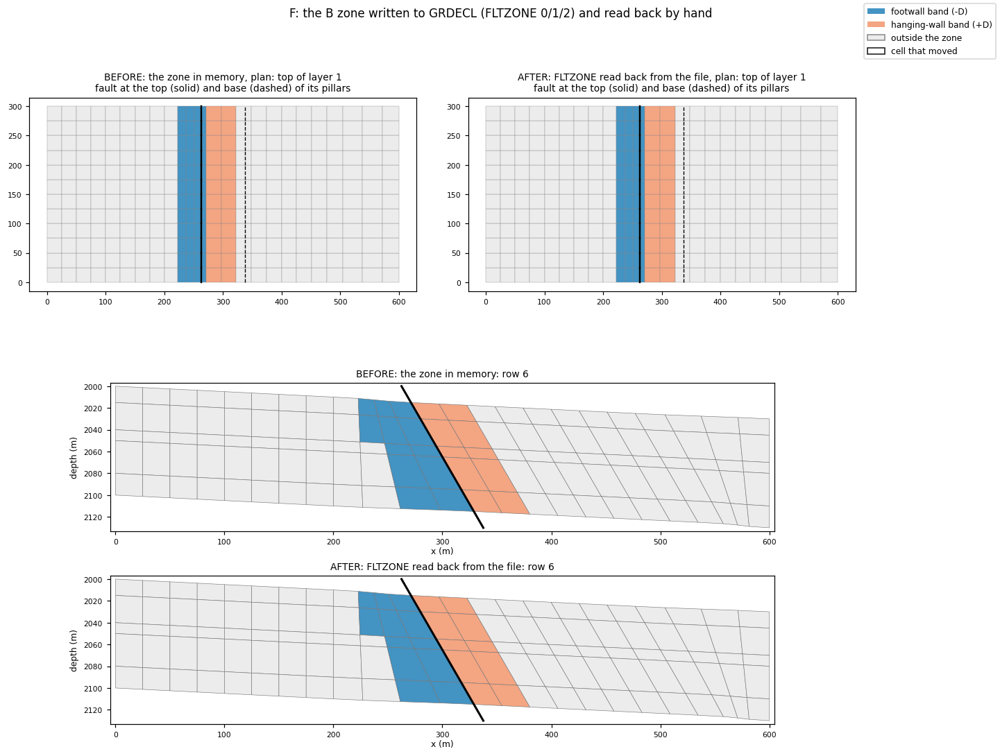

**What to expect:** 19 lines and 867 bytes. Read back by hand, the file holds
1,440 values: 144 × 1 (footwall band), 120 × 2 (hanging-wall band) and
1,176 × 0. Its first lines are:

```text
-- fault zone -50 / +50: 0 outside, 1 footwall band, 2 hanging-wall band
FLTZONE
9*0 3*1 2*2 19*0 3*1 2*2 19*0 3*1 2*2 19*0 3*1 2*2
```

The figure compares the zone in memory (BEFORE) with the zone read back from
the file (AFTER). They are identical.

## G. A confined dip: the whole domain vs inside 100 m

F is set to 60° three ways. The figure shows the original grid and each
result, with every moved cell outlined.

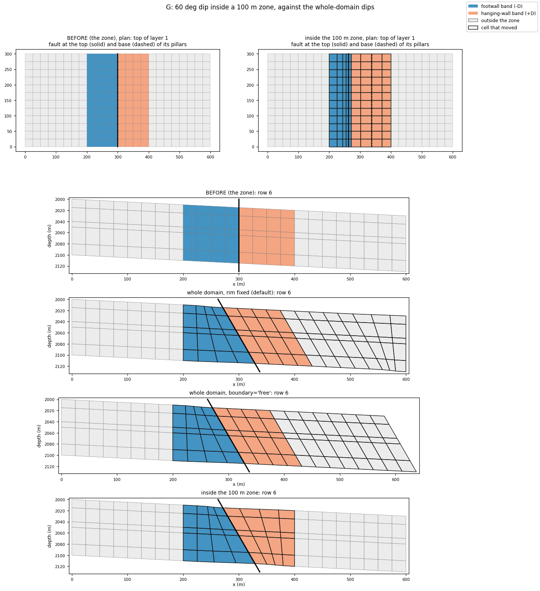

| Run | F | Cells moved | Moved outside the zone | Max volume change | Broken |
|---|---|---|---|---|---|
| Whole domain, rim fixed (default) | 60.000000000° | 960 of 1,440 | 480 | 49.6 % | 0 |
| Whole domain, `boundary="free"` | 60.000000000° | 960 of 1,440 | 480 | 41.4 % | 0 |
| `zone=100` | 60.000000000° | 480 of 1,440 | **0** | 50.6 % | 0 |

With `zone=100`, the 960 cells outside the zone are **bit-identical** (raw
COORD and ZCORN). The confined dip changes cell volumes slightly more,
because the whole tilt is taken up inside the zone.

## H. A confined slide: 20 m inside 75 m

`slide_grid(grid, Throw("F", 20.0), zone=75.0)` against the default slide.

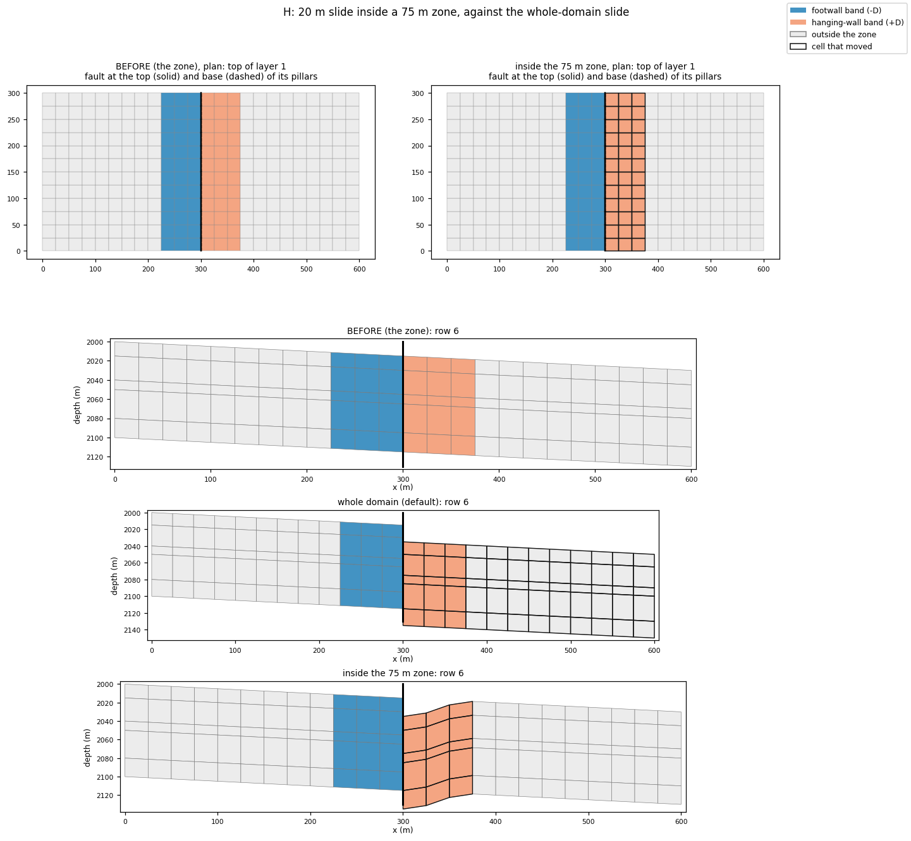

| Run | Throw | Cells moved | Moved outside the zone | Broken |
|---|---|---|---|---|
| Whole domain (default) | 20.000000000 m | 720 | 540 | 0 |
| `zone=75` | 20.000000000 m | 180 | **0** | 0 |

When confined, the hanging wall drops 20 m at the fault, and the drop fades
to 0 at the zone's edge (a cosine). Outside the zone every corner is
bit-identical.

## I. Dip and slide confined together

`dip_grid(grid, Dip("F", 60), slide=Throw("F", 15), zone=120)`.

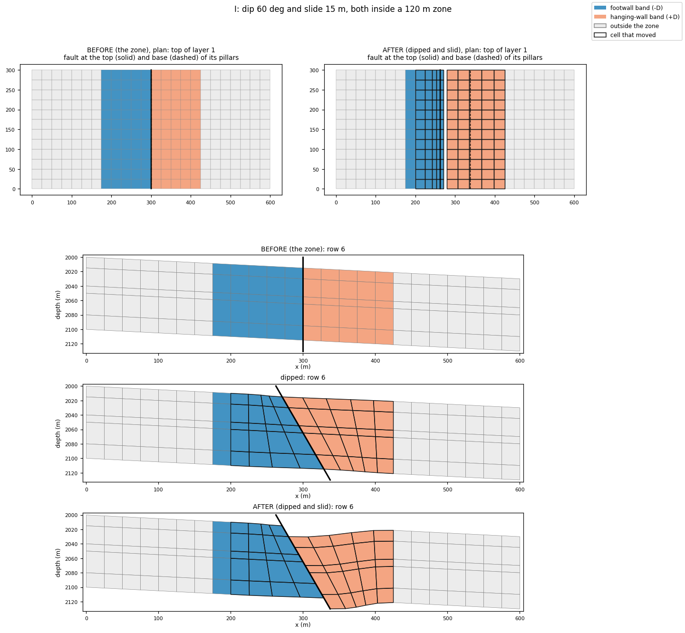

**What to expect:** F dips 60.000000° and the throw is 15.000000 m. 540 cells
moved, 0 of them outside the zone. The checker finds 0 inverted, 0
degenerate, 0 crushed and 0 plan folds; the moved cells' minimum 3-D
Jacobian goes from 0.999 to 0.83.

## J. Refusals: when a zone is too small

A zone only removes room for the change. The library refuses rather than
return broken cells.

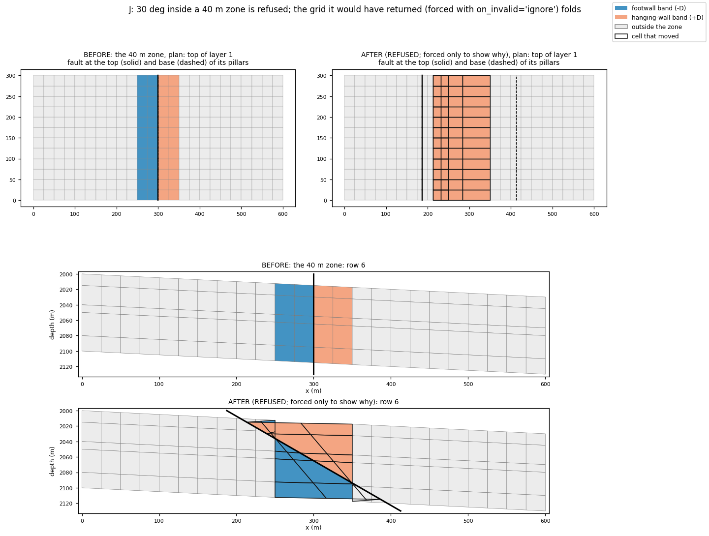

- **A dip inside 10 m** (cells are 25 m wide): `ZoneError: DIP_1: the zone is
  too narrow: 13 of the fault's 13 pillars touch cells outside it`. A pillar
  moves only when every cell around it is in the zone.
- **A slide inside 5 m:** `ZoneError: the zone is too narrow: 78 corners on
  the faults touch cells outside it`.
- **30° inside 40 m:** `DipError: … INVALID cells: 96 folded`. At 30° the
  fault's base sits 225 m from its top in plan (`90 m / tan 30°`). The pillars
  within 40 m must follow it, so the cells fold. Forced with
  `on_invalid="ignore"`, the checker independently finds 96 inverted cells,
  48 crushed and 48 plan folds (min 3-D Jacobian 0.999 → −0.999). The figure
  shows that forced grid: the gate was right.

## K. A field deck: Norne

Case K runs when Norne is on the machine (`CPG_NORNE_GRDECL`, as in lesson
30): 46 × 112 × 22 cells, 61 faults.

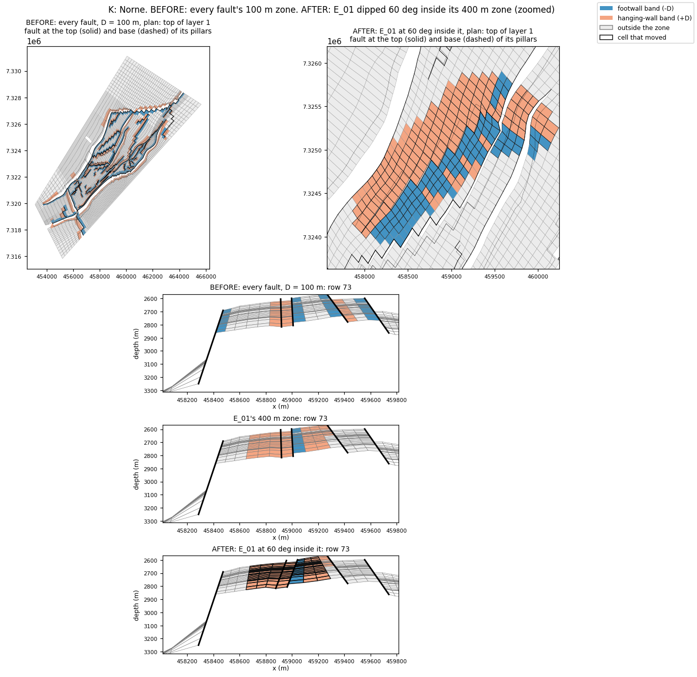

- **All 61 faults at D = 100 m:** 22,759 footwall + 22,075 hanging-wall
  cells (28,043 active). No fault was vertical enough to need a side
  assumed (0 warnings).
- **Brute-force check on E_01:** 300 random zone cells re-measured against
  2,592,000 surface points. The library is at most 0.011 m nearer (the brute
  force's sampling error) and never farther.
- **E_01 → 60° inside 400 m:** exact on all 28 pillars. 4,730 cells moved
  (4,218 active), and **0 of the 108,203 cells outside the zone moved**. The
  checker finds 0 broken cells; the moved cells' minimum 3-D Jacobian goes
  from 0.279 to 0.433.

A bug found by this case: Norne's neighbouring pillars are far from
parallel, so each fault face is a *twisted* ruled surface. The first version
of `fault_zone` cut each face into flat triangles. On E_01 it was off by up
to 21.7 m, and the brute-force check caught it. The distance is now exact on
the ruled surface: each face is minimised along its rulings in closed form.

{{ example:33_fault_zone.py }}

## What a zone does not do

- **A selection is not an edit.** `fault_zone` never changes the grid; it
  only confines a dip or slide when passed as `zone=`.
- **A confined edit is not cheaper on the cells.** The whole change is taken
  up between the fault and the zone's edge, so cells there deform *more*
  (G: up to 50.6 % against 49.6 % unconfined), and a zone that is too narrow
  is refused (J).
- **The zone is measured on the input grid.** After a dip, the fault has
  moved; measure a new zone on the result if you need one.
- **Membership is by cell centre.** A cell whose centre lies within `D` is
  in the zone, however far its corners reach.
