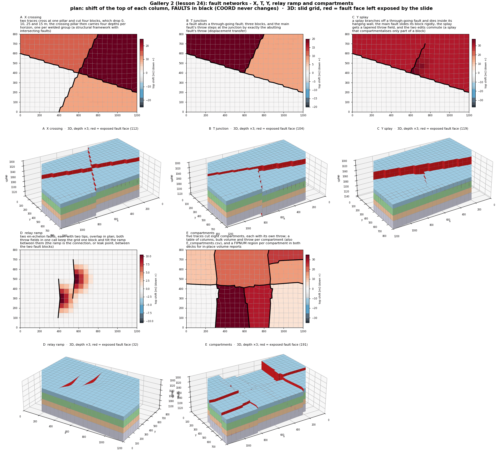
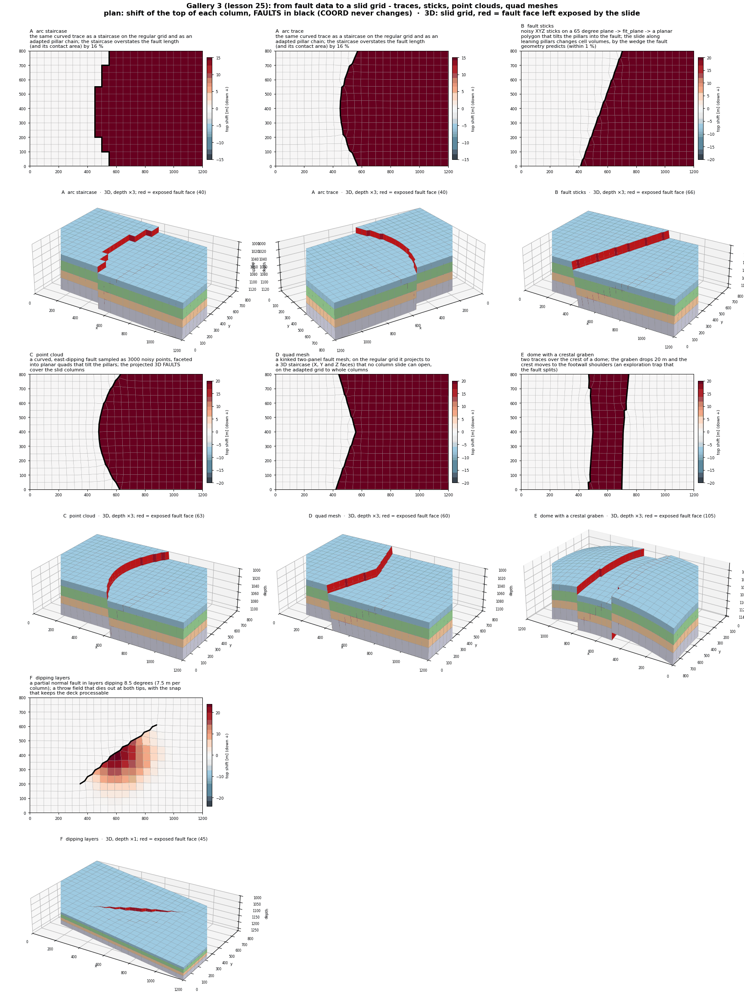
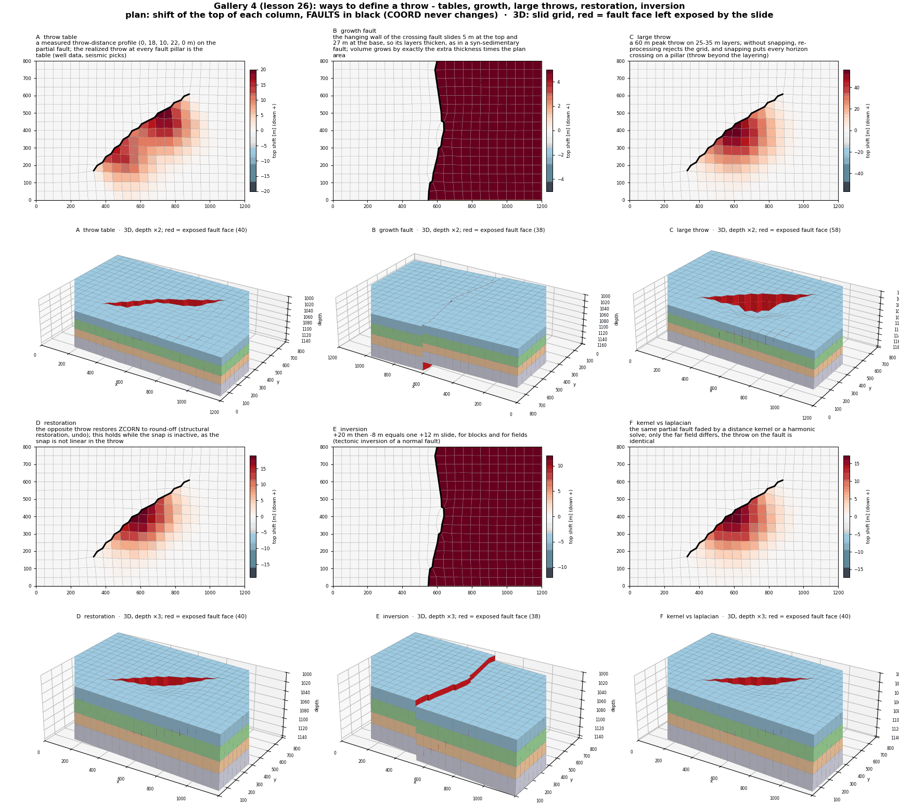
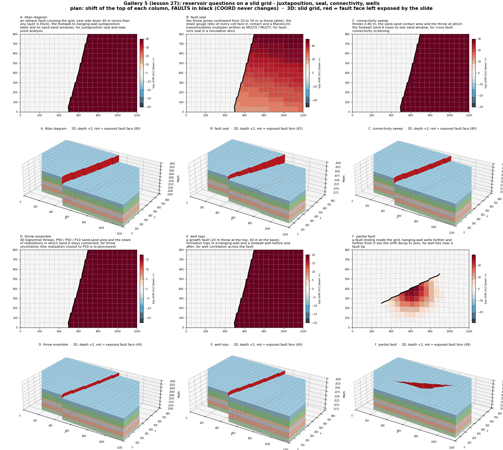
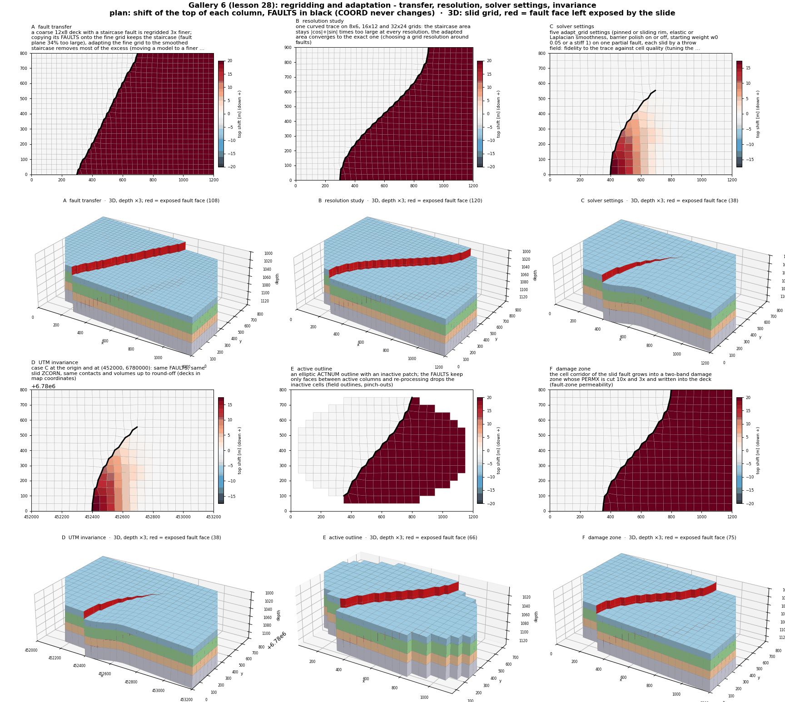
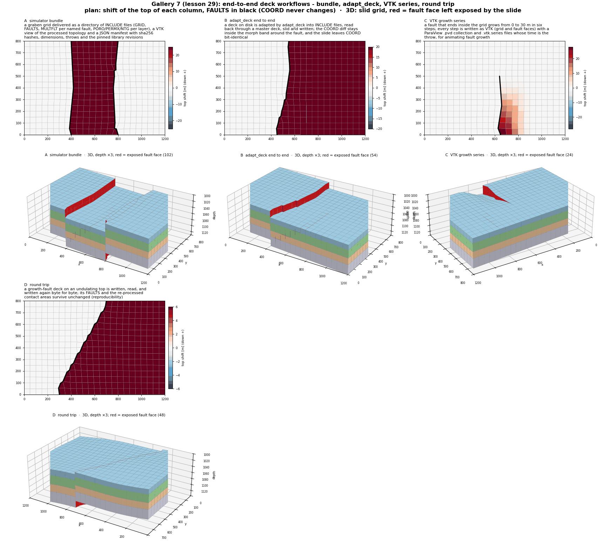

# 6. Gallery: Z slides with meshing, regridding and adaptation

Lessons 23 to 29 combine the Z slide of [chapter 5](z-slide.md) with
the meshing, regridding and grid adaptation features of both
libraries. There are more than thirty cases, grouped into seven
themes, each motivated by an application. Every case:

1. builds or adapts a grid with the libraries;
2. moves corners along their pillars by editing ZCORN only;
3. writes the deck before and after (`<case>_0_input.grdecl`,
   `<case>_1_slid.grdecl`, both with FAULTS);
4. re-processes the slid deck and asserts what changed and what did
   not.

Run any lesson with `python -m fieldbook.cli run NN_name`; add
`--out DIR` to keep the decks.

Each figure shows, per case, a plan map of how far the top of each
column moved, with the FAULTS in black, and a 3D view of the slid grid
with the fault faces the slide exposes in red. All cases are
synthetic: nothing here checks simulator acceptance or flow.

> **The slide helper.** The lessons share `fieldbook/zslide.py`, a
> prototype of the planned slide call. It follows the defaults chosen
> for the library: the far field is `"auto"`, so a fault that closes a
> block slides it rigidly, while a fault that ends inside the grid
> tapers to zero at each tip and its motion decays away from it. The
> decay is a distance kernel by default or a Laplacian solve on the
> pillars. The hanging wall takes the whole throw and the tip profile
> is a cosine. Its main calls:
>
> | Call | What it does |
> | --- | --- |
> | `slide_blocks(grid, faults, {seed: throw})` | moves whole blocks closed by FAULTS; a throw is one value or one per horizon |
> | `slide_field(grid, [Throw(...)], faults=...)` | one throw field per fault that ends inside the grid; one shift per welded group at each pillar |
> | `Throw(faces, throw, hanging_side, profile, taper, decay, hanging, snap)` | peak throw or a throw-distance table; `snap` keeps layer boundaries from crossing inside a face |
> | `unwelded_faces`, `analytic_contacts`, `process`, `compare` | checks: which faces opened, the exact contacts on vertical pillars, the re-processed topology |
> | `layer_cake`, `blocks`, `interior`, `close_ring`, `named_chains` | synthetic grids, block labels, FAULTS cleanup after `adapt_grid` |
>
> `interior` and `close_ring` work around two upstream gaps in
> `adapt_grid(...).faults_after`; see the [known limits](../reference/limits.md).

## 1. Structural styles (lesson 23)

Run `python -m fieldbook.cli run 23_gallery_structural_styles`.
A 24×16×4 layer cake is adapted to fault traces with `adapt_grid`.
The blocks that FAULTS close are then slid rigidly.

| Case | Input | Slide | Application |
| --- | --- | --- | --- |
| A graben | two curved traces | middle block +25 m | rift basin |
| B horst | the same faults | flanks +15 / +20 m | asymmetric horst |
| C domino | three oblique traces | blocks step 12 m | tilted fault blocks |
| D ring collapse | a closed elliptic trace (`close_ring`) | the inner block +30 m | caldera, salt withdrawal |
| E reverse fault | east pillars lean 40 m (66° dip) | hanging wall −20 m (up) | inversion, thrust |

Every case keeps COORD and FAULTS and opens exactly the FAULTS faces.
No cell changes volume. The contacts match the analytic overlaps, or,
on the leaning pillars of E, the face area per metre times the
remaining overlap.

{{ example:23_gallery_structural_styles.py }}

## 2. Fault networks (lesson 24)

Run `python -m fieldbook.cli run 24_gallery_fault_interactions`.
All the traces of a network are adapted at once. Each trace's FAULTS
are read from its own pillar chain.

| Case | Network | Result |
| --- | --- | --- |
| A X crossing | two traces cross at one pillar | 4 blocks (0, 10, 25, 15 m); the crossing pillar carries 4 depths per horizon |
| B T junction | a fault abuts a through-going fault | 3 blocks; the main fault's throw steps by the abutting throw (12 m) |
| C Y splay | a splay dies inside a block | rigid block slide plus a tapered splay field; the two edits commute |
| D relay ramp | two overlapping partial faults | still one block; the ramp tilts about 3° between them |
| E compartments | five traces | 8 compartments, a FIPNUM region and a bulk-volume table per compartment |

At a pillar shared by several faults, each welded group of columns
gets its own depth. That is how the X, T and Y junctions open only
their FAULTS faces.

{{ example:24_gallery_fault_interactions.py }}

## 3. From fault data to a slid grid (lesson 25)

Run `python -m fieldbook.cli run 25_gallery_geometry_inputs`.
Each case starts from a different kind of fault data.

| Case | Fault data | Grid step | Key result |
| --- | --- | --- | --- |
| A arc trace | a curved map trace | staircase vs `adapt_grid` | staircase 16 % too long; adapted −0.3 % |
| B fault sticks | noisy XYZ sticks | `fit_plane`, then a stage-2 polygon | dip 65.1° (true 65°); volume change = predicted wedge within 1 % |
| C point cloud | 3000 noisy points | 68 planar facets, `project_faceted_surface` | 3D FAULTS cover the slid columns |
| D quad mesh | a kinked two-panel mesh | `project_quad_mesh_surface` | regular grid: X/Y/Z staircase; adapted: whole columns |
| E dome | a domed top, two crestal traces | stage 1 + re-draped horizons | the crest moves to the shoulders |
| F dipping layers | a partial fault in 8.5° layers | throw field with snap | unsnapped: rejected; snapped: re-processes |

Stage 2 tilts pillars. A slide along tilted pillars **changes cell
volumes** (B–D). The lesson asserts that the change is the wedge the
fault geometry predicts, not zero.

{{ example:25_gallery_geometry_inputs.py }}

## 4. Ways to define a throw (lesson 26)

Run `python -m fieldbook.cli run 26_gallery_throw_definitions`.

| Case | Throw | What is asserted |
| --- | --- | --- |
| A throw table | measured `((s, t), ...)` profile | the realized throw at every fault pillar is the table |
| B growth fault | one throw per horizon (5 → 27 m) | each hanging-wall layer gains exactly extra thickness × plan area |
| C large throw | 60 m on 25–35 m layers | `snap=False` is rejected; `snap=True` puts every horizon crossing on a pillar |
| D restoration | +T then −T | ZCORN back to round-off |
| E inversion | +20 then −8 m | equals one +12 m slide (blocks and fields) |
| F kernel vs Laplacian | the same partial fault | identical throw on the fault; only the far field differs |

The snap reads both walls at each fault pillar, so throw already on
the fault counts: two +20 m slides and one +40 m slide give the same
grid.

{{ example:26_gallery_throw_definitions.py }}

## 5. Reservoir questions (lesson 27)

Run `python -m fieldbook.cli run 27_gallery_reservoir_applications`.
A six-layer sand/shale cake (VSH 0.1 / 0.7) is cut by an adapted
oblique fault. The re-processed contacts answer the questions.

| Case | Question | Output |
| --- | --- | --- |
| A Allan diagram | which layers touch at 40 m throw? | footwall-to-hanging-wall table; sand–sand windows |
| B fault seal | how much does the fault rock seal? | SGR per face, Manzocchi multipliers as MULTX / MULTY |
| C connectivity sweep | when does Sand A disconnect? | sand–sand area vs throw 0–80 m; Sand A closes at 30 m |
| D throw ensemble | how uncertain is it? | 40 lognormal throws; P90 / P50 / P10 areas |
| E well tops | what does a well see? | formation tops before and after, growth fault |
| F partial fault | how far does the motion reach? | well shifts decaying to zero from a partial fault |

{{ example:27_gallery_reservoir_applications.py }}

## 6. Regridding and adaptation (lesson 28)

Run `python -m fieldbook.cli run 28_gallery_regridding`.

| Case | Question | Key result |
| --- | --- | --- |
| A fault transfer | coarse 12×8 deck to a 3× finer grid | re-staircased +34 %; adapted +2.2 % fault length |
| B resolution study | 8×6, 16×12, 32×24 | staircase stays 1.35× (\|cos\|+\|sin\|); adapted 1.062 → 1.039 → 1.024 |
| C solver settings | five `adapt_grid` settings | fidelity vs quality: polish keeps sj_min ≈ 0.36, no polish 0.0002 |
| D UTM invariance | origin (0, 0) vs (452000, 6780000) | slid ZCORN equal to 1.7e-9 m |
| E active outline | elliptic ACTNUM | FAULTS only between active columns; inactive cells dropped |
| F damage zone | `cell_corridor` around the slid fault | PERMX ×0.1 / ×⅓ bands written and read back |

A slide moves the fault the grid gives it. On an unadapted grid the
fault plane stays a staircase at every resolution; only adapting the
pillars converges to the true fault area.

{{ example:28_gallery_regridding.py }}

## 7. End-to-end deck workflows (lesson 29)

Run `python -m fieldbook.cli run 29_gallery_export_workflows`.

| Case | Workflow | Checked |
| --- | --- | --- |
| A simulator bundle | GRID, FAULTS, MULTFLT, PORO/PERMX/NTG, VTK, JSON manifest | sha256 of every file; bit-exact read-back |
| B `adapt_deck` end to end | adapt a deck on disk, slide, write | COORD moves only in the morph band; the slide keeps COORD |
| C VTK growth series | throw 0 → 30 m in six steps | `.pvd` and `.vtk.series` list every step; volumes unchanged |
| D round trip | write, read, write | byte-identical; FAULTS and contacts unchanged |

{{ example:29_gallery_export_workflows.py }}

The figures are drawn from the decks that `--out` writes: per case, a
plan map of the top shift with the FAULTS, and a 3D view of the slid
grid with the exposed fault faces in red. All cases are synthetic:
nothing here checks simulator acceptance or flow. See also the
[known limits](../reference/limits.md).
