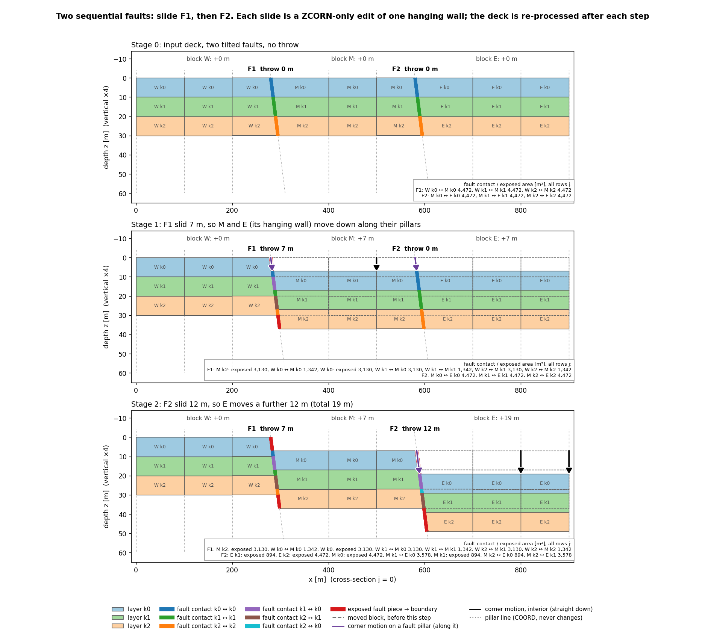
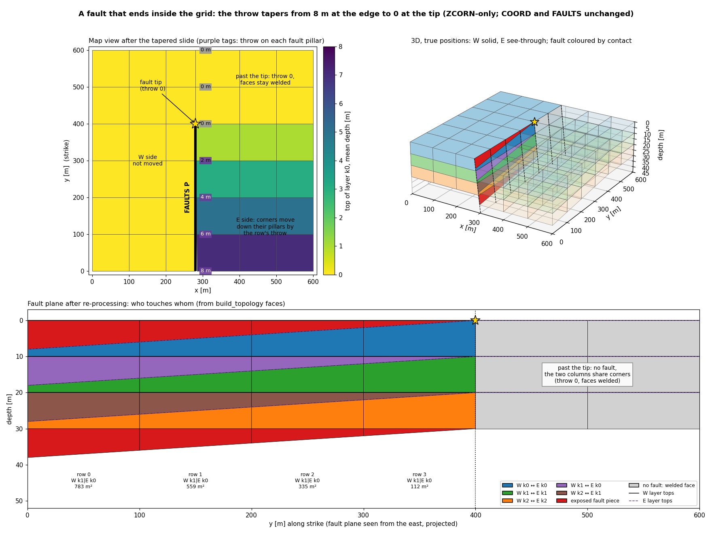
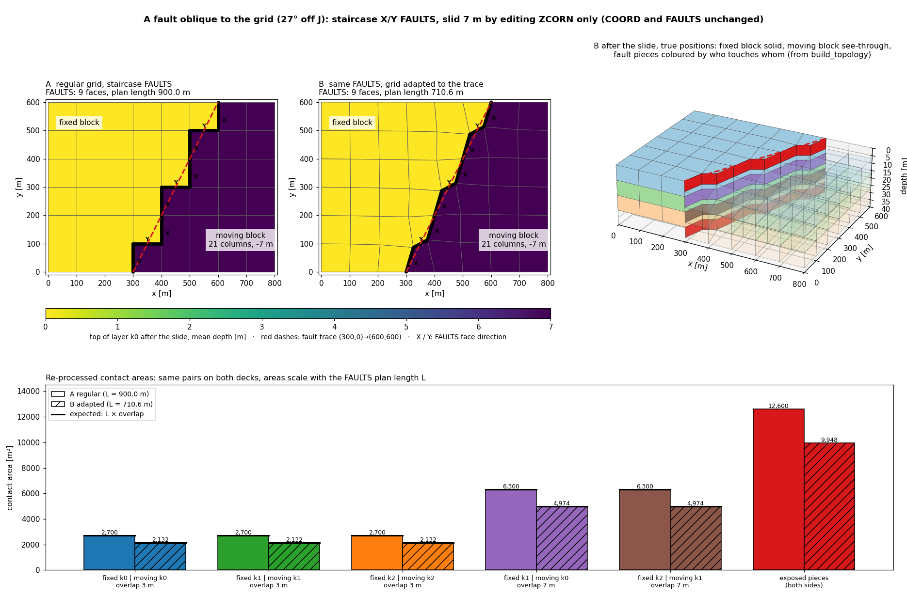
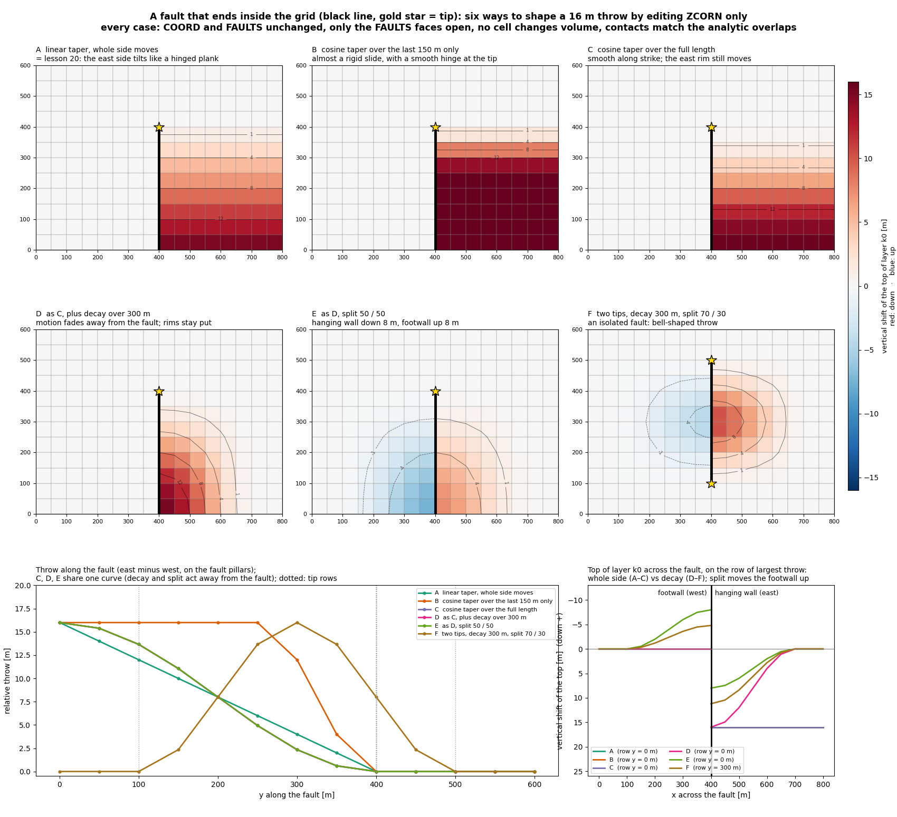
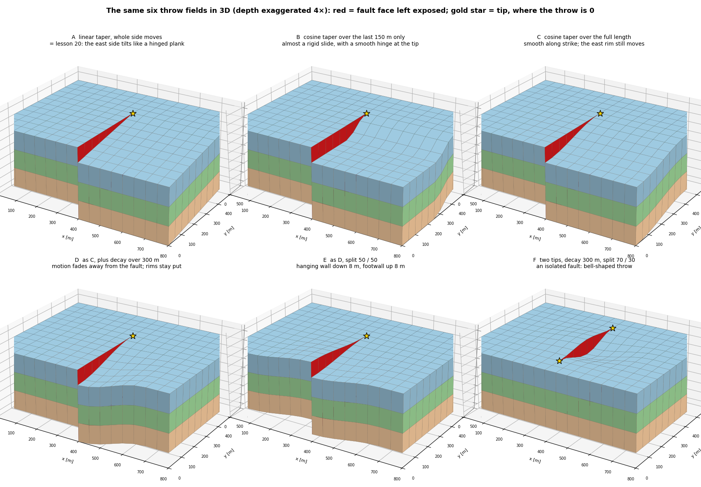
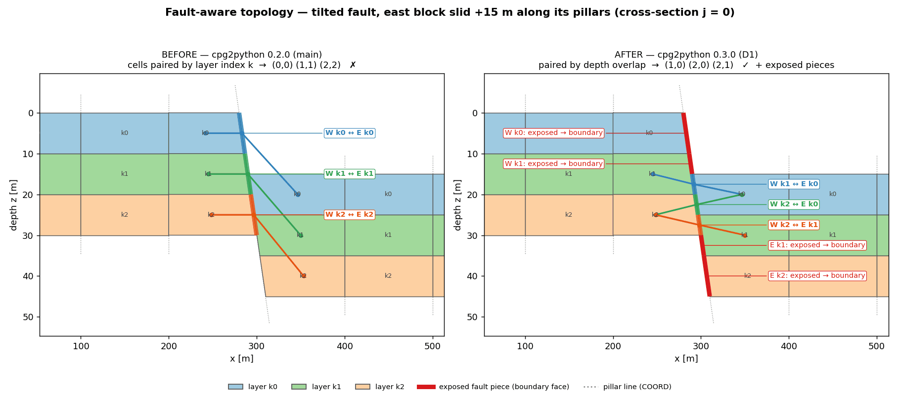
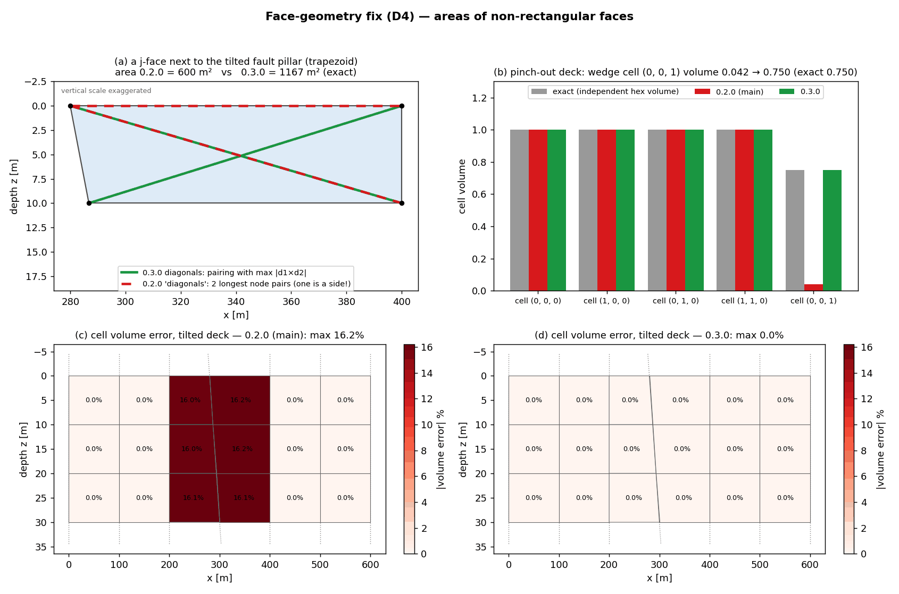
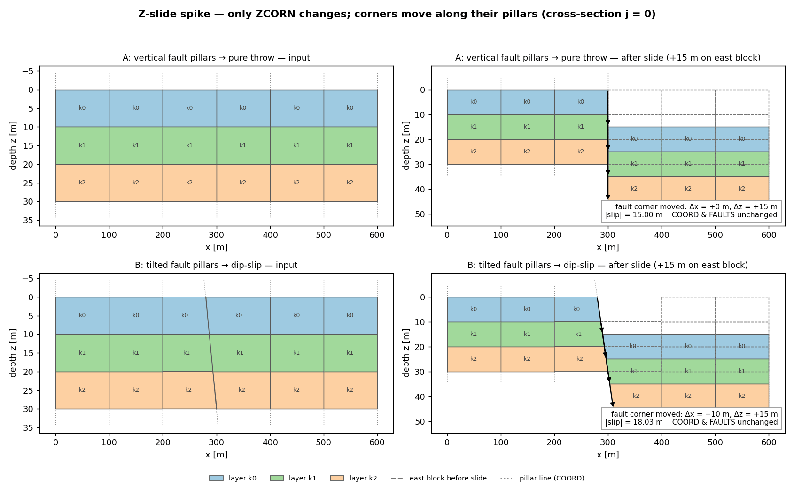
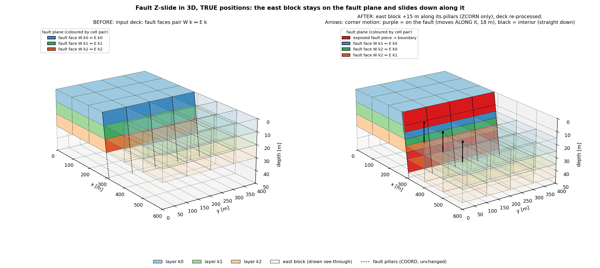
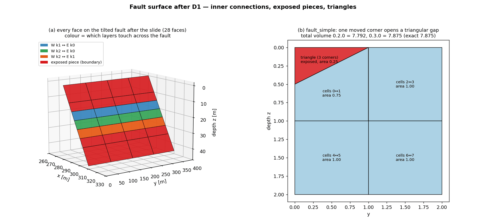

# 5. Slide a fault in Z by editing ZCORN

A Z slide moves cell corners **down their own pillars**, so only ZCORN
changes. COORD, ACTNUM and the FAULTS keyword stay the same, which
leaves the pillar geometry and the fault surface untouched. Everything
derived from depth has to be **re-processed** from the new deck with
`read_grdecl` → `from_grdecl` → `build_topology`:

- which layers touch across the fault;
- the exposed fault pieces that become boundary;
- face areas and cell volumes.

The lessons below write each deck, read it back, and assert what the
rebuilt topology reports.

The lessons index corners with the corner cube
`z = zcorn.reshape(2*NZ, 2*NY, 2*NX)`. Slots `2c` and `2c+1` are the
near and far corners of cell `c` along each axis. On fault pillar
line `i`, slot `2i-1` belongs to the west column and slot `2i` to the
east column, so the throw is `z[:, :, 2*i] - z[:, :, 2*i-1]`.

> **Status.** These lessons write out the corner-cube edit in numpy to
> show the mechanics. The library calls are `cpg2unstructured.zcorn_ops`
> (ZCORN edits) and `fault_projections.slide_grid` (the slide), used by
> lessons 23–29. The lessons need `cpg2unstructured` 0.4.0, whose
> `build_topology` pairs cells across a fault by depth overlap and
> handles faces where layer edges cross.

## Two faults, one after the other

Run `python -m fieldbook.cli run 19_z_slide_sequential`. Add
`--out DIR` to keep the three decks.

A rigid slide needs a **hanging wall**: the columns you can reach
from the east side of the fault's FAULTS faces without crossing them.
That flood fill cuts only the fault being slid. Sliding F1 therefore
moves blocks M and E together, carrying F2 with them, and F2 has no
throw until it is slid itself.

**What to expect:**

- **Throws:** F1 is 7 m, then F2 is 12 m, both exact on every pillar.
- **Unchanged keywords:** COORD and FAULTS are unchanged in all three
  decks.
- **Slides commute:** F2-then-F1 is bit-identical to F1-then-F2,
  which equals one block map (W 0, M 7, E 19 m).
- **Contacts:** after re-processing, the contact pairs match the
  depth-interval overlaps. For example, on F2 after 12 m the contact
  W k1 | E k0 is 3,578 m².
- **Volume side effect on tilted faults:** a corner that moves down a
  tilted pillar also moves in x.
  - Cells bounded by a moved tilted pillar change volume: columns 3,
    5 and 6 here, from −8.8 % to +4.2 %.
  - Cell thickness never changes.
  - Column 5 widens: it is the far side of block M, and F2's pillar
    moved with M.

{{ example:19_z_slide_sequential.py }}

## A fault that ends inside the grid

Run `python -m fieldbook.cli run 20_z_slide_partial_fault`. Add
`--out DIR` to keep the decks.

FAULTS `P` covers only rows 0–3 of pillar line 3. Around the tip
pillar, the east side is still joined to the west side, so the flood
fill finds no closed block and a rigid slide is impossible.

Instead, the throw is a **field on pillars**: 8, 6, 4, 2 and 0 m along
the fault, applied to every corner east of the line.

- **Zero at the tip:** the four cells around the tip pillar share its
  corners, so the throw there must be zero.
- **Welded past the tip:** the throw stays zero beyond the tip, so
  those faces stay welded.

**What to expect:**

- **Faces that open:** only the four FAULTS faces open. Every other
  face, including those past the tip, keeps shared corners.
- **Contact shapes:** contacts become trapezoids, and triangles in the
  last row before the tip.
- **Contact areas:** the rebuilt areas match the analytic overlaps.
  For example, W k1 | E k0 goes 783 → 559 → 335 → 112 m² towards the
  tip.
- **Layer edges crossing inside a face:** a 15 m taper passes the
  10 m layer thickness inside one cell face. Since cpg2unstructured
  0.4.0, `build_topology` adds a node where the layer edges cross: 10
  fault faces carry one, and the contacts still match the exact
  trapezoid overlaps.

{{ example:20_z_slide_partial_fault.py }}

## An oblique, dipping fault

Run `python -m fieldbook.cli run 21_z_slide_oblique_fault`. Add
`--out DIR` to keep the four decks.

At the top (z = 0), the fault trace runs from (300, 0) to (600, 600),
27° off the J axis, so no single pillar line carries it.
`fault_faces_for` turns it into a **staircase** of 6 X faces and 3 Y
faces. The flood fill and the throw check therefore treat both
directions:

- an X face at pillar line `i` compares slots `2i-1 | 2i` along I;
- a Y face at pillar row `j` compares slots `2j-1 | 2j` along J.

The grid has three 40 m layers (120 m thick). The staircase pillars
keep their tops on the trace and lean 75 m east at the base, so the
fault dips 60.8° to the south-east. Every other pillar of the
south-east hanging wall leans by the same vector, while the footwall
pillars stay vertical. Each FAULTS face is a planar parallelogram, with
area `|edge × lean|` per metre of depth.

The lesson runs the same slide on two decks with identical FAULTS:

- **A, regular grid:** the staircase follows the grid lines, so the
  fault is 900 m long in plan and 1,007.5 m² per metre of depth.
- **B, adapted grid:** `adapt_grid(..., boundary="pinned")` takes a
  2D trace (stage 1). It moves pillars rigidly, so the fault pillars
  land on the trace and keep their lean. The FAULTS faces are
  unchanged (`faces_invariant`). The fault is 710.7 m long in plan and
  807.9 m² per metre of depth.

A stage-2 dipping polygon is not used here because `boundary="pinned"`
keeps the rim pillars vertical, and this fault ends on the rim.

**What to expect:**

- **The slide:** in both decks the whole south-east hanging wall (21
  columns) slides 25 m. COORD and FAULTS are unchanged.
- **Slip along the fault:** every moving corner slides 29.5 m along
  its pillar (Δx +15.6 m, Δz +25 m), so the corners on the fault stay
  on the fault surface. The slip follows the pillar lean (east), which
  is not exactly the dip direction (south-east).
- **Faces that open:** exactly the 9 FAULTS faces lose shared
  corners, X and Y alike.
- **Contacts:** the same five layer pairs touch in both decks. Each
  area is the fault area per metre of depth times the depth overlap,
  so A carries 25 % more contact area than B. For example, fixed k1 |
  moving k0 is 25,189 m² in A and 20,199 m² in B.
- **Volumes:** no cell changes volume. All hanging-wall pillars are
  parallel, so every moving corner moves by the same vector and the
  block translates rigidly along the fault. If only the fault pillars
  leaned, the cells beside them would be sheared and change volume.
- **Steep traces:** keep `adapt_grid` traces gentle on small grids.
  At about 30° or more off the axis here, the regenerated FAULTS
  include a face on the grid rim and `faces_invariant` is False. The
  staircase from `fault_faces_for` on the regular grid is still
  usable.

{{ example:21_z_slide_oblique_fault.py }}

## Control the throw around a fault tip

Run `python -m fieldbook.cli run 22_z_slide_throw_control`. Add
`--out DIR` to keep the twelve decks.

A fault that ends inside the grid cannot slide rigidly. The lesson
first tries a uniform 16 m slide of the east side: it opens four faces
past the tip that are not in FAULTS, so it is refused. The throw must
fall to zero at the tip. Lesson 20 picks one way to do that; this
lesson builds the same kind of pillar field from three controls:

- **Profile:** the relative throw rises from 0 at each tip, linearly
  or as a cosine, over a taper length. Past the taper the full throw
  applies.
- **Far field:** either the whole side moves with its nearest fault
  point, or the motion fades to zero at a decay distance from the
  fault.
- **Share:** the hanging wall (east) goes down by its share of the
  throw; the footwall (west) goes up by the rest.

The grid is 16×12×3 with 50 m columns and 20 m layers. The fault lies
on pillar line 8 (x = 400 m) and the full throw is 16 m.

| Case | Profile | Far field | Hanging-wall share | Throw on the fault, south to north (m) |
| --- | --- | --- | --- | --- |
| A | linear, full length | whole side | 100 % | 16, 14, 12, ... 2, 0 (lesson 20's shape) |
| B | cosine, last 150 m | whole side | 100 % | 16 ×6, 12, 4, 0 |
| C | cosine, full length | whole side | 100 % | 16, 15.4, 13.7, ... 0.6, 0 |
| D | as C | decay 300 m | 100 % | as C |
| E | as C | decay 300 m | 50 % | as C |
| F | cosine, two tips | decay 300 m | 70 % | 0, 2.3, 8, 13.7, 16, 13.7, 8, 2.3, 0 |

**What to expect:**

- **Whole side (A–C):** each row of the east side moves by that row's
  throw, all the way to the east rim, so the side tilts like a plank
  hinged at the tip. B is almost a rigid slide with a smooth hinge.
- **Decay (D–F):** the motion fades to zero 300 m from the fault, so
  the grid rims stay put and the throw is a local feature. The
  relative throw on the fault is unchanged: C, D and E have the same
  throw curve.
- **Share (E, F):** in E the hanging wall goes down 8 m and the
  footwall comes up 8 m at the fault. F has two tips, a bell-shaped
  throw and a 70/30 share: 11.2 m down, 4.8 m up at its centre.
- **Checks:** every case keeps COORD and FAULTS, opens exactly the
  FAULTS faces, keeps every cell volume, and re-processes to contact
  areas that match the analytic overlaps.
- **Which to pick:** use a rigid slide when FAULTS close a block
  (lessons 19 and 21). Otherwise taper the throw to zero at each tip,
  and choose the far field and share to match the geology. The
  library call will expose these three controls.

{{ example:22_z_slide_throw_control.py }}

## How it started: the topology fix behind the slide

A first spike slid the east block of a tilted fault 15 m by editing
ZCORN only, then re-processed the deck. With `cpg2unstructured` 0.2.0
it gave wrong answers. Version 0.3.0 fixes three things:

- cells across a fault are paired by **depth overlap**, not by layer
  index, and the unpaired parts become boundary faces;
- faces that are not rectangles get their true area;
- cell volumes are right on tilted pillars and in pinch-outs.

These five figures are snapshots: they compare 0.2.0 with 0.3.0, so
they are not regenerated. The lesson figures above are; run
`python tools/figures/make_figures.py` (see the README).

The figures are drawn from the decks that `--out` writes. The plotted
numbers are the ones the lessons print. All cases are synthetic layer
cakes: nothing here checks simulator acceptance, transmissibility or
flow. See also the [known limits](../reference/limits.md).
