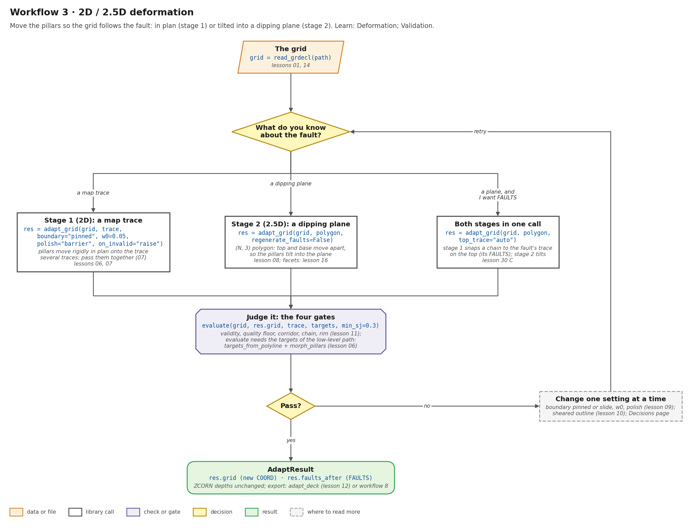
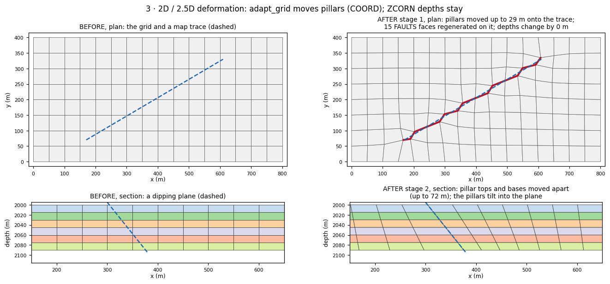
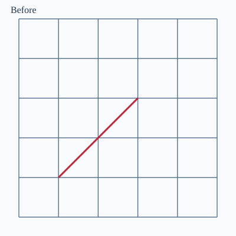
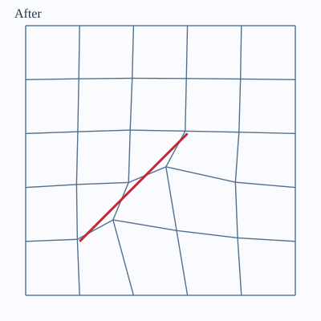

# Workflow 3 · 2D / 2.5D deformation

Move the pillars so the grid follows the fault, instead of making the
fault follow the grid.

- **Stage 1 (2D):** a map trace. Pillars move rigidly in plan onto
  the trace, and `FAULTS` are re-projected on the adapted grid.
- **Stage 2 (2.5D):** a dipping planar polygon. Each pillar's top and
  base move to different XY positions, so the pillars tilt into the
  plane.

Both change `COORD` only; `ZCORN` depths are unchanged.



## Steps

```python
import numpy as np
from cpg2unstructured import morph_pillars, read_grdecl
from fault_projections import adapt_grid, targets_from_polyline
from fieldbook.diagnostics import evaluate

grid = read_grdecl("FIELD.GRDECL")

# stage 1: a map trace (N, 2); several traces go in one list, together (lesson 07)
trace = np.array([[170.0, 70.0], [610.0, 330.0]])
res = adapt_grid(grid, trace, boundary="pinned", w0=0.05,
                 polish="barrier", on_invalid="raise")
res.grid, res.faults_after          # new COORD; FAULTS re-projected on it
res.ok, res.min_jacobian            # validity and the worst scaled Jacobian
print(res.summary())

# stage 2: a dipping plane, a coplanar (N, 3) polygon (lesson 08)
polygon = np.array([[300.0, 40.0, 2000.0], [300.0, 360.0, 2000.0],
                    [380.0, 360.0, 2090.0], [380.0, 40.0, 2090.0]])
res2 = adapt_grid(grid, polygon, regenerate_faults=False)

# both stages in one call: stage 1 snaps a chain to the plane's top trace (lesson 30 C)
res3 = adapt_grid(grid, polygon, top_trace="auto")

# the four gates need the targets, so use the low-level path (lessons 06, 11)
targets = targets_from_polyline(grid, trace)
morph = morph_pillars(grid, targets, boundary="pinned", smoothness="elastic",
                      w0=0.05, polish="barrier", on_invalid="raise")
gates = evaluate(grid, morph.grid, trace, targets, min_sj=0.3)
assert morph.ok and gates.ok, gates
```

1. **Read the grid** and run the read-only intake on a field deck
    ([Start with a read-only field-deck intake](../learn/validation.md#start-with-a-read-only-field-deck-intake)).
2. **Pick the stage from what you know about the fault.** A map trace
    is stage 1. A dipping plane is stage 2. Use `top_trace="auto"` for
    both: tilt, plus a `FAULTS` chain on the trace.
3. **Choose the settings.** The conditional starting point is pinned
    (or `slide` for a rim-to-rim fault on an axis-aligned outline),
    elastic, `w0=0.05`, barrier polish and `on_invalid="raise"`
    ([Which settings?](../decisions/settings.md)).
4. **Judge it with the four gates:** validity, quality floor,
    corridor, chain and rim
    ([Judge the adaptation](../learn/validation.md)). If a gate fails,
    change one setting at a time (lesson 09). A sheared outline needs
    `pinned` (lesson 10).
5. **Export** with `adapt_deck`, or the deck route in
    [workflow 8](field-deck.md).

## Before and after



- **Stage 1:** pillars move up to 29 m in plan onto the trace. The 15
  `FAULTS` faces are regenerated on the adapted grid, and depths
  change by 0 m.
- **Stage 2:** a polygon running from x = 300 m at the top to
  x = 380 m at the base. Each pillar's top and base move apart by up
  to 72 m, so the column of cells leans into the plane. Depths are
  still unchanged.

## Run the lessons

| Lesson | What it shows | Run | Read |
| --- | --- | --- | --- |
| 06 | the low-level path: targets → `morph_pillars` → gates | `python -m fieldbook.cli run 06_one_trace` | [Deformation](../learn/deformation.md) |
| 07 | two crossing traces passed together | `python -m fieldbook.cli run 07_crossing_traces` | [Deformation](../learn/deformation.md) |
| 08 | stage 2: a dipping polygon tilts the pillars | `python -m fieldbook.cli run 08_dipping_fault` | [Deformation](../learn/deformation.md) |
| 16 | a faceted fault: one target row per facet | `python -m fieldbook.cli run 16_faceted_fault` | [Deformation](../learn/deformation.md) |
| 09 | one setting at a time | `python -m fieldbook.cli run 09_settings` | [Which settings?](../decisions/settings.md) |
| 10 | a sheared outline: `slide` moves the rim | `python -m fieldbook.cli run 10_sheared_rim` | [Outline trap](../cases/outline-trap.md) |
| 11 | the four gates | `python -m fieldbook.cli run 11_four_gates` | [Validation](../learn/validation.md) |
| 15 | before/after drawings on one scale | `python -m fieldbook.cli run 15_visualize --out output/figures` | [Visual inspection](../learn/validation.md#visual-inspection-uses-the-same-scale-for-before-and-after) |
| 18 | a one-trace case dossier | `python -m fieldbook.cli run 18_case_dossier --out output/dossier` | [One-trace case](../cases/one-trace.md) |

Source: [examples/](https://github.com/arturcastiel/cpg-fault-fieldbook/tree/main/examples).
Method pages: [`adapt_grid`](../functions/adapt-grid.md),
[`morph_pillars`](../functions/morph-pillars.md),
[Trace targets](../functions/targets-corridors.md).

| Before (lesson 15) | After (lesson 15) |
| --- | --- |
|  |  |

## Checks and limits

- `ok=True` is validity only. It does not check the corridor or the
  quality floor, and it does not certify the deck for a simulator
  ([Quality trap](../cases/quality-trap.md)).
- `free` boundaries can fit the trace by moving the reservoir
  footprint ([Outline trap](../cases/outline-trap.md)).
- Stage 2 does not write 3D `FAULTS`. For that, use
  [workflow 2](full-3d.md) on the adapted grid.
- Adapting moves pillars in XY only. To set a dip **angle**, use
  [workflow 6](dip-angle.md). To offset the layers, use
  [workflow 4](slide.md) or [workflow 5](slide-pillars.md).
- See [Failure modes](../functions/adapt-grid.md#failure-modes-and-limitations)
  and [Limits](../reference/limits.md).
