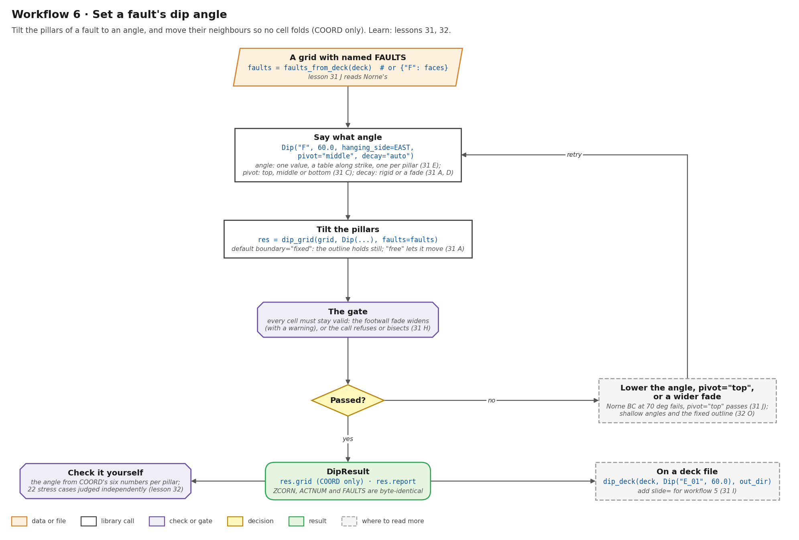
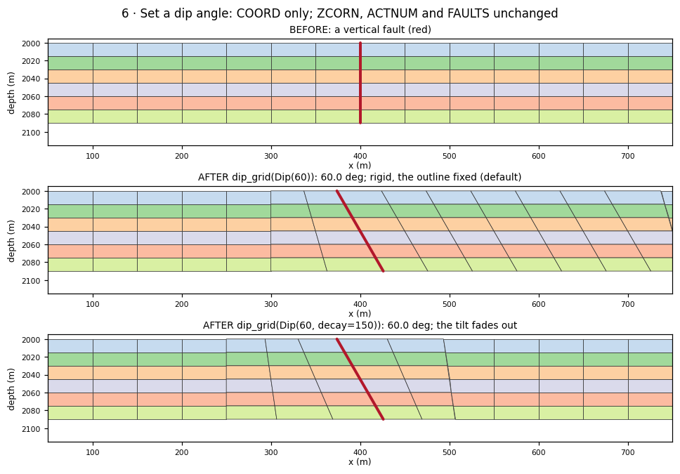
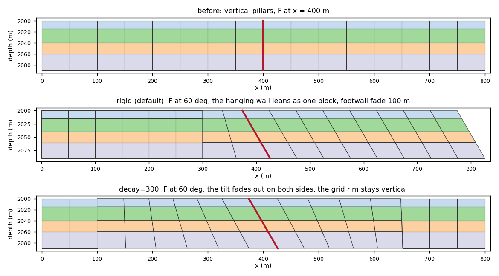
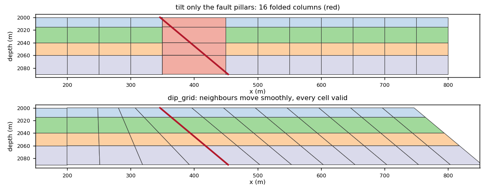
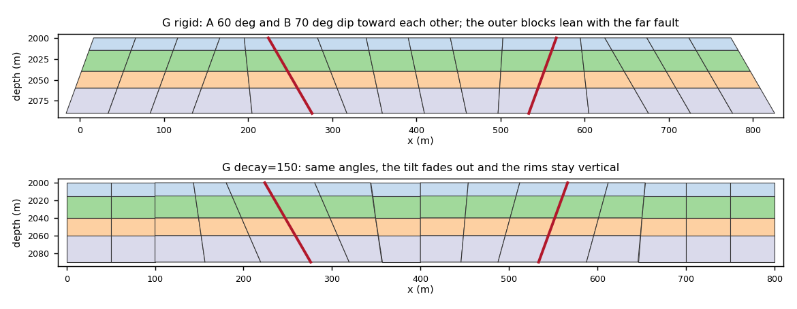

# Workflow 6 · Set a fault's dip angle

Tilt the pillars of a fault to a chosen angle, and move their
neighbours so no cell folds. Only `COORD` changes. `ZCORN`, `ACTNUM`
and `FAULTS` are byte-identical, so the fault stays on the same
pillar lines.



## Steps

```python
import numpy as np
from cpg2unstructured import read_grdecl
from fault_projections import Dip, dip_deck, dip_grid, fault_faces_for, faults_from_deck

grid = read_grdecl("FIELD.GRDECL")
EAST = (575.0, 150.0)                         # a plan point on the hanging wall
faults = faults_from_deck("FIELD.GRDECL")     # or {"F": faces}
f1 = fault_faces_for(grid, [np.array([[400.0, -1.0], [400.0, 401.0]])])

res = dip_grid(grid, Dip(f1, 60.0, hanging_side=EAST, name="F"))
# by name, with options:
#   dip_grid(grid, Dip("F1", 60.0, hanging_side=EAST, pivot="top", decay=150.0),
#            faults=faults, boundary="fixed", on_invalid="raise")

assert res.ok                                 # the gate passed, the grid re-processes
res.realized_dip("F")                         # (arc length, degrees) per chain pillar
res.modes, res.volume_change                  # "rigid" or "decay"; per-cell change
print(res.summary()); print(res.report())

# on a deck file: writes the grid INCLUDE and a report
dip_deck("FIELD.GRDECL", Dip("F1", 60.0, hanging_side=EAST), "out")
```

1. **Name the fault.** Use a deck's `FAULTS`, read through `INCLUDE`
    (`faults_from_deck`), or pass faces. A vertical fault needs
    `hanging_side`.
2. **Say what angle.** The `Dip` options are:
    - `angle`: one value, a table along strike, or one per pillar (31 E);
    - `pivot`: the depth that keeps its plan position (`top`, `middle`
      or `bottom`, 31 C);
    - `decay`: `"auto"` is rigid for a fault that cuts the grid in two
      and a fade for one with a tip (31 A, D).
3. **Tilt.** The outline holds still by default (`boundary="fixed"`).
    `"free"` lets it lean (31 A).
4. **The gate** checks every cell, in plan and in 3D. If a cell
    fails, the fades double up to `widen` times, with a warning. If it
    still fails, `on_invalid` raises, bisects (the angle is then **not**
    reached), or ignores (31 H).
5. **If it refuses,** try a different `pivot`, a smaller change, or a
    longer `decay`/`footwall`, in that order, and read `summary()` each
    time (Norne BC: 31 J).
6. **Check it yourself.** A pillar's six `COORD` numbers give its
    angle ([Check every number yourself](../learn/fault-dip.md#check-every-number-yourself)).

## Before and after



A vertical fault at x = 400 m. With `Dip(60)` and the default fixed
outline it reaches 60.0°: the hanging wall moves rigidly and the
footwall fades. With `decay=150` it also reaches 60.0°, but the tilt
fades out within 150 m. Depths are the same in all three panels.

## Run the lessons

| Lesson | What it shows | Run | Read |
| --- | --- | --- | --- |
| 31 A–J | free / fixed / decay, why the neighbours move, pivot, tips, angle tables, staircase, graben, the gate, decks, Norne | `python -m fieldbook.cli run 31_fault_dip` | [Set a dip angle](../learn/fault-dip.md) |
| 32 A–V | 22 hard cases, judged independently of the library | `python -m fieldbook.cli run 32_fault_dip_stress` | [Stress tests](../learn/fault-dip-stress.md) |

Source: [31_fault_dip.py](https://github.com/arturcastiel/cpg-fault-fieldbook/blob/main/examples/31_fault_dip.py),
[32_fault_dip_stress.py](https://github.com/arturcastiel/cpg-fault-fieldbook/blob/main/examples/32_fault_dip_stress.py).
Method page: [Fault dip](../functions/fault-dip.md).

| Question | Section |
| --- | --- |
| rigid, fixed outline, or decay? | [A](../learn/fault-dip.md#a-a-60-dip-free-fixed-outline-or-decay) |
| why do the neighbours move? | [B](../learn/fault-dip.md#b-why-the-neighbours-must-move) |
| which depth stays put? | [C](../learn/fault-dip.md#c-the-pivot-which-depth-stays-put) |
| a fault with a tip | [D](../learn/fault-dip.md#d-a-fault-with-a-tip) |
| an angle along strike | [E](../learn/fault-dip.md#e-an-angle-that-varies-along-strike) |
| a stair-stepped diagonal | [F](../learn/fault-dip.md#f-a-stair-stepped-diagonal-fault) |
| two faults, a graben | [G](../learn/fault-dip.md#g-a-graben-two-faults-dipping-toward-each-other) |
| the gate refuses | [H](../learn/fault-dip.md#h-the-gate-widening-refusing-bisecting) |
| a field deck | [J](../learn/fault-dip.md#j-a-field-deck-norne), [stress V](../learn/fault-dip-stress.md#v-norne) |
| shallow angles | [stress O](../learn/fault-dip-stress.md#o-shallow-angles-and-the-fixed-outline) |

| Rigid vs decay (31 A) | Why the neighbours move (31 B) |
| --- | --- |
|  |  |



## Checks and limits

- A dip moves no `ZCORN`. For a throw, slide afterwards
  ([workflow 5](slide-pillars.md)).
- It does not change `FAULTS`, so it cannot move a fault in plan;
  for that, use [workflow 3](deformation.md).
- It is not volume-neutral cell by cell; read `volume_change`.
- Angles must be in (0°, 90°].
- See [What a dip does not do](../learn/fault-dip.md#what-a-dip-does-not-do),
  [Failure modes](../functions/fault-dip.md#failure-modes-and-limitations)
  and [Limits](../reference/limits.md).

## Next

- Keep the tilt inside a band: [workflow 7](fault-zones.md).
- Tilt and slide: [workflow 5](slide-pillars.md).
