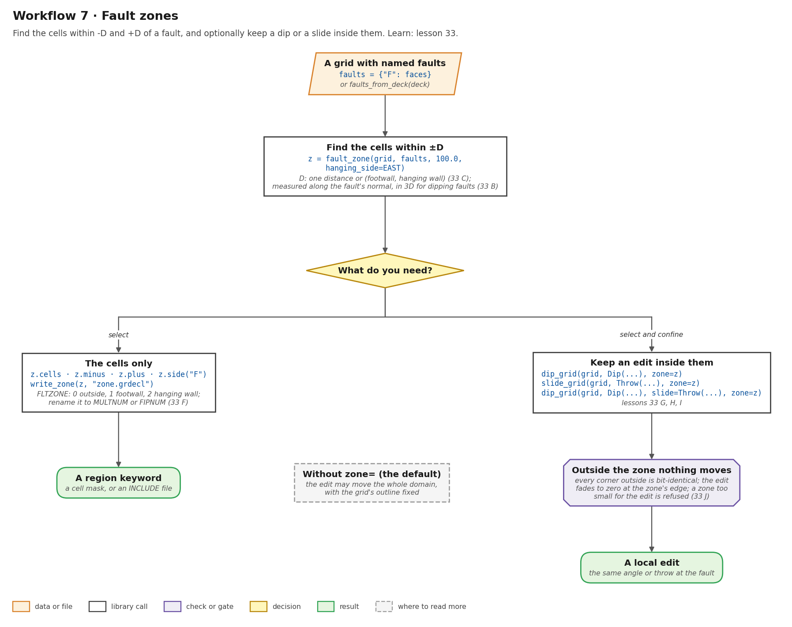
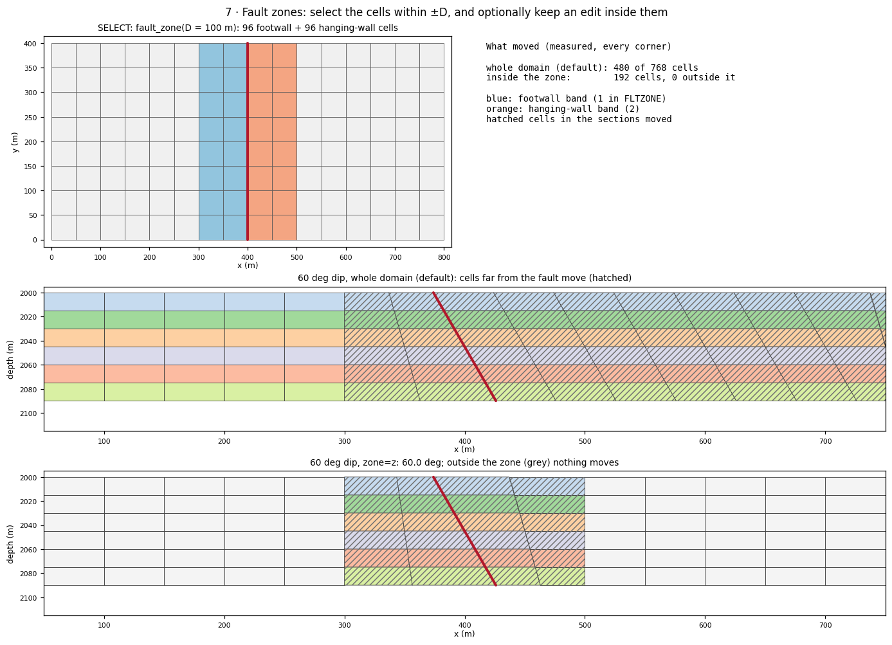
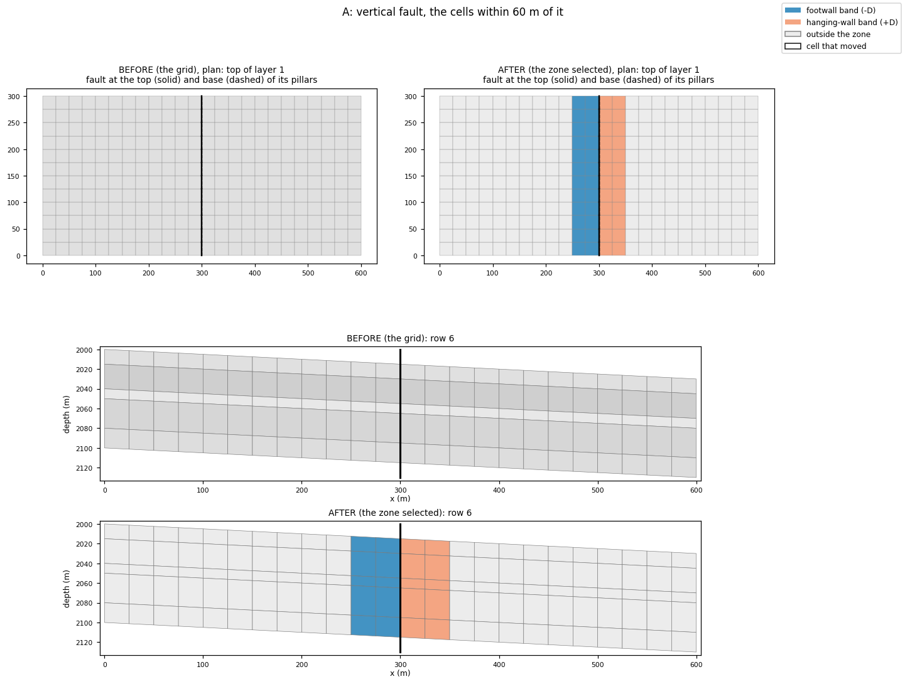
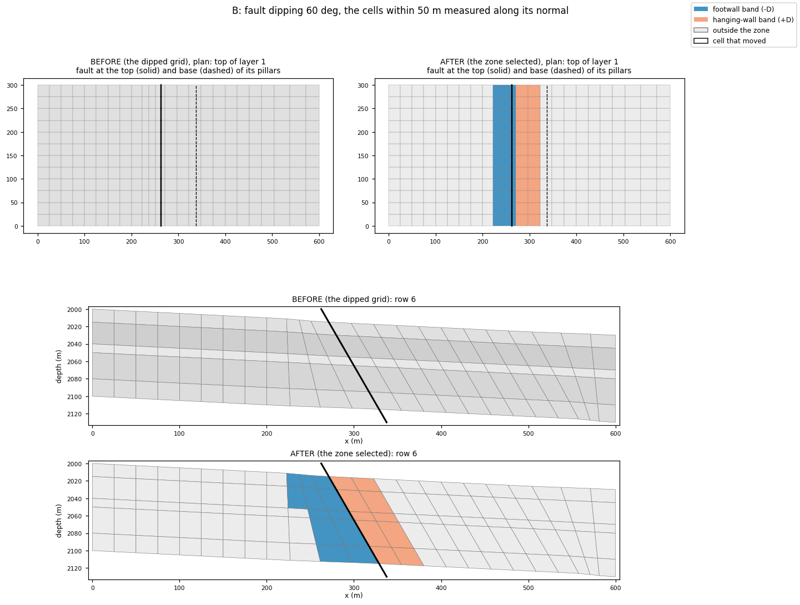
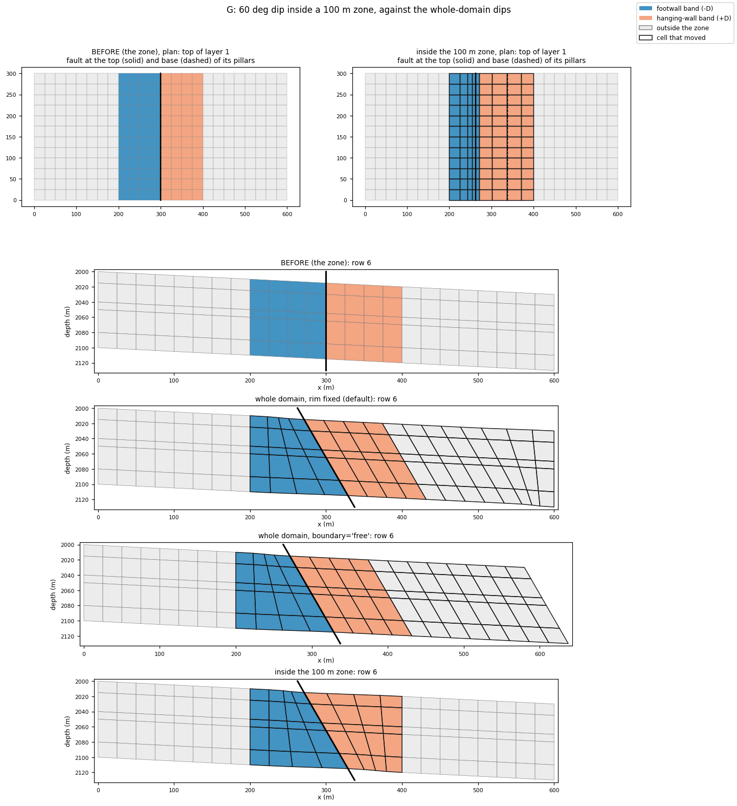
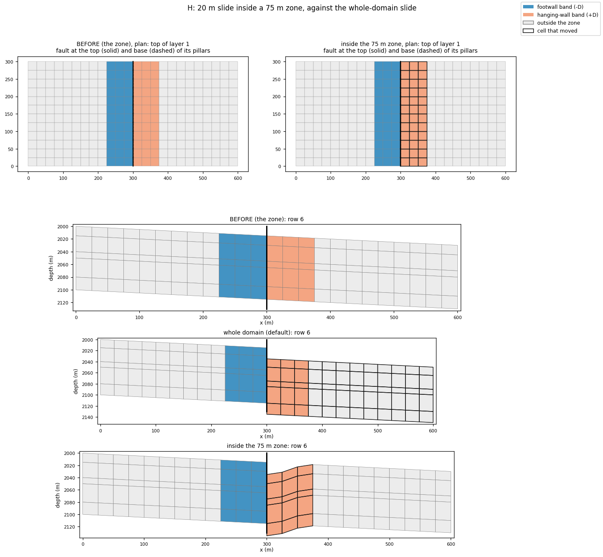

# Workflow 7 · Fault zones

There are two separate features here:

- **Select** the cells within −D and +D of a fault. `fault_zone`
  measures each cell centre's distance along the fault's normal, and
  never changes the grid.
- **Confine** (optional): pass the zone as `zone=` to `dip_grid` or
  `slide_grid`, and only cells inside it deform.

**The default is no zone.** A dip or slide may then move the whole
domain, with the grid's outline fixed.



## Steps

```python
import numpy as np
from cpg2unstructured import read_grdecl
from fault_projections import (Dip, Throw, dip_grid, fault_faces_for, fault_zone, slide_grid,
                               write_zone)

grid = read_grdecl("FIELD.GRDECL")
EAST = (575.0, 150.0)                       # the hanging wall is "+"
f1 = fault_faces_for(grid, [np.array([[400.0, -1.0], [400.0, 401.0]])])
faults = {"F": f1}                          # or faults_from_deck(deck)

# select: the cells within 100 m (or (D_footwall, D_hanging_wall))
z = fault_zone(grid, faults, 100.0, hanging_side=EAST)
z.cells, z.minus, z.plus                    # bool (NX, NY, NZ): either, footwall, hanging wall
z.side("F"), z.counts(), z.summary()        # -1 / 0 / +1;  {name: (fw, hw)}
write_zone(z, "zone.grdecl")                # FLTZONE: 0 outside, 1 footwall, 2 hanging wall
write_zone(z, "multnum.grdecl", keyword="MULTNUM")

# confine (optional): only cells of the zone may move
d = dip_grid(grid, Dip(f1, 60.0, hanging_side=EAST, name="F"), zone=z)
s = slide_grid(grid, Throw(f1, 20.0, hanging_side=EAST, name="F"), zone=75.0)
ds = dip_grid(grid, Dip(f1, 60.0, hanging_side=EAST, name="F"),
              slide=Throw(f1, 15.0, hanging_side=EAST, name="F"), zone=z)
assert not (d.moved & ~z.cells).any()       # nothing outside the zone moved
```

1. **Name the faults.** Use a deck's `FAULTS` as they are, or
    `{name: faces}`.
2. **Find the cells.** D is one distance or `(footwall, hanging wall)`
    (33 C). It is measured from each cell centre along the fault's
    normal, in 3D for a dipping fault (33 B).
3. **Select only?** Use the masks, or write a region keyword. The
    default `FLTZONE` can be renamed to `MULTNUM` or `FIPNUM` (33 F).
4. **Or confine an edit.** Pass `zone=` (a `FaultZone`, `D` or
    `(D_fw, D_hw)`) to `dip_grid`, `slide_grid` or `dip_grid(slide=...)`
    (33 G, H, I). Inside the zone the change fades to zero at its edge.
    Outside it, every corner is bit-identical.
5. **If it is refused,** the zone is too narrow for the edit. Widen
    it or ask for less (33 J).

## Before and after



`fault_zone(D = 100 m)` around a vertical fault at x = 400 m selects
96 footwall and 96 hanging-wall cells. A 60° dip over the whole
domain (the default) moves 480 of 768 cells, some of them far from
the fault. With `zone=z` it still reaches 60.0°, but only 192 cells
move, and **0** outside the zone.

## Run the lessons

| Lesson | What it shows | Run | Read |
| --- | --- | --- | --- |
| 33 A–E | selection: vertical, dipping, asymmetric, curved, two faults | `python -m fieldbook.cli run 33_fault_zone` | [Fault zones](../learn/fault-zone.md) |
| 33 F | export as `FLTZONE`, read back | (same run) | [F. Export](../learn/fault-zone.md#f-export-as-a-grdecl-region-keyword) |
| 33 G, H, I | a confined dip, slide, and both | (same run) | [G](../learn/fault-zone.md#g-a-confined-dip-the-whole-domain-vs-inside-100-m), [H](../learn/fault-zone.md#h-a-confined-slide-20-m-inside-75-m), [I](../learn/fault-zone.md#i-dip-and-slide-confined-together) |
| 33 J | refusals: a zone too small | (same run) | [J. Refusals](../learn/fault-zone.md#j-refusals-when-a-zone-is-too-small) |
| 33 K | Norne, when present | (same run) | [K. Norne](../learn/fault-zone.md#k-a-field-deck-norne) |

Source: [33_fault_zone.py](https://github.com/arturcastiel/cpg-fault-fieldbook/blob/main/examples/33_fault_zone.py).
Method page: [Fault zones](../functions/fault-zone.md).

| Selection (33 A) | Selection, dipping fault (33 B) |
| --- | --- |
|  |  |

| Confined dip (33 G) | Confined slide (33 H) |
| --- | --- |
|  |  |

## Checks and limits

- A selection is not an edit: `fault_zone` never changes the grid.
- A confined edit is not gentler on its cells. The whole change is
  taken up inside the zone, so those cells deform more (33 G).
- The zone is measured on the input grid. After a dip, measure a new
  zone on the result if you need one.
- Membership is by cell centre.
- See [What a zone does not do](../learn/fault-zone.md#what-a-zone-does-not-do),
  [Failure modes](../functions/fault-zone.md#failure-modes-and-limitations)
  and [Limits](../reference/limits.md).
