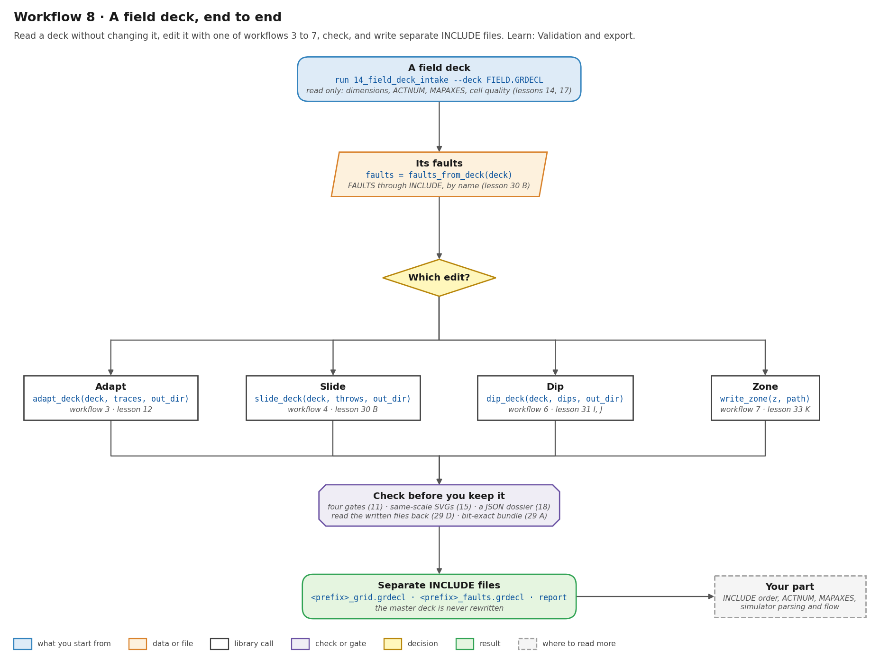
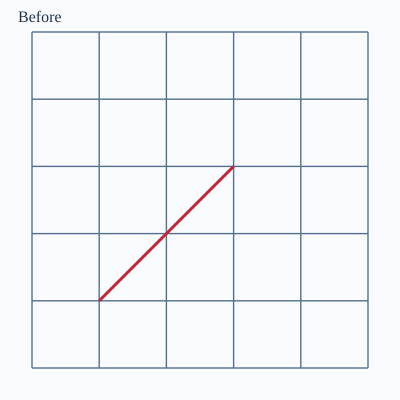
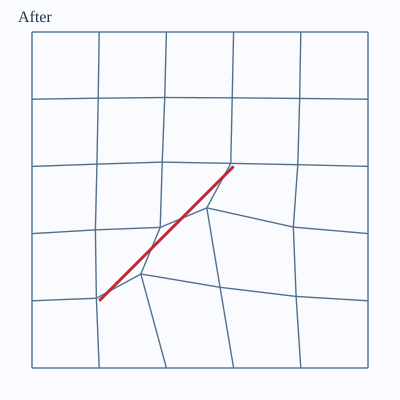
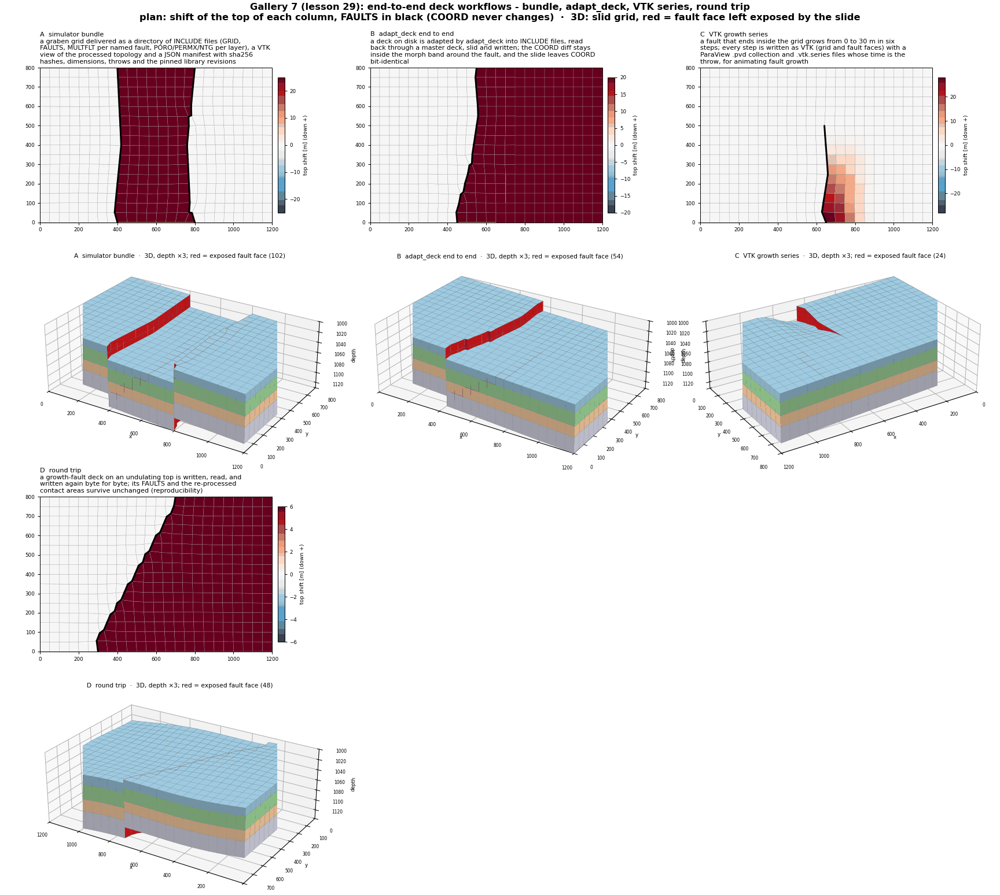
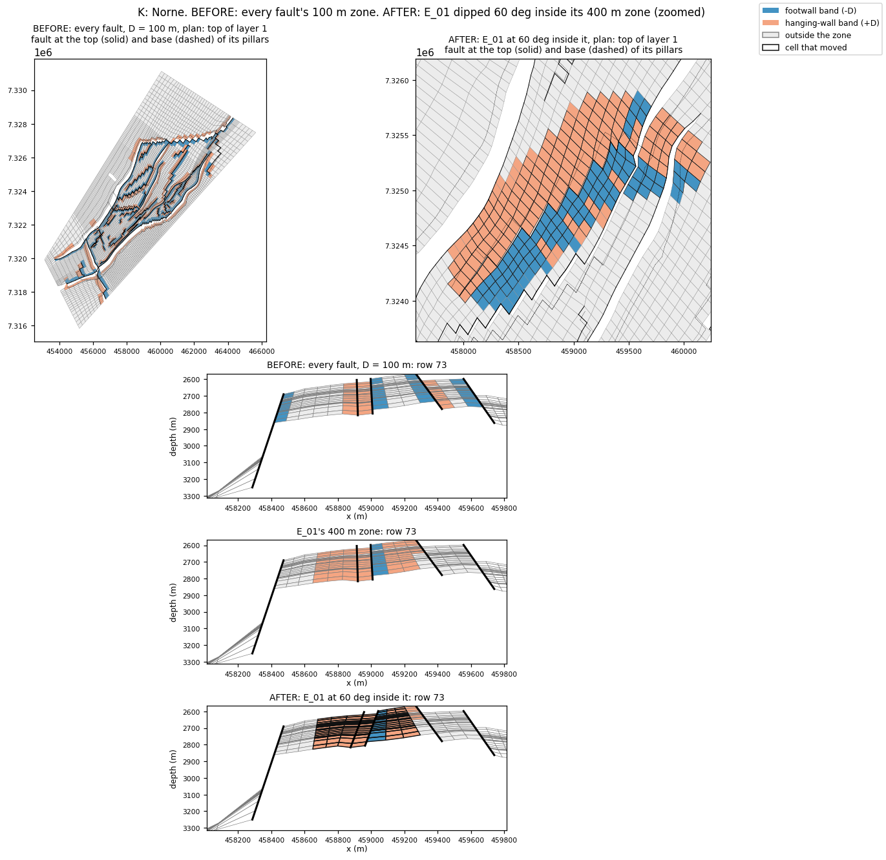

# Workflow 8 · A field deck, end to end

Read a deck without changing it, make one of the edits from
workflows 3 to 7, check the result, and write **separate** `INCLUDE`
files. The master deck is never rewritten. You decide what goes into
it.



## Steps

```bash
python -m fieldbook.cli run 14_field_deck_intake --deck FIELD.GRDECL   # read only
```

```python
import numpy as np
from cpg2unstructured import read_grdecl
from fault_projections import (Dip, Throw, adapt_deck, dip_deck, fault_zone, faults_from_deck,
                               slide_deck, write_zone)

deck = "FIELD.GRDECL"
EAST = (575.0, 150.0)                          # a plan point on F1's hanging wall
faults = faults_from_deck(deck)                # {name: faces}; INCLUDE is followed
print({name: len(faces) for name, faces in faults.items()})

# one edit; each writes into its own out_dir and never touches the deck
trace = np.array([[170.0, 70.0], [610.0, 330.0]])
a = adapt_deck(deck, [trace], "out/adapt", prefix="case_a",
               boundary="pinned", on_invalid="raise")                     # workflow 3
s = slide_deck(deck, Throw("F1", 5.0, hanging_side=EAST), "out/slide")    # workflow 4
d = dip_deck(deck, Dip("F1", 60.0, hanging_side=EAST), "out/dip")         # workflow 6
z = fault_zone(read_grdecl(deck), faults, 100.0, hanging_side=EAST)       # workflow 7
write_zone(z, "fltzone.grdecl")

# read back what was written, not what is in memory
back = read_grdecl(d.grid_path)
print(d.realized_dip("F1", grid=back))
print(a.grid_path, a.faults_path, s.grid_path, s.report_path, d.report_path)
```

1. **Intake, read only** (lesson 14). It reports dimensions,
    `ACTNUM`, the coordinate frame (`MAPAXES`, lesson 17), and quality
    on both planes. It does not declare the deck valid.
2. **Read its faults by name.** `faults_from_deck` follows `INCLUDE`.
    A `FAULTS` K range other than 1 to NZ slides as a blind fault.
3. **Pick the edit.** Each `*_deck` call is the in-memory workflow
    plus the writing:

    | Edit | Call | Writes | Workflow |
    | --- | --- | --- | --- |
    | adapt | `adapt_deck(deck, traces, out_dir)` | `<prefix>_grid.grdecl` (`COORD`), `<prefix>_faults.grdecl` | [3](deformation.md), [5](slide-pillars.md) |
    | slide | `slide_deck(deck, throws, out_dir)` | `<prefix>_grid.grdecl`, `<prefix>_report.txt` | [4](slide.md) |
    | dip | `dip_deck(deck, dips, out_dir)` | `<prefix>_grid.grdecl`, `<prefix>_report.txt` | [6](dip-angle.md), [5](slide-pillars.md) |
    | zone | `write_zone(fault_zone(...), path)` | a region keyword (`FLTZONE`) | [7](fault-zones.md) |

4. **Check before you keep it.** The checks are:
    - the four gates (lesson 11);
    - same-scale before/after drawings (15);
    - a JSON case dossier (18);
    - reading the written files back (29 D), and a bit-exact bundle
      (29 A).
5. **Use it.** Add `INCLUDE '<prefix>_grid.grdecl' /` to a copy of the
    deck in place of the grid. `INCLUDE` order, `ACTNUM`, `MAPAXES`,
    other keywords, simulator parsing and flow are your part.

## Before and after

| Before (lesson 15) | After (lesson 15) |
| --- | --- |
|  |  |



On Norne (46 × 112 × 22 cells, 44,927 active), when it is on the
machine:

- `slide_deck` gives E_01 5 m and BC 3 m. 8 faces open, none outside
  `FAULTS` (lesson 30 B).
- `dip_deck` sets E_01 to 60°, read back as 60.000000°. BC at 70°
  fails with the middle pivot and passes with `pivot="top"`
  (lesson 31 J).
- `fault_zone` selects 100 m bands around all 61 faults. E_01 is
  set to 60° inside 400 m, and 0 of the 108,203 cells outside the
  zone move (lesson 33 K).



## Run the lessons

| Lesson | What it shows | Run | Read |
| --- | --- | --- | --- |
| 14 | read-only intake of your deck | `python -m fieldbook.cli run 14_field_deck_intake --deck FIELD.GRDECL` | [Intake](../learn/validation.md#start-with-a-read-only-field-deck-intake) |
| 17 | `MAPAXES`: raw-local vs world frames | `python -m fieldbook.cli run 17_mapaxes_guard` | [Grids](../learn/grids.md) |
| 12 | export separate `INCLUDE` files | `python -m fieldbook.cli run 12_export_includes --out output/one` | [Validation](../learn/validation.md) |
| 15 | same-scale before/after SVGs | `python -m fieldbook.cli run 15_visualize --out output/figures` | [Visual inspection](../learn/validation.md#visual-inspection-uses-the-same-scale-for-before-and-after) |
| 18 | a case dossier | `python -m fieldbook.cli run 18_case_dossier --out output/dossier` | [One-trace case](../cases/one-trace.md) |
| 29 | bundle, `adapt_deck`, VTK series, round trip | `python -m fieldbook.cli run 29_gallery_export_workflows` | [Gallery 7](../learn/gallery.md#7-end-to-end-deck-workflows-lesson-29) |
| 30 | `adapt_deck(slide=...)`, `slide_deck` on a field deck | `python -m fieldbook.cli run 30_deck_slide_workflows --deck FIELD.GRDECL --throw F1=5` | [`slide_deck`](../functions/fault-slide.md#slide_deck) |
| 31 J, 32 V, 33 K | Norne: dip, stress, zones | `python -m fieldbook.cli run 31_fault_dip` (and 32, 33) | [J. Norne](../learn/fault-dip.md#j-a-field-deck-norne) |

The Norne cases run when `CPG_NORNE_GRDECL` points at the deck
(see lesson 30's header).

## Checks and limits

- Nothing here establishes simulator readiness. A written `INCLUDE`
  and four passing gates are not acceptance.
- `adapt_deck` is for GRDECL text decks. With
  `regenerate_faults=False` there is no `FAULTS` `INCLUDE`.
- See [Judge the adaptation](../learn/validation.md),
  [Data](../reference/data.md) and [Limits](../reference/limits.md).
