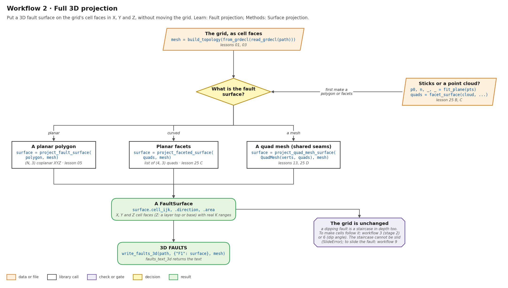
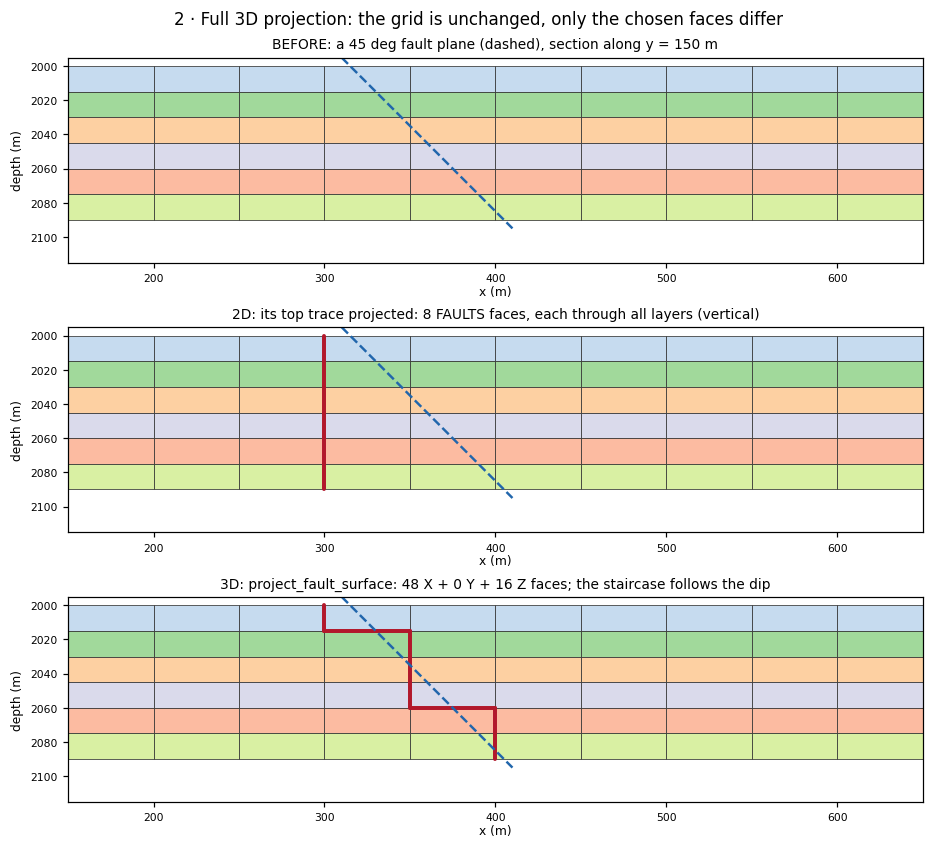
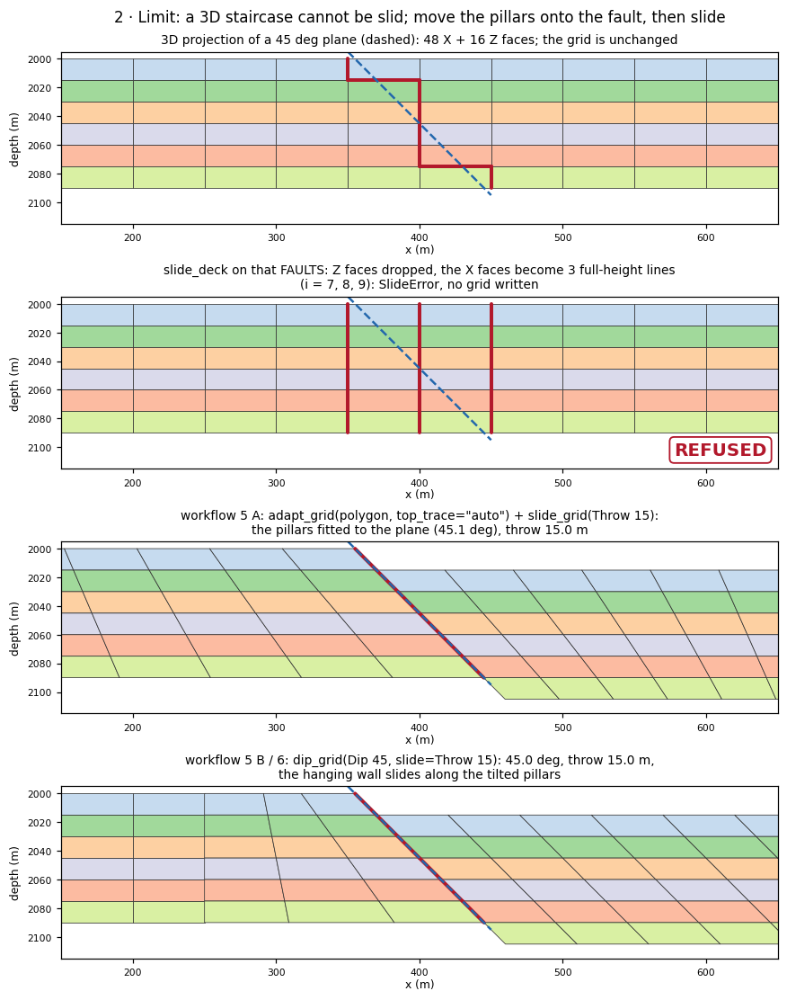
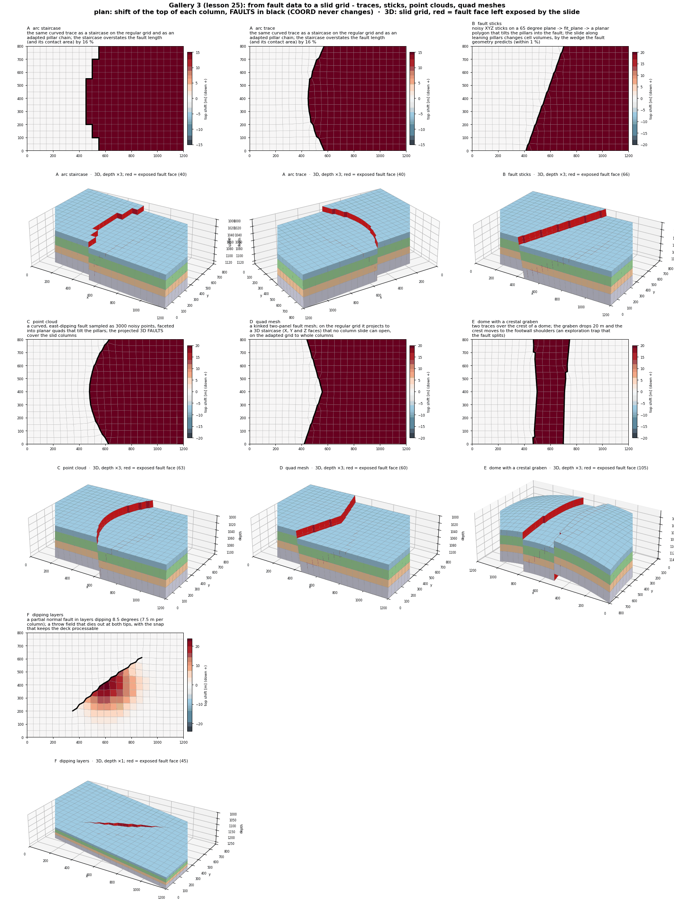

# Workflow 2 · Full 3D projection

Put a 3D fault surface on the grid's cell faces, in X, Y **and** Z,
with real K ranges, without moving the grid. A dipping fault becomes
a staircase in depth as well as in plan.



## Steps

```python
import numpy as np
from cpg2unstructured import build_topology, from_grdecl, read_grdecl
from fault_projections import QuadMesh, faults_text_3d, project_fault_surface, write_faults_3d

mesh = build_topology(from_grdecl(read_grdecl("FIELD.GRDECL")))

# a planar polygon: (N, 3) coplanar XYZ; here a 45 degree plane
polygon = np.array([[310.0, -10.0, 1995.0], [310.0, 410.0, 1995.0],
                    [410.0, 410.0, 2095.0], [410.0, -10.0, 2095.0]])
surface = project_fault_surface(polygon, mesh)
# planar facets:  surface = project_faceted_surface(quads, mesh)   # list of (4, 3) quads
# a quad mesh:    surface = project_quad_mesh_surface(QuadMesh(verts, quads), mesh)

surface.face_ids                           # the selected cell faces (any input)
surface.cell_ijk, surface.direction        # polygon/facets: cell pairs, 0 = X, 1 = Y, 2 = Z
                                           # (empty for a quad mesh)
write_faults_3d("faults3d.grdecl", {"F1": surface}, mesh)   # faults_text_3d returns the text
```

1. **Build the cell-face mesh** of the grid
    ([lesson 03](../learn/grids.md)).
2. **Choose the call for your surface:** one planar polygon
    (lesson 05), planar facets (lesson 25 C) or a quad mesh with shared
    seams (lessons 13, 25 D). Sticks or a point cloud: fit a plane
    (`fit_plane`, lesson 25 B) or build facets (`facet_surface`,
    lesson 25 C) first.
3. **Write 3D `FAULTS`.** Z faces are a layer's top or base.

## Before and after



The same 45° plane, two ways. Projecting only its top trace
([workflow 1](stair-step.md)) gives 8 vertical faces through every
layer, at x = 300 m all the way down. Projecting the surface gives
48 X faces and 16 Z faces (0 Y faces; the plane strikes north), and
the staircase follows the dip. The grid is the same in all three
panels.

## Can I slide it afterwards? Not the staircase

A full 3D projection only marks faces, and the faces of a dipping
fault cannot be slid. A slide moves cell corners only up and down
their own pillars (`ZCORN`). It takes a fault as whole column faces,
`FaultFace(i, j, "X" | "Y")` over one K range. A dipping staircase
crosses the pillars instead:

- its Z steps (a layer's top or base) have no pillar to slide along;
- its X faces sit on several pillar lines, one per depth step.

`slide_deck` on the 3D `FAULTS` drops the Z faces, sees the X faces
as parallel full-height lines, and refuses with `SlideError`. It
writes nothing.

To slide a dipping fault, first move the pillars onto it, then slide
along them ([workflow 9](slide-3d.md) starts from the surface;
[workflow 5](slide-pillars.md) explains the two routes):

- **A.** fit the pillars to the same polygon:
  `adapt_grid(grid, polygon, top_trace="auto")`, then `slide_grid`;
- **B.** tilt a vertical fault to the angle:
  `dip_grid(grid, Dip(faces, 45.0, ...), slide=Throw(...))`
  ([workflow 6](dip-angle.md)).



Measured on the same grid, with a 45° plane through x = 355 m at the
top and x = 445 m at the base:

| | Result |
| --- | --- |
| 3D projection | 48 X + 16 Z faces; the grid is unchanged |
| `slide_deck(deck, Throw("F", 15.0, ...))` | the X faces become 3 lines (i = 7, 8, 9); `SlideError: F: a slid fault must be one branch-free chain` |
| A: `adapt_grid(top_trace="auto")` + `slide_grid` | pillar line 7 fitted to the plane, 45.1°; throw 15.0 m; 0 unexpected faces |
| B: `dip_grid(Dip 45, slide=Throw 15)` | 45.0°; throw 15.0 m |

Two cases differ:

- **A vertical fault** projected in 3D has X and Y faces only, so it
  can be slid. If its `FAULTS` cut only some layers, `slide_deck`
  uses that K range as `Throw.layers` ([workflow 4](slide.md)).
  Measured with a 10 m throw: a vertical plane through all layers
  slides 10.0 m at the top and the base; one through layers 1–3
  slides 10.0 m at the top and 0 at the base.
- **A horizontal fault** (Z faces only) cannot be slid or dipped:
  both refuse it with an error. Pillars run unbroken from top to
  base, so a corner-point grid cannot offset cells across a
  horizontal surface. Its 3D `FAULTS` still mark the faces for flow.

All three cases, from the surface to a slid grid, are
[workflow 9](slide-3d.md).

Shallow dips run out of room: with the default fixed outline, 15° is
refused where 30° passes
([lesson 32 O](../learn/fault-dip-stress.md#o-shallow-angles-and-the-fixed-outline)).

## Run the lessons

| Lesson | What it shows | Run | Read |
| --- | --- | --- | --- |
| 05 | a planar polygon onto X/Y/Z faces | `python -m fieldbook.cli run 05_project_surface` | [Fault projection](../learn/faults.md) |
| 13 | a quad mesh with a shared ridge (needs a sibling source checkout) | `python -m fieldbook.cli run 13_quad_surface --out output/quad` | [Fault projection](../learn/faults.md) |
| 25 B, C, D | sticks → `fit_plane`; a point cloud → facets; a kinked quad mesh | `python -m fieldbook.cli run 25_gallery_geometry_inputs` | [Gallery 3](../learn/gallery.md#3-from-fault-data-to-a-slid-grid-lesson-25) |

Source: [05_project_surface.py](https://github.com/arturcastiel/cpg-fault-fieldbook/blob/main/examples/05_project_surface.py),
[13_quad_surface.py](https://github.com/arturcastiel/cpg-fault-fieldbook/blob/main/examples/13_quad_surface.py),
[25_gallery_geometry_inputs.py](https://github.com/arturcastiel/cpg-fault-fieldbook/blob/main/examples/25_gallery_geometry_inputs.py).
Method page: [Surface projection](../functions/surface-projection.md).



## Checks and limits

- The grid is unchanged: a dipping fault is a staircase in depth.
  To make the cells follow it, tilt the pillars: stage 2 of
  [workflow 3](deformation.md), or [workflow 6](dip-angle.md).
- The staircase of a dipping fault cannot be slid (`SlideError`). To
  slide the fault, move the pillars onto it first
  ([above](#can-i-slide-it-afterwards-not-the-staircase),
  [workflow 9](slide-3d.md)).
- Independently projected quads can tear at a seam; a `QuadMesh`
  with shared vertices avoids it
  ([Surface projection](../functions/surface-projection.md#project_quad_mesh_surface)).
- See [Limits](../reference/limits.md).

## Next

- Slide the fault: [workflow 9](slide-3d.md).
- Make the cells follow it without a slide: [workflow 6](dip-angle.md).
