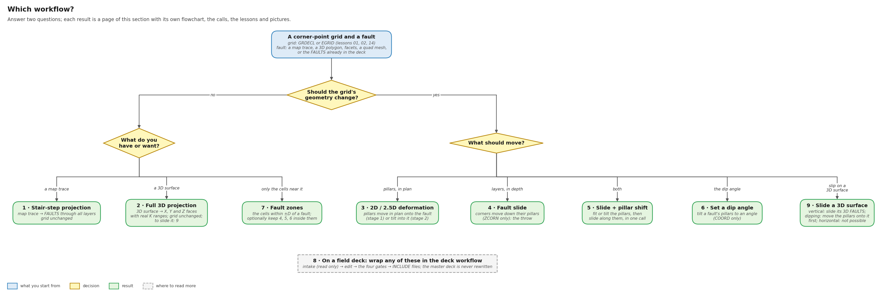
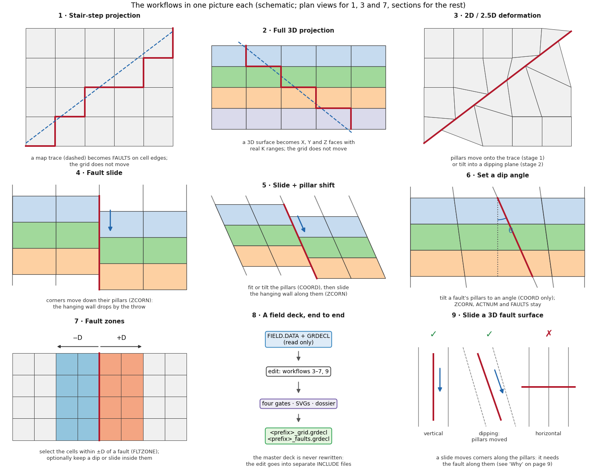
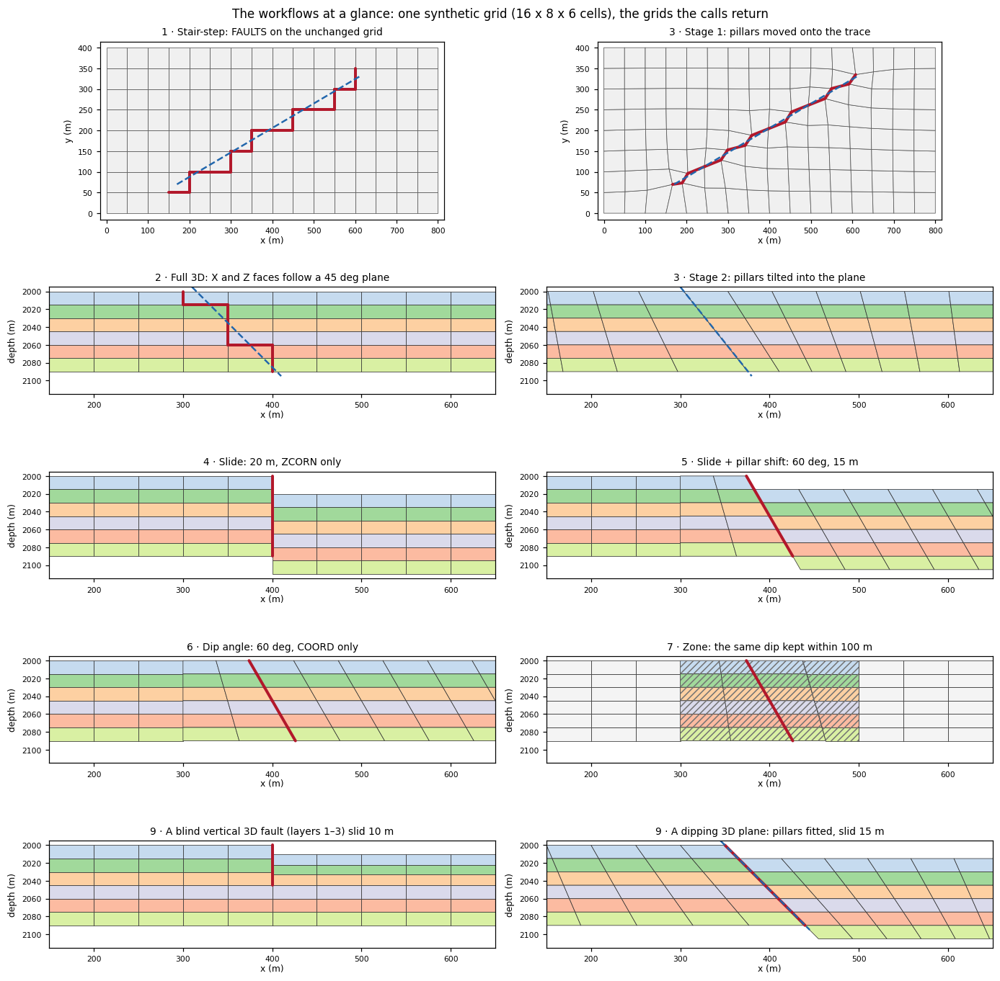

# Workflows: which tool, in which order

The [Learn](../learn/grids.md) pages teach one tool at a time. This
section starts from the job instead. Each workflow is a flowchart of
the calls in order. It links to the lessons and pages that show each
step, and shows a computed before-and-after picture.

## Which workflow?

Answer two questions: should the grid's geometry change, and if so,
what should move?

| # | Workflow | Changes | Use it when | Lessons |
| --- | --- | --- | --- | --- |
| 1 | [Stair-step projection](stair-step.md) | FAULTS only | you have a map trace and the grid must not move | 03, 04, 28 |
| 2 | [Full 3D projection](full-3d.md) | FAULTS only (X, Y and Z faces) | you have a 3D surface: a polygon, facets or a quad mesh (to slide it, use 9) | 05, 13, 25 |
| 3 | [2D / 2.5D deformation](deformation.md) | COORD (+ regenerated FAULTS) | the grid should follow the fault: in plan, or tilted into it | 06–12, 16, 30 C |
| 4 | [Fault slide](slide.md) | ZCORN only | the layers should be offset across a fault (the throw) | 19–22, 23–29 |
| 5 | [Slide + pillar shift](slide-pillars.md) | COORD, then ZCORN | the pillars should move and the layers slide along them | 21 B, 30 A, 30 C, 31 I |
| 6 | [Set a dip angle](dip-angle.md) | COORD only | a fault should dip at a given angle | 31, 32 |
| 7 | [Fault zones](fault-zones.md) | nothing, or a local edit | you need the cells within ±D of a fault, or want 4–6 kept inside them | 33 |
| 8 | [A field deck, end to end](field-deck.md) | separate INCLUDE files | any of 3–7 or 9 on a deck on disk | 11, 12, 14, 15, 17, 18, 29, 30, 31 J, 33 K |
| 9 | [Slide a 3D fault surface](slide-3d.md) | ZCORN; COORD too if it dips | you have a 3D surface and want the layers offset across it (a horizontal one cannot be) | 05, 25, 30 B, 30 C, 31 I |

What each workflow writes into the grid:

| Keyword | 1 | 2 | 3 | 4 | 5 | 6 | 7 (select) | 7 (confine) | 9 |
| --- | --- | --- | --- | --- | --- | --- | --- | --- | --- |
| COORD (pillars) | – | – | changes | – | changes | changes | – | changes, in the zone | – if vertical; changes if dipping |
| ZCORN (corner depths) | – | – | – | changes | changes | – | – | changes, in the zone (a slide) | changes |
| FAULTS | written | written (3D) | regenerated | kept | regenerated (`adapt_deck`) or kept (`dip_grid`) | kept | kept | kept | written (3D) if vertical; as 5 if dipping |
| a region keyword | – | – | – | – | – | – | `FLTZONE` | – | – |

## Each workflow in one picture

A drawn schematic of each workflow: what moves, and what stays. These
are sketches, one idea per panel; the computed pictures follow below
and on each workflow page.

## The workflows at a glance

The same synthetic grid (16 × 8 × 6 cells, 50 m by 15 m) run through
every workflow. Each panel is the grid a call returned. The sections
cut along the south faces of the cells in row J = 4 (y = 150 m), at
true scale, with the same depth range in every panel.

## What the workflows cannot do

Each limit below was measured in a lesson or on the synthetic grid of
this section. Most have a way around; two do not.

| Limit | Why | Way around | Read |
| --- | --- | --- | --- |
| A stair-step fault is longer than its trace: 1.35× at every resolution | `FAULTS` lie on cell edges | adapt the grid to the trace: 1.062× → 1.024× with refinement | [1](stair-step.md), lesson 28 B |
| A 3D projection does not move the grid | it only marks faces | tilt the pillars: [3](deformation.md) (stage 2) or [6](dip-angle.md) | [2](full-3d.md) |
| **The 3D staircase of a dipping fault cannot be slid** (`SlideError`) | a slide moves corners only along their pillars; the X faces sit on several pillar lines and the Z steps have no pillar | move the pillars onto the fault first, then slide (routes A and B) | [9](slide-3d.md) |
| **A horizontal fault cannot be slid or dipped** (`SlideError`, `DipError`) | pillars run unbroken from top to base | none on a corner-point grid; keep its 3D `FAULTS` as a flow barrier | [9](slide-3d.md#why-the-pillars-decide) |
| A slide does not move pillars: a vertical fault stays vertical | it edits `ZCORN` only | tilt first: [5](slide-pillars.md) or [6](dip-angle.md) | [4](slide.md) |
| A slid fault must be one branch-free chain (a ring is allowed) | the throw is laid out along one path | one fault per branch (lesson 24) | [Fault slides](../functions/fault-slide.md#failure-modes-and-limitations) |
| Route B tilts the nearest pillar line, up to half a cell off the plane (15 m measured) | `dip_grid` tilts existing pillar lines | route A moves the pillars onto the plane | [9](slide-3d.md#checks-and-limits) |
| A dip changes cell volumes (up to 21.65 % in lesson 31 A) | the cells beside a tilted pillar shear | check `volume_change`; `boundary="free"` keeps a hanging wall rigid | [6](dip-angle.md), [lesson 31](../learn/fault-dip.md#what-a-dip-does-not-do) |
| A shallow dip near a parallel side is refused (15° refused, 30° passes) | the default fixed outline leaves no room | `boundary="free"` or a `decay` distance | [lesson 32 O](../learn/fault-dip-stress.md#o-shallow-angles-and-the-fixed-outline) |
| `on_invalid="bisect"` keeps the grid valid but misses the angle (45° for 35°) | it scales the change back until the gate passes | widen the fades (the default) | [lesson 31 H](../learn/fault-dip.md#h-the-gate-widening-refusing-bisecting) |
| A zone too narrow for the change is refused (`ZoneError`) | the whole change must fit inside the zone | widen D | [7](fault-zones.md), [lesson 33 J](../learn/fault-zone.md#j-refusals-when-a-zone-is-too-small) |
| `boundary="slide"` can shear the outline while `ok` is true | it slides rim pillars in index space | prefer `boundary="pinned"` | [3](deformation.md), lesson 10 |
| A written `INCLUDE` is not a validated simulator deck | flow and transmissibility are not checked | run it in your simulator | [8](field-deck.md) |

The full list is in [Limits](../reference/limits.md).

## How to read the flowcharts

| Shape | Meaning |
| --- | --- |
| blue rounded box | what you start from |
| orange slanted box | data or a file |
| white box | a library call; blue text is the call itself |
| purple cut-corner box | a check or gate |
| yellow diamond | a decision |
| green rounded box | the result |
| red box | refused: the call raises and writes no grid |
| dashed grey box | a note, or where to read more |

Grey italic text names the lessons and pages: "lesson 31 E" is case E
of lesson 31. Each lesson runs with
`python -m fieldbook.cli run NN_name`; the lesson table on each
workflow page gives the exact command.

## How these figures are made

`python tools/figures/workflows.py` draws every figure in this
section into `docs/assets/workflows/`. The flowcharts are drawn with
matplotlib. The before-and-after pictures are not sketches: the
script calls `fault_faces_for`, `project_fault_surface`, `adapt_grid`,
`slide_grid`, `dip_grid` and `fault_zone` on the synthetic grid,
draws the grids they return, and prints the measured numbers into
the titles. It asserts what it draws: the adapted grid is valid, the
slide opens only FAULTS faces, nothing outside the zone moves, and
every refusal shown really raises. The one-picture-per-workflow
schematics and the "why the pillars decide" figure are drawn, not
computed.
