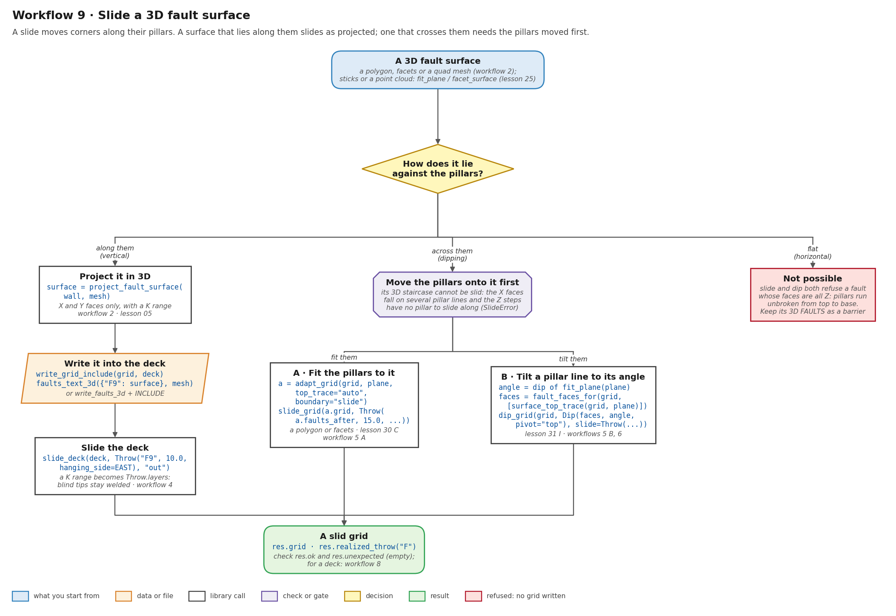
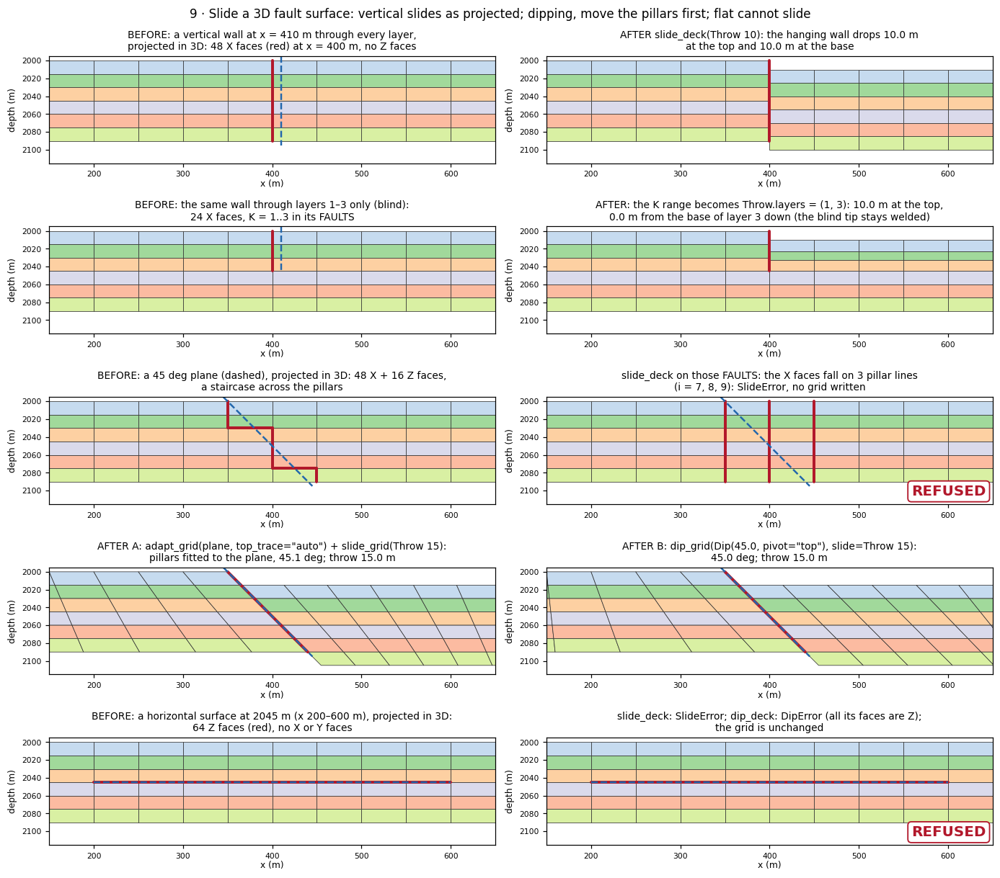
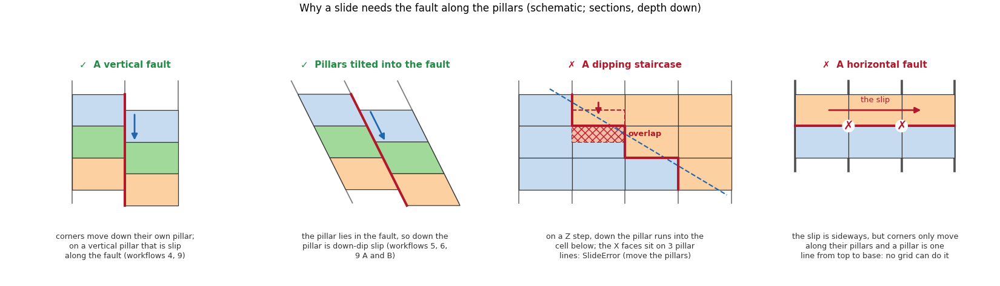

# Workflow 9 · Slide a 3D fault surface

Offset the layers across a fault you have as a 3D surface (a polygon,
facets, a quad mesh, sticks or a point cloud). What to do depends on
how the surface lies against the pillars, because a slide moves cell
corners only along their own pillars:

- **along them** (a vertical fault): project it in 3D and slide its
  `FAULTS` as they are;
- **across them** (a dipping fault): move the pillars onto it first,
  then slide along them;
- **flat** (a horizontal fault): not possible on a corner-point grid.



## Steps

```python
import numpy as np
from cpg2unstructured import (build_topology, fit_plane, from_grdecl, read_grdecl,
                              write_grid_include)
from fault_projections import (Dip, Throw, adapt_grid, dip_grid, fault_faces_for,
                               faults_text_3d, project_fault_surface, slide_deck, slide_grid,
                               surface_top_trace)

grid = read_grdecl("FIELD.GRDECL")
mesh = build_topology(from_grdecl(grid))
EAST = (575.0, 150.0)                         # a plan point on the hanging wall


def plane(x_top, z_top, x_base, z_base, y=(-10.0, 410.0)):
    """A planar polygon striking north: x_top at depth z_top, x_base at z_base."""
    return np.array([[x_top, y[0], z_top], [x_top, y[1], z_top],
                     [x_base, y[1], z_base], [x_base, y[0], z_base]])


# 1. along the pillars: a vertical wall through layers 1-3 (a blind fault)
wall = project_fault_surface(plane(410.0, 1995.0, 410.0, 2045.0), mesh)
assert set(wall.direction) <= {0, 1}          # X and Y faces only, no Z steps
write_grid_include(grid, "F9.grdecl")
with open("F9.grdecl", "a") as deck:
    deck.write("\n" + faults_text_3d({"F9": wall}, mesh))
res = slide_deck("F9.grdecl", Throw("F9", 10.0, hanging_side=EAST), "out")
assert res.ok and not res.unexpected          # K 1..3 became Throw.layers = (1, 3)

# 2. across the pillars: a 45 degree plane, reaching past the grid along strike
dipping = plane(345.0, 1995.0, 445.0, 2095.0, y=(-2000.0, 2000.0))

# A. fit the pillars to the plane, then slide along them
a = adapt_grid(grid, dipping, top_trace="auto", boundary="slide", w0=0.05,
               polish="barrier")              # a list of (4, 3) facets works too
slid = slide_grid(a.grid, Throw(a.faults_after, 15.0, hanging_side=EAST, name="F"))
assert a.ok and slid.ok and not slid.unexpected

# B. tilt the pillar line under the plane's top trace to the plane's angle, and slide
_, normal, _, _ = fit_plane(dipping)
angle = float(np.degrees(np.arccos(abs(normal[2]))))          # 45.0
faces = fault_faces_for(grid, [surface_top_trace(grid, dipping)])
b = dip_grid(grid, Dip(faces, angle, hanging_side=EAST, pivot="top", name="F"),
             slide=Throw(faces, 15.0, hanging_side=EAST, name="F"))
assert b.ok and b.slide.ok                    # b.slide.grid is dipped and slid

# 3. flat: a surface with Z faces only. slide_deck raises SlideError and dip_deck
#    raises DipError; keep its 3D FAULTS as a flow barrier (workflow 2).
```

1. **Look at how the surface lies against the pillars.** On a grid
    with vertical pillars, a vertical surface lies along them, a
    dipping one crosses them and a horizontal one lies across all of
    them. Sticks or a point cloud: fit a plane (`fit_plane`) or build
    facets (`facet_surface`) first
    ([lesson 25](../learn/gallery.md#3-from-fault-data-to-a-slid-grid-lesson-25)).
2. **Along the pillars:** project it in 3D
    ([workflow 2](full-3d.md)). It has X and Y faces only. Write them
    into a deck with `faults_text_3d` (or `write_faults_3d` and an
    `INCLUDE`) and slide the deck by name. If the surface cuts only
    some layers, `slide_deck` turns the `FAULTS` K range into
    `Throw.layers`, so the blind tips stay welded
    ([workflow 4](slide.md)).
3. **Across the pillars:** do not slide the 3D staircase; it is
    refused. Move the pillars onto the surface first, then slide along
    them ([workflow 5](slide-pillars.md)), by one of two routes:
    - **A.** `adapt_grid(grid, surface, top_trace="auto")` fits the
      pillars to the polygon or to a list of planar facets, so a
      kinked surface works too (lesson 30 C does it on a deck);
    - **B.** take the angle from `fit_plane`, the faces from
      `surface_top_trace` and `fault_faces_for`, and tilt them with
      `dip_grid(Dip(faces, angle, pivot="top"), slide=Throw(...))`
      ([workflow 6](dip-angle.md), lesson 31 I). It keeps the pillar
      line where it is.
4. **Flat:** stop. Pillars run unbroken from top to base, so no
    corner-point grid can offset cells across a horizontal surface.
5. **Check** `ok` and `unexpected`, as in every slide. On a field
    deck, wrap it in [workflow 8](field-deck.md).

## Before and after



All on the synthetic grid of this section (16 × 8 × 6 cells, 50 m ×
15 m, top at 2000 m), measured by the figure script:

| Surface | 3D projection | Slide | Result |
| --- | --- | --- | --- |
| vertical wall at x = 410 m, every layer | 48 X faces at x = 400 m, 0 Z | `slide_deck`, 10 m | 10.0 m at the top and at the base; 8 faces open, 0 unexpected |
| the same wall, layers 1–3 only | 24 X faces, K 1..3 | `slide_deck`, 10 m | 10.0 m at the top, 7.5 and 2.5 m at the bases of layers 1 and 2, 0 from the base of layer 3 down: the blind tip stays welded |
| 45° plane, x = 350 m at the top, 440 m at the base | 48 X + 16 Z faces | `slide_deck`, 15 m | refused: the X faces lie on pillar lines 7, 8 and 9 (`SlideError: a slid fault must be one branch-free chain`) |
| the same plane, route A | — | `adapt_grid` + `slide_grid`, 15 m | pillar line 7 fitted at 45.1°; throw 15.0 m; 0 unexpected |
| the same plane, route B | — | `dip_grid`, 45°, 15 m | 45.0°; pillar from x = 350 m at the top to 440 m at the base, on the plane; throw 15.0 m |
| horizontal surface at 2045 m, x 200–600 m | 64 Z faces, 0 X or Y | `slide_deck` and `dip_deck` | refused (`SlideError`, `DipError`: every face is Z); the grid is unchanged |

Route A also takes facets: a fault at 60° down to 2045 m, then 45°,
slides 15.0 m with 0 unexpected faces.

## Why the pillars decide



A slide edits `ZCORN` only, so each corner moves up or down its own
pillar. That is slip along the fault only where the fault lies along
the pillars:

- **a vertical fault on vertical pillars:** down the pillar is down
  the fault;
- **pillars tilted into the fault** (routes A and B): down the
  pillar is down-dip;
- **a dipping staircase on vertical pillars:** at each Z step, moving
  a corner down its pillar pushes the cell into the one below it, and
  the X faces sit on several pillar lines, so the fault is not one
  chain. `slide_deck` refuses it before writing anything;
- **a horizontal fault:** the slip is sideways, but a corner cannot
  leave its pillar, and the pillar is one line from top to base.

## Run the lessons

| Lesson | What it shows | Run | Read |
| --- | --- | --- | --- |
| 05 | a planar polygon onto X/Y/Z faces | `python -m fieldbook.cli run 05_project_surface` | [Fault projection](../learn/faults.md) |
| 25 B, C | sticks → `fit_plane` → slide; a point cloud → facets | `python -m fieldbook.cli run 25_gallery_geometry_inputs` | [Gallery 3](../learn/gallery.md#3-from-fault-data-to-a-slid-grid-lesson-25) |
| 30 B, C | `slide_deck` on a deck; `adapt_deck` on a 65° plane, then slide | `python -m fieldbook.cli run 30_deck_slide_workflows` | [`slide_deck`](../functions/fault-slide.md#slide_deck), [`adapt_deck`](../functions/adapt-grid.md#adapt_deck) |
| 31 I | `dip_deck` with `slide=`, read back from disk | `python -m fieldbook.cli run 31_fault_dip` | [I. On a deck](../learn/fault-dip.md#i-on-a-deck-dip-and-slide-in-one-call) |
| 32 O | shallow dips and the fixed outline | `python -m fieldbook.cli run 32_fault_dip_stress` | [O. Shallow angles](../learn/fault-dip-stress.md#o-shallow-angles-and-the-fixed-outline) |

Source: [examples/](https://github.com/arturcastiel/cpg-fault-fieldbook/tree/main/examples);
the cases above are `compute_9` in
[tools/figures/workflows.py](https://github.com/arturcastiel/cpg-fault-fieldbook/blob/main/tools/figures/workflows.py).

## Checks and limits

- **Route B snaps to a pillar line.** `surface_top_trace` gives the
  plane's top trace and `fault_faces_for` takes the nearest pillar
  line, so a plane that meets the top between two lines is tilted on
  a line up to half a cell away. Measured: a 45° plane meeting the
  top at x = 365 m tilts line 7 (x = 350 m), parallel to the plane
  but 15 m off it. Route A moves the pillars onto the plane itself.
- **Route A on a plane whose top trace is already on a pillar line**
  needs cpg2unstructured 09affc9 or later. Before that, `adapt_grid`
  left those pillars vertical and still reported `ok`
  ([Limits](../reference/limits.md)).
- Both routes move pillars, so cells change shape and volume
  ([What a dip does not do](../learn/fault-dip.md#what-a-dip-does-not-do)).
  Shallow dips need room: with the default fixed outline, 15° is
  refused where 30° passes (lesson 32 O).
- A slid fault must be one branch-free chain of column faces. Split
  a branching surface into one fault per branch.
- The 3D `FAULTS` of a dipping or flat fault are still valid for flow
  without a slide ([workflow 2](full-3d.md)).
- See [Limits](../reference/limits.md).

## Next

- Wrap it for a field deck: [workflow 8](field-deck.md).
- Keep the deformation within ±D of the fault:
  [workflow 7](fault-zones.md).
- What none of the workflows can do:
  [the workflows index](index.md#what-the-workflows-cannot-do).
