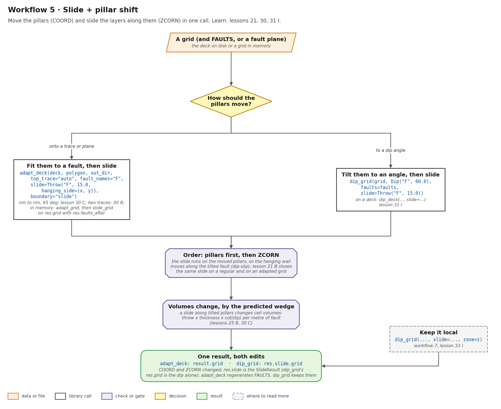
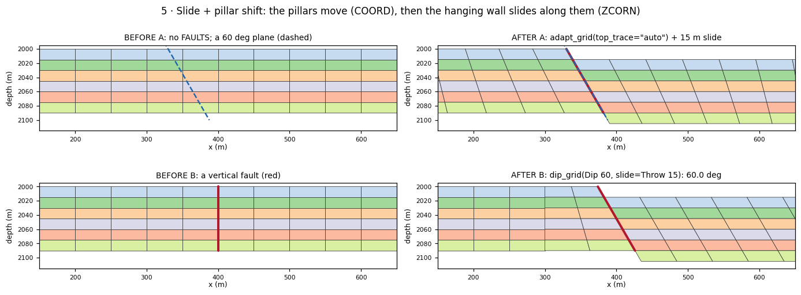
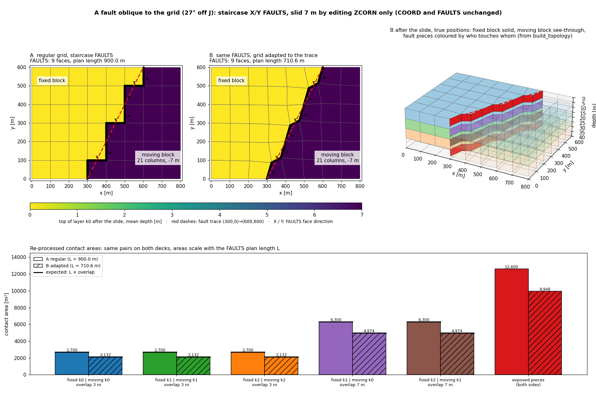

# Workflow 5 · Slide + pillar shift

Move the pillars (`COORD`) **and** slide the layers along them
(`ZCORN`), so the hanging wall moves down a tilted fault: a dip-slip.
There are two ways to move the pillars:

- **A. Fit them to a fault**, a trace or a dipping plane, with
  `adapt_grid` / `adapt_deck`.
- **B. Tilt them to an angle** with `dip_grid` / `dip_deck`.

Either way the slide runs **after** the pillars move, in the same
call.



## Steps

```python
import numpy as np
from cpg2unstructured import read_grdecl
from fault_projections import (Dip, Throw, adapt_deck, adapt_grid, dip_grid, fault_faces_for,
                               slide_grid)

grid = read_grdecl("FIELD.GRDECL")
EAST = (575.0, 150.0)                       # a plan point on the hanging wall
t = np.tan(np.radians(60.0))                # a rim-to-rim 60 degree plane, (N, 3) XYZ
polygon = np.array([[330 - 10 / t, -10.0, 1990.0], [330 - 10 / t, 410.0, 1990.0],
                    [330 + 100 / t, 410.0, 2100.0], [330 + 100 / t, -10.0, 2100.0]])
f1 = fault_faces_for(grid, [np.array([[400.0, -1.0], [400.0, 401.0]])])   # a vertical fault

# A. fit the pillars to a rim-to-rim 60 degree plane, then slide 15 m (lesson 30 C)
res = adapt_deck("FIELD.GRDECL", polygon, "out", top_trace="auto", fault_names="F",
                 slide=Throw("F", 15.0, hanging_side=EAST), boundary="slide")
res.grid                                    # adapted and slid; res.slide is the SlideResult
# in memory: the same two steps
a = adapt_grid(grid, polygon, top_trace="auto", boundary="slide")
s = slide_grid(a.grid, Throw(a.faults_after, 15.0, hanging_side=EAST, name="F"))

# B. tilt the pillars to 60 degrees, then slide 15 m along them (lesson 31 I)
d = dip_grid(grid, Dip(f1, 60.0, hanging_side=EAST, name="F"),
             slide=Throw(f1, 15.0, hanging_side=EAST, name="F"))
d.slide.grid                                # dipped AND slid; d.grid is the dip alone
d.realized_dip("F"), d.slide.modes
# on a deck: dip_deck("FIELD.GRDECL", Dip("F1", 60.0, hanging_side=EAST), "out",
#                     slide=Throw("F1", 15.0, hanging_side=EAST))
```

1. **Decide how the pillars move.** To put them on a fault trace or
    plane, use A. To give them an angle, use B.
2. **A:** `adapt_deck(..., slide=...)` adapts and then slides in one
    call. It regenerates `FAULTS` on the adapted grid and slides
    them. Use `top_trace="auto"` for a plane, which needs
    `boundary="slide"` when the plane reaches the rim. In memory, run
    `adapt_grid` and then `slide_grid` on `res.grid` with
    `res.faults_after`.
3. **B:** `dip_grid(..., slide=...)` tilts and then slides. `FAULTS`
    stay as they were. If the slide does not fit, the fades widen
    until it does.
4. **Check the volumes.** A slide along tilted pillars changes cell
    volumes by the predicted wedge, throw × thickness × cot(dip) per
    metre of fault (lessons 25 B, 30 C). That is the geometry, not an
    error.
5. **Keep it local**, if you want, with `zone=`
    ([workflow 7](fault-zones.md)).

## Before and after



- **A:** the grid has no `FAULTS`, only a 60° plane.
  `adapt_grid(top_trace="auto", boundary="slide")` snaps a chain of 8
  faces to its top trace and tilts the pillars into it.
  `slide_grid` then drops the hanging wall 15 m along them (rigid,
  8 faces opened, 0 unexpected, volumes change by up to 2.05 %).
- **B:** a vertical fault. `dip_grid(Dip 60, slide=Throw 15)`
  reaches 60.0°. The dip alone changes volumes by up to 21.7 %, and
  the slide on top of it by up to 11.1 %. `d.grid` has the original
  `ZCORN`; `d.slide.grid` is the one drawn.

## Run the lessons

| Lesson | What it shows | Run | Read |
| --- | --- | --- | --- |
| 21 | the same slide on a regular and on an adapted, leaning grid | `python -m fieldbook.cli run 21_z_slide_oblique_fault` | [An oblique fault](../learn/z-slide.md#an-oblique-dipping-fault) |
| 25 B | fault sticks → plane → stage 2 → slide: the wedge volume | `python -m fieldbook.cli run 25_gallery_geometry_inputs` | [Gallery 3](../learn/gallery.md#3-from-fault-data-to-a-slid-grid-lesson-25) |
| 30 A, C | `adapt_deck(slide=...)`: two traces; a 65° plane | `python -m fieldbook.cli run 30_deck_slide_workflows` | [`slide_deck`](../functions/fault-slide.md#slide_deck), [`adapt_deck`](../functions/adapt-grid.md#adapt_deck) |
| 31 I | `dip_deck` with `slide=`, read back from disk | `python -m fieldbook.cli run 31_fault_dip` | [I. On a deck](../learn/fault-dip.md#i-on-a-deck-dip-and-slide-in-one-call) |
| 32 B, C, Q | dipped and slid traces; the slide's cell gate | `python -m fieldbook.cli run 32_fault_dip_stress` | [Stress tests](../learn/fault-dip-stress.md#q-the-slides-cell-gate) |

Source: [examples/](https://github.com/arturcastiel/cpg-fault-fieldbook/tree/main/examples).



## Checks and limits

- In one call the pillars move first, then `ZCORN`, so the slide runs
  on the moved pillars and the gate judges the final grid.
- With `dip_grid`, `res.grid` is the dip alone; read
  `res.slide.grid` for both. `adapt_deck(slide=...)` puts the slid
  grid in `result.grid`.
- `boundary="pinned"` keeps rim pillars vertical, so a plane that
  reaches the rim needs `boundary="slide"` (lesson 21).
- See [What a dip does not do](../learn/fault-dip.md#what-a-dip-does-not-do)
  and [Limits](../reference/limits.md).
