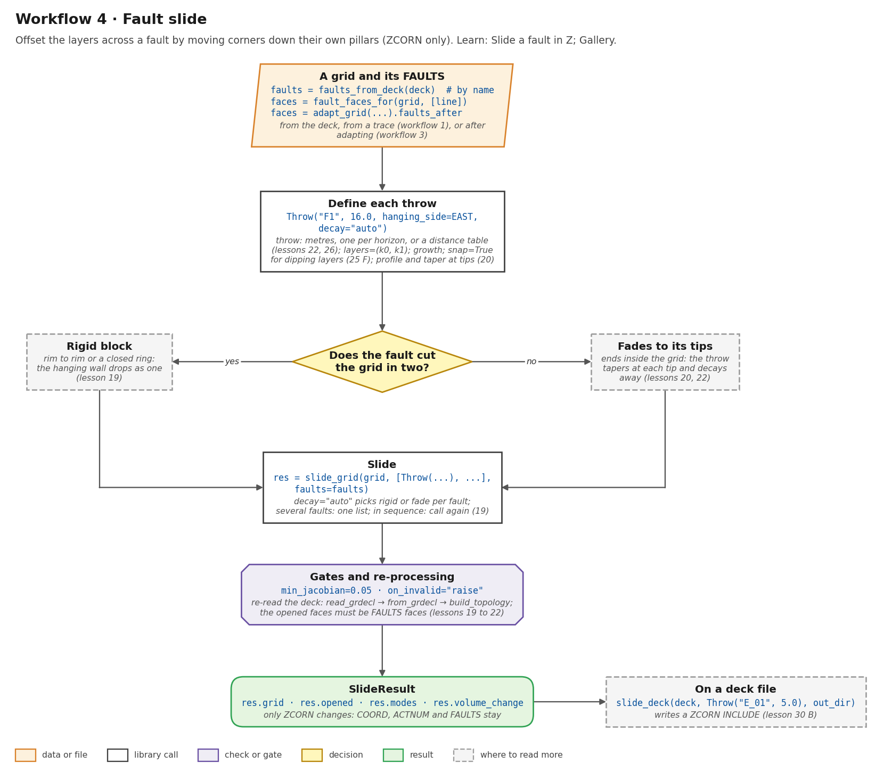
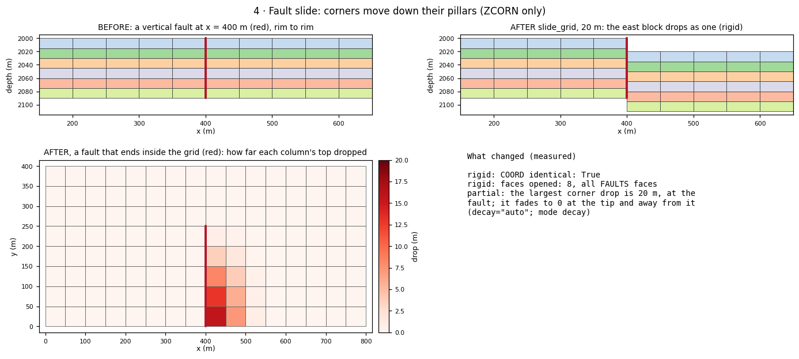
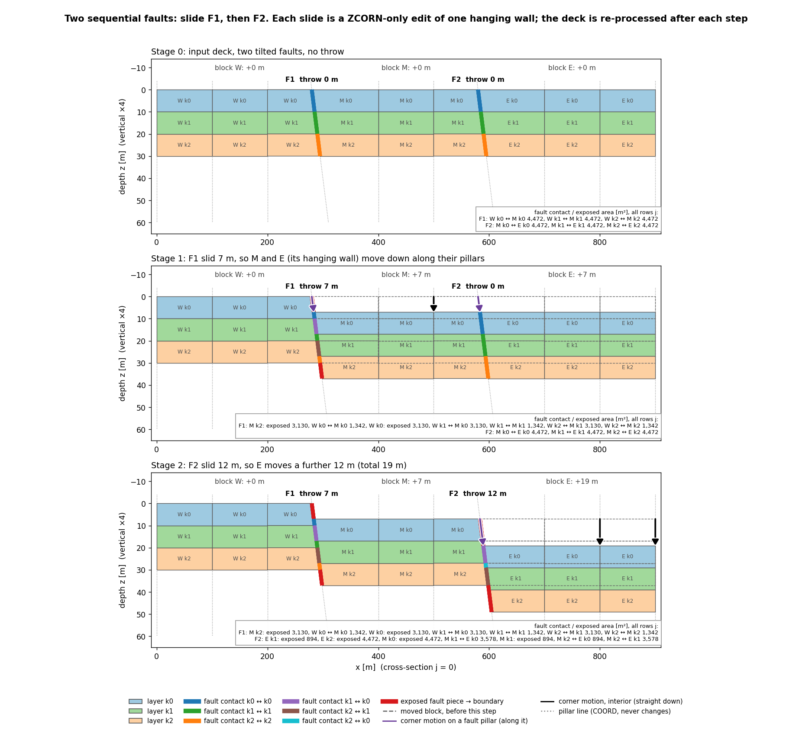
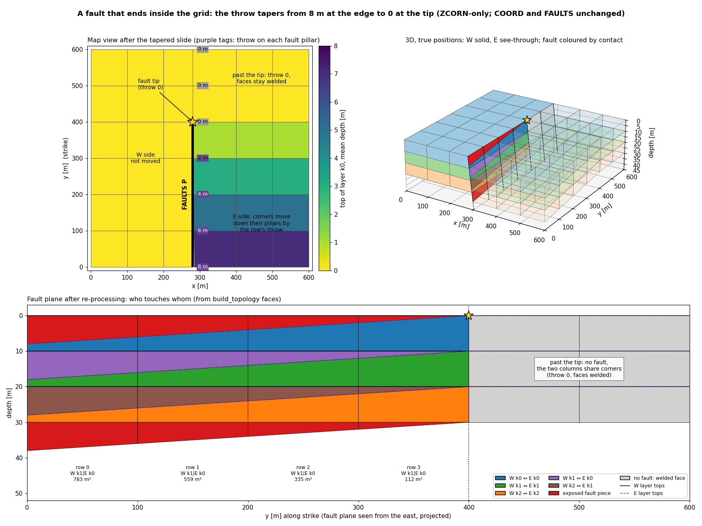
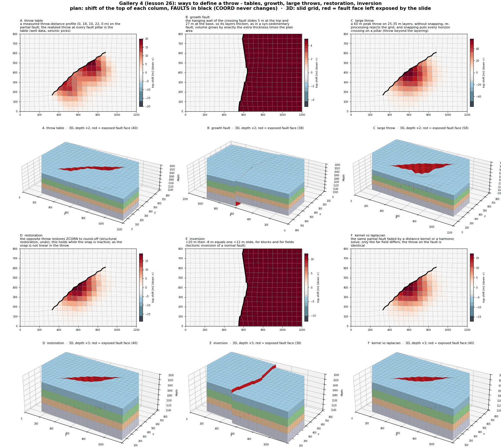

# Workflow 4 · Fault slide

Offset the layers across a fault by moving cell corners down (or up)
their own pillars. Only `ZCORN` changes. `COORD`, `ACTNUM` and
`FAULTS` stay as they are, and the faces that open are exactly the
fault's `FAULTS` faces.



## Steps

```python
import numpy as np
from cpg2unstructured import read_grdecl
from fault_projections import Throw, fault_faces_for, faults_from_deck, slide_grid, slide_deck

grid = read_grdecl("FIELD.GRDECL")
EAST = (575.0, 150.0)                         # a plan point on the hanging wall

# the fault: by name from the deck, from a trace (workflow 1), or after adapting (workflow 3)
faults = faults_from_deck("FIELD.GRDECL")     # {"F1": [FaultFace, ...], ...}
f1 = fault_faces_for(grid, [np.array([[400.0, -1.0], [400.0, 401.0]])])

res = slide_grid(grid, Throw(f1, 20.0, hanging_side=EAST, name="F1"))
# by name:  slide_grid(grid, [Throw("F1", 20.0, hanging_side=EAST)], faults=faults)

assert res.ok                                 # no inversion, no overlap, no unexpected face
res.grid, res.modes                           # {"F1": "rigid"} or "decay" or "block"
res.opened, res.unexpected                    # opened faces; faces opened outside FAULTS
res.realized_throw("F1"), res.volume_change
print(res.summary())

# on a deck file: writes a ZCORN INCLUDE and a report (lesson 30 B)
slide_deck("FIELD.GRDECL", Throw("F1", 5.0, hanging_side=EAST), "out")
```

1. **Get the fault's faces.** Read them by name from the deck, project
    a trace ([workflow 1](stair-step.md)), or take `faults_after`
    from an adapted grid ([workflow 3](deformation.md)).
2. **Define each throw** with `Throw`. The throw can be metres, one
    value per horizon, or an arc-length table (lessons 22, 26). The
    options are:
    - `layers=(k1, k2)` for a blind fault;
    - `growth` for a growth fault;
    - `snap=True` for dipping layers (lesson 25 F);
    - `profile` and `taper` to shape the throw at the tips (lesson 20).
3. **Let `decay="auto"` choose.** A fault that cuts the grid in two (rim
    to rim, or a closed ring) drops its block **rigidly**. A fault that
    ends inside the grid **fades** to its tips and with distance.
4. **Slide.** Several faults go in one list, and their throws add up.
    To slide them in sequence, call `slide_grid` again (lesson 19).
5. **Check** `res.ok`. It requires that nothing inverted or
    overlapped, that `res.unexpected` is empty (only `FAULTS` faces
    opened), and that the grid re-processes.

## Before and after



- **Rim-to-rim fault:** `Throw(F1, 20.0, hanging_side=EAST)` on a
  fault at x = 400 m. The east block drops 20 m rigidly. `COORD` is
  identical before and after, and 8 faces open, all of them `FAULTS`
  faces.
- **Partial fault (rows 1 to 5):** the fault ends inside the grid, so
  its mode is `decay`. The largest corner drop is 20 m, on the fault,
  and it fades to 0 at the tips and away from the fault.

## Run the lessons

| Lesson | What it shows | Run | Read |
| --- | --- | --- | --- |
| 19 | two faults, one after the other | `python -m fieldbook.cli run 19_z_slide_sequential` | [Two faults](../learn/z-slide.md#two-faults-one-after-the-other) |
| 20 | a fault that ends inside the grid | `python -m fieldbook.cli run 20_z_slide_partial_fault` | [A fault that ends inside](../learn/z-slide.md#a-fault-that-ends-inside-the-grid) |
| 21 | an oblique, dipping fault | `python -m fieldbook.cli run 21_z_slide_oblique_fault` | [An oblique fault](../learn/z-slide.md#an-oblique-dipping-fault) |
| 22 | the throw around a fault tip | `python -m fieldbook.cli run 22_z_slide_throw_control` | [Throw control](../learn/z-slide.md#control-the-throw-around-a-fault-tip) |
| 23 | structural styles: graben, horst, domino, ring collapse, reverse fault | `python -m fieldbook.cli run 23_gallery_structural_styles` | [Gallery 1](../learn/gallery.md#1-structural-styles-lesson-23) |
| 24 | fault networks: X crossing, T junction, Y splay, relay ramp, compartments | `python -m fieldbook.cli run 24_gallery_fault_interactions` | [Gallery 2](../learn/gallery.md#2-fault-networks-lesson-24) |
| 26 | ways to define a throw | `python -m fieldbook.cli run 26_gallery_throw_definitions` | [Gallery 4](../learn/gallery.md#4-ways-to-define-a-throw-lesson-26) |
| 27 | reservoir questions: Allan diagram, fault seal, connectivity, throw ensemble, well tops | `python -m fieldbook.cli run 27_gallery_reservoir_applications` | [Gallery 5](../learn/gallery.md#5-reservoir-questions-lesson-27) |
| 30 B | `slide_deck` on a field deck (Norne when present) | `python -m fieldbook.cli run 30_deck_slide_workflows --deck FIELD.GRDECL --throw F1=5` | [`slide_deck`](../functions/fault-slide.md#slide_deck) |

Source: [examples/](https://github.com/arturcastiel/cpg-fault-fieldbook/tree/main/examples).
Method page: [Fault slides](../functions/fault-slide.md).

| Two faults in sequence (lesson 19) | A fault that ends inside the grid (lesson 20) |
| --- | --- |
|  |  |



## Checks and limits

- A slide moves corners along their pillars. It does not move
  pillars, so a vertical fault stays vertical. To slide along a
  dipping fault, tilt it first ([workflow 5](slide-pillars.md)). The
  3D staircase of a dipping fault from [workflow 2](full-3d.md) is
  refused (`SlideError`); [workflow 9](slide-3d.md) slides a 3D
  surface.
- `hanging_side=None` reads the side from the pillar dip, so a
  vertical fault needs it.
- The faces that open are the `FAULTS` faces; a face opening anywhere
  else is reported in `unexpected` and fails `ok`.
- To keep the slide inside a band around the fault, pass `zone=`
  ([workflow 7](fault-zones.md)).
- See [Failure modes](../functions/fault-slide.md#failure-modes-and-limitations)
  and [Limits](../reference/limits.md).

## Next

- Slide along a tilted fault: [workflow 5](slide-pillars.md).
- Tilt and slide in one call: `dip_grid(..., slide=...)`
  ([workflow 6](dip-angle.md)).
- Slide a fault you have as a 3D surface: [workflow 9](slide-3d.md).
- Write a deck: [workflow 8](field-deck.md).
