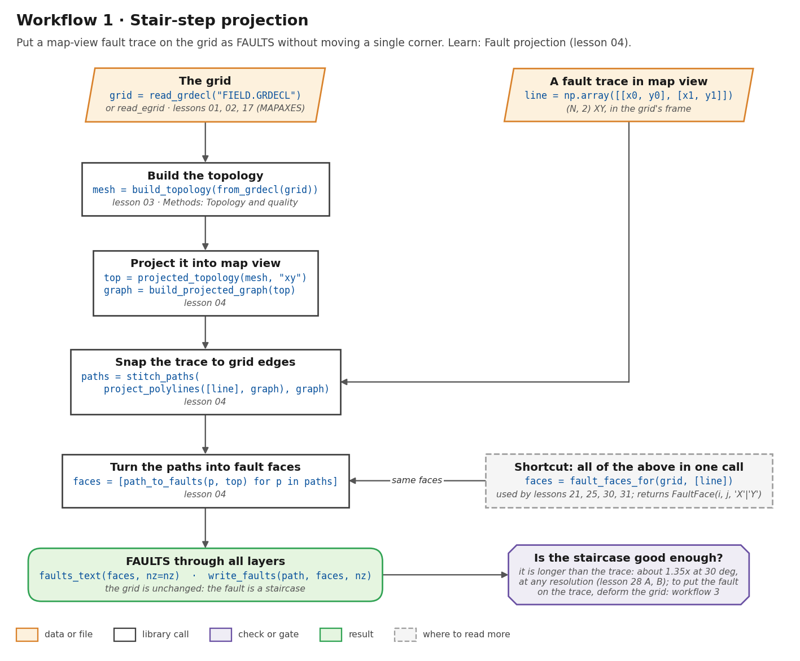
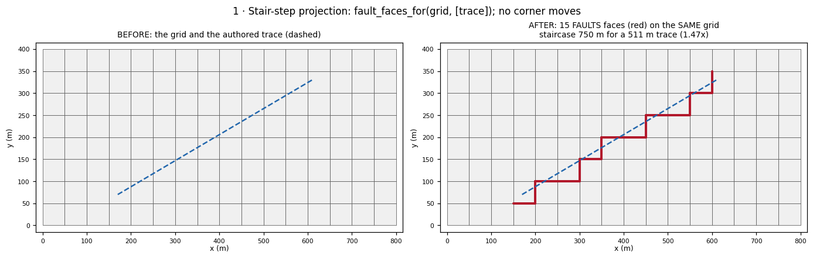
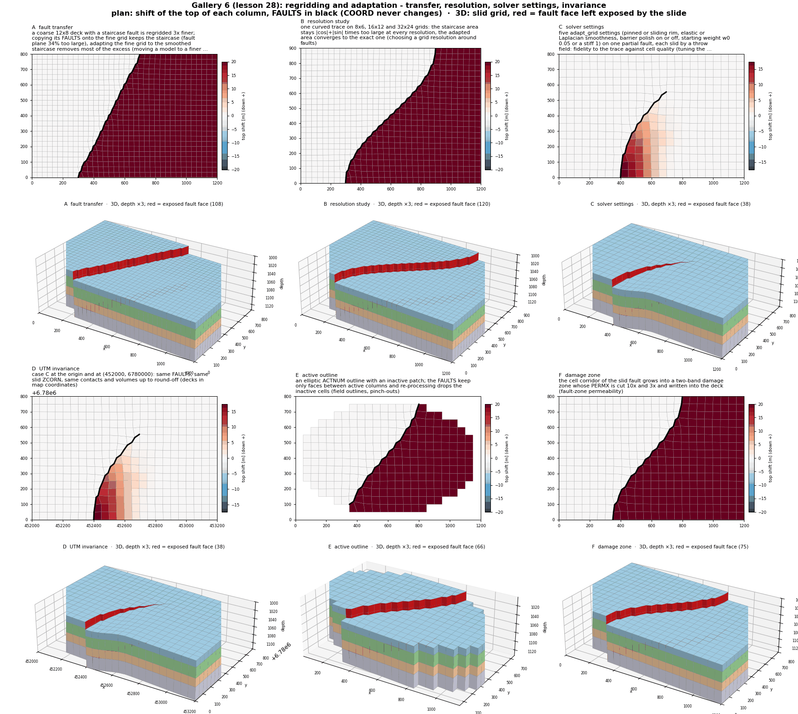

# Workflow 1 · Stair-step projection

Put a fault traced in map view on the grid as `FAULTS`, without
moving a single corner. The fault follows cell edges, so it is a
staircase. Use this when the grid must stay as it is, or as the
first step of a [slide](slide.md).



## Steps

```python
import numpy as np
from cpg2unstructured import build_topology, from_grdecl, projected_topology, read_grdecl
from fault_projections import (build_projected_graph, fault_faces_for, faults_text,
                               path_to_faults, project_polylines, stitch_paths)

grid = read_grdecl("FIELD.GRDECL")                    # or read_egrid (lesson 02)
line = np.array([[170.0, 70.0], [610.0, 330.0]])     # (N, 2) XY, in the grid's frame

# 1. the shortcut: one call
faces = fault_faces_for(grid, [line])                # list of FaultFace(i, j, "X" | "Y")

# 2. or the steps it runs (lesson 04)
mesh = build_topology(from_grdecl(grid))
top = projected_topology(mesh, "xy")
graph = build_projected_graph(top)
paths = stitch_paths(project_polylines([line], graph), graph)
faces_per_fault = [path_to_faults(p, top) for p in paths]

text = faults_text(faces_per_fault, nz=mesh.cart_dims[2])   # write_faults(path, ...) writes it
```

1. **Read the grid.** GRDECL or EGRID. If the deck has `MAPAXES`, the
    trace must be in the same frame as `COORD`
    ([lesson 17](../learn/grids.md)).
2. **Build the topology and project it into map view.** This is the
    explicit face graph the trace snaps to
    ([Grid and topology](../learn/grids.md),
    [Topology and quality](../functions/topology-quality.md)).
3. **Snap the trace to grid edges** and turn the paths into one-based
    Eclipse face records ([Fault projection](../learn/faults.md)).
4. **Write `FAULTS`.** The faces cut every layer (K = 1 to NZ).

## Before and after



A 440 m by 260 m trace on a 50 m grid becomes 15 `FAULTS` faces. The
staircase is 750 m long for a 511 m trace (1.47×). No corner moves.

## Run the lessons

| Lesson | What it shows | Run | Read |
| --- | --- | --- | --- |
| 03 | the mesh and its projected graph | `python -m fieldbook.cli run 03_mesh_graph` | [Grid and topology](../learn/grids.md) |
| 04 | trace → snapped path → FAULTS | `python -m fieldbook.cli run 04_project_trace` | [Fault projection](../learn/faults.md) |
| 28 A, B | the staircase is about 1.35× too long at every resolution; adapting converges | `python -m fieldbook.cli run 28_gallery_regridding` | [Gallery 6](../learn/gallery.md#6-regridding-and-adaptation-lesson-28) |

Source: [04_project_trace.py](https://github.com/arturcastiel/cpg-fault-fieldbook/blob/main/examples/04_project_trace.py),
[28_gallery_regridding.py](https://github.com/arturcastiel/cpg-fault-fieldbook/blob/main/examples/28_gallery_regridding.py).



## Checks and limits

- The fault is a staircase, longer than the trace: 1.47× here, and
  1.35× (|cos θ| + |sin θ|) at every resolution in lesson 28 B.
  Refining the grid does not shorten it. To put the fault on the
  trace, move the pillars: [workflow 3](deformation.md).
- The faces are vertical and cut every layer. For a dipping fault
  with real K ranges, use [workflow 2](full-3d.md).
- Projection writes no transmissibility multipliers.
- See [Limits](../reference/limits.md).

## Next

- Offset the layers across these faces: [workflow 4](slide.md).
- Tilt the fault to an angle: [workflow 6](dip-angle.md).
- Find the cells near it: [workflow 7](fault-zones.md).
